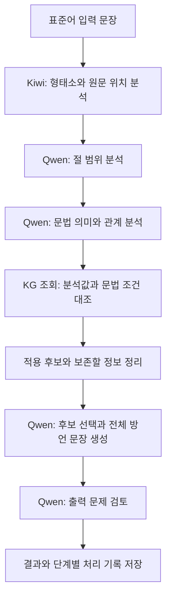

# Korean Dialect Grammar KG

**한국어 문법 지식을 그래프로 연결하고, 이를 참고한 언어 모델이 표준어 문장을 경상도 방언으로 생성하는 연구입니다.**

단어를 사투리 단어로 바꾸는 데 그치지 않고, 문장의 질문·요청·높임·시제 같은 문법적 특징에 맞는 표현을 찾는 것이 목표입니다. 뜻과 높임을 유지하면서 자연스러운 방언을 만들 수 있는지, 필요한 지식만 전달하면 정보 전달 비용을 줄일 수 있는지 검증합니다.

## 핵심 연구 질문

- 문법 조건과 표현을 연결한 **지식그래프(Knowledge Graph, KG)**가 방언 생성에 도움이 되는가?
- 같은 지식을 사용할 때, 문서 검색·조건표 검색·그래프 조회 사이에 품질과 비용 차이가 있는가?
- 분석·검색·생성 중 어느 단계에서 오류가 생기며, 그 원인을 처리 기록으로 설명할 수 있는가?

KG가 더 좋다는 결론을 전제하지 않습니다. 실제 생성 결과와 사람 평가, 토큰 사용량 및 처리 시간으로 효과와 한계를 확인하는 연구입니다.

## 전체 작동 방식



| 단계 | 하는 일 |
| --- | --- |
| 형태 분석 | Kiwi가 어간·어미 등을 나누고, 각 부분이 원문의 어디에 있는지 찾습니다. |
| 의미·관계 분석 | Qwen이 절의 범위, 질문·요청 등의 기능, 시제·높임과 표현 사이의 관계를 분석합니다. |
| 조건에 따른 조회 | 분석값을 KG의 조건과 대조해 관련 지식을 찾습니다. 조건이 맞는 후보와 판단이 부족한 후보를 구분합니다. |
| 생성 정보 전달 | 원문, 수정 대상, 표현 후보, 적용 조건, 보존해야 할 정보를 전달합니다. 출처 기록 전체를 생성 요청에 넣지는 않습니다. |
| 문장 생성·검토 | Qwen이 최종 문장 전체를 작성하고, 별도 역할의 Qwen이 문제를 점검합니다. 모델의 검토 자체를 정답 판정으로 보지는 않습니다. |

분석·생성·검토는 역할을 나눈 모델 호출로 구성됩니다. 현재 기본 형태 분석은 **Kiwi**이며, 최종 문장 작성자는 **Qwen**입니다. 활용 조합기는 보조 도구이고 모델 출력을 대신 작성하지 않습니다.

현재 실행 조회는 그래프 파일을 읽는 코드가 수행합니다. **Neo4j는 그래프를 시각화하고 탐색하는 데 사용하며, 실행 시 모든 조회가 Neo4j 서버를 거치는 구조는 아닙니다.**

## 문법 지식을 어떻게 구성하는가

공통 한국어 문법 틀을 **12개 문법 모듈**로 나누고, 여기에 경상도 방언 문헌 7종에서 정리한 지식을 연결합니다. 이 틀은 지식을 분류하는 기준이며, 모든 문법 현상의 변환이 구현되었다는 뜻은 아닙니다.

| 구성 요소 | 담는 내용 |
| --- | --- |
| 문법 개념 | 품사, 어미, 시제, 높임 등 문장을 설명하는 개념 |
| 문법 구성·규칙 | 어떤 표현을 어떤 조건에서 사용할 수 있는지 |
| 조건과 관계 | 적용 대상, 함께 필요한 특징, 다른 표현과의 연결 및 제약 |
| 표현 정보 | 생성에 사용할 형태와 보존해야 할 의미·문법 정보 |
| 별도 근거 기록 | 출처 위치, 해석, 검토 결과를 지식 ID와 버전으로 연결한 기록 |

실행 그래프에는 문법 작동에 필요한 정보를 중심으로 담습니다. 출처·검토 기록은 그래프 밖에서 추적하며, **지식을 찾았다는 사실과 그 지식을 현재 문장에 적용할 수 있다는 판단을 구별합니다.**

예를 들어 **“열쇠를 어디에 뒀어?”**를 처리할 때는 질문에 맞는 어미 후보뿐 아니라, 원문의 과거 의미도 함께 전달해야 합니다. 질문 규칙을 찾았더라도 생성 과정에서 과거가 사라졌다면 성공으로 보지 않습니다. 분석값·조회 후보·전달 내용·실제 출력을 함께 남기는 이유입니다.

## 현재 구현 범위와 검증 과제

| 구분 | 현재 범위 |
| --- | --- |
| 구현 | 형태·의미 분석, KG 조건 조회, 생성 정보 선별, Qwen 문장 생성과 검토, 단계별 기록 |
| 지식 관리 | 실행 정보와 근거 기록 분리, 규칙·조건 분기 검사, 지원 범위와 미확인 항목 관리 |
| 실험 관리 | 실행별 입력·설정·코드·KG·프롬프트 버전, 요청·응답·실패, 시간·사용량 기록 |
| 계속 검증할 내용 | 문법군별 지원 범위, 분석값과 KG 조건의 연결, 규칙 조합, 시제·높임 보존 및 자연스러움 |
| 연구 효과 평가 | 같은 조건에서 검색 방식을 비교하고, 독립 문장에 대한 사람 평가로 효과를 확인할 필요가 있습니다. |

자동 검사를 통과했다는 것은 코드나 연결이 검사 기준대로 작동했다는 뜻입니다. 방언의 자연스러움이나 의미 정확도가 입증되었다는 뜻은 아닙니다. 관리 중인 **50문장은 오류 분석과 회귀 검사에 사용하는 문장집**이며, 독립적인 최종 평가 데이터로 주장하지 않습니다.

## 저장소 안내

| 경로 | 내용 |
| --- | --- |
| `src/` | 문장 처리, KG 조회, 실험 관리 구현 |
| `tools/` | 파이프라인 실행·검사·관리 도구 |
| `knowledge/` | 공유 가능한 문법 지식 명세와 검토 자료 |
| `experiments/` | 실험 설정, 공개 가능한 결과 요약과 분석 |
| `docs/` | 연구 계획, 설계, 실행·관리 절차 |
| `tests/` | 코드와 단계별 연결 검사 |

### 실행 준비

주 실행 진입점은 [`tools/run_qwen_multi.py`](tools/run_qwen_multi.py)입니다. 실행 옵션은 다음 명령으로 확인합니다.

```bash
python tools/run_qwen_multi.py --help
```

실제 모델 실행에는 Python 환경과 [실행 의존성](requirements-runtime.txt), OpenAI 호환 API로 제공되는 Qwen 서버, 입력 데이터 및 실행용 KG가 필요합니다. 서버는 vLLM을 사용하며 접속 설정과 인증정보는 로컬에서 관리합니다.

**공개 저장소를 복제하는 것만으로 전체 실험 데이터와 실행 환경이 준비되지는 않습니다.** 원본 PDF·전체 추출 본문·비공개 실행용 KG·입력별 비공개 기록·인증정보 등은 포함하지 않습니다. 협업 실행에 필요한 자료는 접근 권한을 확인한 뒤 별도로 준비해야 합니다.

### 상세 문서

- [현행 연구 계획](docs/research/CURRENT_RESEARCH_PLAN.md): 연구 질문, 검사 범위와 다음 실험
- [연구 관리 시스템](docs/research/RESEARCH_MANAGEMENT.md): 실행 기록과 결과 비교 구조
- [연구 관리 절차](docs/workflows/RESEARCH_MANAGEMENT.md): 실행·등록·조회 방법
- [기록 규격](docs/research/RECORDING_CONTRACT.md): 재현에 필요한 입력·설정·결과 기록

문헌과 데이터의 이용 조건은 각 원자료의 권리와 이용 조건을 따릅니다.
