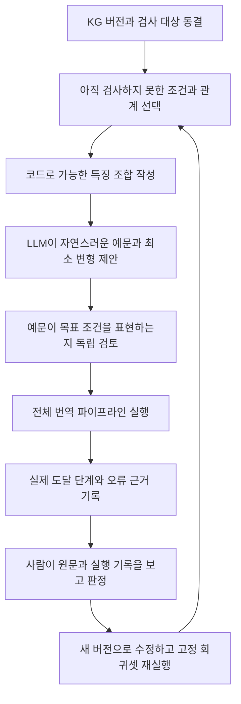

# 두 연구원의 협업과 연구 재시작 계획

작성일 2026-11-06. 사용자는 기존 버전을 보존하면서 재설계 아이디어들을 모두 적용해 볼 방향을 정했다. 추가 핵심 요구는 LLM이 많은 검사 예문을 생성하고 전체 파이프라인을 실행하며, 발견한 문제를 사람이 근거를 보고 수정할 수 있게 만드는 것이다. 동료의 전문 분야는 아직 정해지지 않았다.

권고는 **공통 검증 체계를 먼저 만들고, 두 사람이 서로 다른 산출물을 병행 개발하며, 기능을 켜고 끌 수 있는 통합 후보에서 중요한 조합을 비교하는 방식**이다. 모든 아이디어를 구현할 방향과 모든 아이디어가 효과적이라는 결론은 구별한다. 이 문서의 역할·일정·비교표는 협의용 제안이며 새 모델 실험 결과가 아니다.

## 1. 지금 무엇을 이어받는가

연구 목표는 문헌에 근거한 문법 지식을 사용해 뜻·시제·부정·높임을 보존하는 자연스러운 방언 문장을 생성하는 것이다. 최종 문장 작성은 Qwen이 맡는다. KG의 우월성이나 역할 분담의 효과는 아직 결론이 아니다.

| 구분 | 작성 시점과 의미 | 현재 읽을 근거 |
|---|---|---|
| 과거 RAG v1, 실패한 v2 graph, current_kg, kg_v2 | 과거 연구 계보. 현재 KG v3와 합치지 않는다 | [초기 인계](../KG_V3_RESEARCH_HANDOFF.md), [전체 복습 자료 안내](../../experiments/analyses/research_recap_20261106/README.md) |
| KG v3 원본 | 1,625노드·6,167관계. 문헌 항목·출처·설계가 섞인 자료이며 전부 실행 규칙은 아니다 | [범위 점검](../../experiments/analyses/coverage_scope_20261106/README.md) |
| 11월 5일 이전 실행 기준 r7과 확장 후보 r10 | 각각 195/472, 222/541의 작은 실행 그래프. 기존 기준과 후보를 구분 | [야간 연구 결과](../../experiments/analyses/overnight_20261105/README.md) |
| 11월 6일 통합 후보 | 2,320노드·7,476관계, 56용법·57조건 분기. 26묶음 전체 의미 정제 완료가 아니다 | [통합 결과](../../experiments/analyses/integrated_grammar_20261106/README.md), [판단 기록](../../experiments/analyses/integrated_grammar_20261106/DECISIONS.md) |
| 11월 6일 재설계 | KG 검사, 분석·생성 분업, Kiwi 대안, 공정 비교에 대한 계획 | [재설계 계획](../../experiments/analyses/research_redesign_20261106/PLAN.md), [검토 반영](../../experiments/analyses/research_redesign_20261106/DECISIONS.md) |

통합 작업의 199호출과 보고된 802,561토큰은 실행량이다. 개발30·기존50·재사용18의 결과를 합쳐 독립 표본98개로 세지 않는다. 실제 고유 입력은 80개이며, 그 뒤 어간 투영 등의 코드 수정은 Qwen 재실행으로 검증되지 않았다. 과거 실행의 코드 사본과 현재 작업 코드를 별도 기준으로 둔다. 11월 6일 오전 복습 보고서만 읽으면 같은 날 이후 통합 결과를 놓치므로 위 순서의 최신 기록까지 읽는다.

## 2. 새 동료에게 전달할 순서

전체 폴더를 보내고 전부 읽게 하는 대신, 짧은 설명으로 지도를 만들고 실제 한 사례를 재현한 뒤 담당 범위의 원본을 읽게 한다. localhost 주소는 다른 PC에서 이 컴퓨터를 가리키지 않으므로 링크만 전달하면 보고서를 열 수 없다. Git 자료와 권한 있는 비공개 자료를 따로 인계해야 한다.

| 순서 | 함께 볼 내용 | 동료가 직접 해 볼 일 | 인계 완료의 증거 |
|---|---|---|---|
| 첫 설명 약30분 | 목표, 전체 처리 흐름, 버전 계보, 확인 사실과 가설 | 현재 기준과 최신 후보의 차이를 자기 말로 설명 | 한 쪽의 이해 메모와 질문 |
| 실제 사례 약60분 | 정상 동작, 전달 후 의미 손실, 분석 오류, 미지원/차단 사례 | 원문→Kiwi→Qwen 분석→KG 후보→실제 요청→원시 출력을 연결 | 근거 파일이 연결된 사례 카드 |
| 읽기 전용 재현 | 저장 실행의 코드/KG/요청 해시, 집계 코드, 누락 자료 | 저장 출력 집계 또는 조회 재생 하나를 수행 | 동일 집계 또는 차이가 난 위치와 이유 |
| 작은 독립 과제 | 하나의 용법과 양성·음성·모호 사례 | 문헌 확인, 기대 조건 작성, 조회 결과 대조 | 상대가 재현 가능한 문제 카드 또는 검사 기록 |
| 역할 확정 | 첫 과제에서 확인한 강점과 어려움 | 구현/검증 주담당을 조정 | 책임자와 완료 기준이 있는 첫 작업표 |

인계 자료는 여섯 부분으로 관리한다. ①연구 질문과 주장 범위 ②버전 계보 ③실험별 질문·조건·관찰·한계 ④대표 실패 사례 ⑤현재 미해결 문제와 다음 결정 ⑥환경·데이터·재현 방법이다. 기존 문서를 이 여섯 부분의 원본으로 연결하고 같은 내용을 여러 곳에 복사해 서로 어긋나게 만들지 않는다.

초기 사례는 이미 노출된 개발 자료에서 고른다. 과거형 전달 후 손실, 요청 구성의 분석 오류, 조건 unknown에 따른 차단처럼 단계가 다른 사례를 포함한다. 동료가 출력만 보고 실패 원인을 추측하는 대신 실제 요청까지 추적할 수 있어야 한다. 개발 동료가 방법 이름을 가리고 채점하더라도 개발 참여 이력은 남으므로 독립 최종 평가자를 자동으로 대체하지 않는다.

## 3. 두 사람의 업무 분담

초기에는 사용자가 시스템의 맥락을 알고 있으므로 통합 책임을 맡고, 동료가 검증 체계와 반례를 독립적으로 준비하는 구성이 효율적이다. 이것은 동료에게 단순 라벨링만 맡긴다는 뜻이 아니다. 동료에게도 연구 질문, 구현 범위, 결과 해석의 책임을 준다. 첫 작은 과제 후 강점이 반대면 주담당을 바꾼다.

| 작업 묶음 | 사용자 주담당 | 동료 주담당 | 서로 확인할 접점 |
|---|---|---|---|
| 연구 설계와 버전 | 연구 질문, 통합 기준, 모델 예산, 최종 결정 | 대조 조건·데이터 노출·주장 범위 검토 | 실행 전에 조건표를 함께 동결 |
| 번역 파이프라인 | 분석/전달/생성 모듈과 기능 선택, 공통 기록 | 입력·출력 계약에 대한 검사와 실패 재현 | 동일한 위치 ID·특징·관계 형식 |
| KG 검증 체계 | 조회 추적 정보와 실행 연결 제공 | 전체 대장, 조건 시나리오, 예문 생성·변형·검사 도구 | 대상 분기와 실제 도달 기록 연결 |
| 문헌과 지식 수정 | 영향 범위와 통합 결정 | 문헌 구절·조건·반례·충돌의 근거 정리 | 원문과 해석을 구분해 공동 검토 |
| 실험 실행 | 공용 서버 실행 예약과 통합 실행 | 요청 동결 확인, 누락·실패·비용 집계 | 같은 시간 블록에서 조건 순서를 섞어 실행 |
| 논문 자료 | 질문·방법·결론의 일관성 | 실험표·오류 분류·재현 방법 초안 | 개발 관찰과 독립 평가를 구별 |

같은 거대한 graph.json이나 같은 실행 파일을 동시에 수정하지 않는다. 지식 변경은 안정 ID를 참조하는 작은 변경 제안과 새 버전으로 만들고, 통합 담당자가 검토된 변경을 묶는다. 양쪽 모두 코드에 기여할 수 있지만 한 변경 묶음의 주담당은 한 명이다. 각자 별도 브랜치·작업 폴더를 쓰고, 다른 사람의 변경은 검토 후 통합한다.

최소 공통 계약은 원문 해시와 문자 위치, 단위·용법·분기 ID, 관찰/해석/작성 주체, unknown과 충돌, 조건 판정, 전달 여부, 생성 원본, 코드/KG/요청 해시다. 인터페이스를 먼저 맞추면 동료는 저장 기록과 모의 입력으로 검증 도구를 만들고 사용자는 새 파이프라인을 동시에 개발할 수 있다.

매일 짧은 공유에서는 완료 산출물·새로 확인한 사실·막힌 접점만 다룬다. 주 2회 정도의 공동 검토에서 작은 변경을 통합하고 다음 실험 묶음을 고정한다. 회의 횟수는 운영 초안이며 실제 근무 형태에 맞춰 조정한다. 문제 카드에는 관찰, 근거, 원인 가설, 담당, 영향 범위, 다음 검사를 남긴다. 모든 오류를 사용자에게 먼저 승인받게 하지 말고, 구체적 언어 해석 충돌·목표 변경·독립 평가 설계는 공동 판단으로 올린다.

## 4. LLM 추론을 이용한 광범위 KG 검사

사용자가 설명한 방법의 정확한 고유 명칭은 특정되지 않았다. 여러 후보를 탐색·평가하는 Tree of Thoughts와, LLM으로 시험 입력을 생성·변형하는 Fuzz4All은 관련된 별개의 접근이다. 이 과제에는 **조건 조합 검사와 LLM 예문 생성, 실제 도달 기록에 따른 다음 검사 선택**을 결합하는 방식이 더 직접적이다. 관련 연구가 한국어 방언 KG의 정확성을 이미 입증한 것은 아니다.

우리가 열거할 대상은 무한한 한국어 문장 전체가 아니라, 동결한 KG에서 정의한 조건값·관계·적용 분기와 그 조합이다. ‘전체 KG 검사’는 다음 네 층을 함께 관리한다.

| 검사 층 | 빠짐없이 확인할 대상 | 완료와 남은 문제의 기록 |
|---|---|---|
| 구조와 출처 | 모든 노드·관계의 ID, 종류, 참조 무결성, 문헌 위치 | 통과/결함/미확인/검사 비대상과 이유. 문장 방문률과 별도 |
| 지식 의미 | 문헌 구간→지식 항목의 누락, 조건·범위·예외 해석 | 원문 대조 상태, 상충 해석, 미확보 근거. 링크 존재만으로 완료 아님 |
| 실행 조건 | 모든 실행 분기의 허용·비허용·unknown, 관계 불일치와 충돌 | 문법 특징값 직접 입력으로 코드 검사. 가지별 기대와 전체 OR 결과 모두 기록 |
| 전체 문장 처리 | 확정한 예문마다 실제 분석→조회→전달→생성→평가 | 단계별 도달, 첫 불일치, 출력·실패·보류·사람 판정 |

권장 흐름은 다음과 같다.

처음에는 조건을 모두 만족하는 예, 필수 조건 하나만 바꾼 예, 필요한 문맥이 없어 판단이 불가능한 예를 분기마다 준비한다. 그 다음 시제×높임, 부정×보조용언, 의문 범위×절 관계 등 서로 영향을 줄 가능성이 큰 조합을 늘린다. 관계 방향·범위·잘못된 연결도 별도 검사한다. 서로 모순되는 조합은 자연스러운 예문을 억지로 만들지 않고 불가능/미확인 상태로 남긴다.

가능한 유한 조합은 코드로 전수 검사한다. 조합이 너무 커지면 정한 두 요소 조합을 모두 포함하는 검사부터 시작하고, 위험한 세 요소 이상의 조합을 추가한다. 두 요소를 모두 검사했다고 모든 상호작용을 검사한 것은 아니다. 현재 57분기라는 수와 579라는 단순 산식은 실제 확정 예문 수가 아니다. OR 분기·공유 조건·관계 제약을 검토한 실제 목록에서 분모를 계산한다.

LLM은 빈 칸을 채울 문장을 제안하고 실패 예문의 의미를 유지한 최소 변형을 찾는다. 코드가 대상 목록·실제 도달·중복·호출 예산을 관리한다. 생성 LLM의 ‘이 문장은 요청이다’라는 설명을 정답으로 바로 채택하지 않는다. 초기에는 동료가 검사 기대값과 예문의 적합성을 확인하고, 실질적 문헌/현대 표현 충돌은 사용자가 근거를 보고 판단한다. 확장 시 자동 선별과 사람 표본 검토를 쓴다면 검토하지 않은 범위를 표시한다.

각 예문은 원문과 필요 문맥, 목표 용법·분기, 바꾼 조건, 보존할 조건, 기대 적용/비적용/모름, 기대값 근거, 생성·검토 주체, 실제 분석·조회·전달·생성·평가를 연결한다. 목표 규칙을 모델 분석이나 조회에 강제로 주입한 검사는 조회기 진단으로 분리한다. 전체 처리 검사에서는 원문만으로 그 규칙에 실제 도달하는지 본다.

도달률은 하나의 숫자로 합치지 않는다. 예컨대 목표 분기 100개 중 문장이 확보된 분기, 실제 분석이 맞은 분기, 조회된 분기, 전달된 분기, 생성까지 수행된 분기, 사람 확인을 마친 분기의 수를 따로 보여 준다. 100은 설명용 가정이며 현재 실측 분모가 아니다. 같은 쉬운 규칙에 1만 번 도달한 것이 다른 규칙을 검사한 실적을 대신하지 못한다.

사람 검토 화면에는 **기대했던 조건 → 실제 분석 → 선택·제외된 KG와 이유 → 전달된 내용 → 실제 출력 → 판단 선택지와 수정 영향**을 한 줄기로 보여 준다. 자동 경고는 형식 위반 확정·의미 손실 의심·판단 불가로 나눈다. 실패·미시도·비정상 종료도 남기며, 반복되는 오류는 묶되 각 원본 사례에 접근할 수 있어야 한다. 경고가 없는 층에서도 표본을 검토해 검사기의 누락을 찾는다.

KG 자체에서 만든 기대값과 실행기가 일치한다는 것은 내부 일관성 검사다. KG가 잘못 해석한 규칙을 둘 다 그대로 따르면 함께 틀릴 수 있다. 따라서 문헌 대조와 KG를 보지 않고 작성한 문장·독립 화자 평가를 따로 유지한다. 생성한 검사 예문은 개발·회귀 자료로 사용하며 최종 독립 평가셋으로 재명명하지 않는다.

중단 기준은 ‘모든 문제를 찾았다’가 아니다. 동결한 버전의 모든 항목에 검사 상태가 있고, 실행 분기마다 정당한 검사 또는 미확보 이유가 있으며, 미도달·미판정·남은 심각 오류가 공개돼야 한다. 다음 예문 묶음의 호출/토큰/시간 상한과 새 조건 도달·새 결함 증가가 멈췄을 때의 종료 기준을 실행 전에 정한다. 한두 번의 정체를 결함 부재 증명으로 쓰지 않는다.

## 5. 모든 아이디어를 적용하면서 효과를 알아내는 방법

하나씩 개발하는 순서와 하나씩만 비교하는 실험은 다르다. 기능은 작은 변경으로 개발하되, 필요한 경우 두 기능을 함께 켠 조건까지 비교한다. 분석 방식, Kiwi 사용, 전달 투영, 참고 선별, 생성 역할, 모델, 지식 버전을 각각 기록한다. 특정 기능이 다른 기능을 필요로 하면 독립적인 켜기/끄기 축으로 억지 취급하지 말고 유효한 조합 또는 결합된 한 요인으로 정의한다.

| 선택 | 얻는 것 | 놓치는 것 | 권고 용도 |
|---|---|---|---|
| 전부 한 번에 바꾸고 전후 비교 | 새 통합 시스템을 빨리 확인 | 어떤 변화가 원인인지, 무엇이 악화했는지 분리 어려움 | 통합 시연과 연결 검사 |
| 한 요소씩 순서대로 교체 | 국소 원인 추적이 쉬움 | 함께 써야 나타나는 이익/충돌, 순서 의존성 | 단위 구현·초기 진단 |
| 가능한 모든 조합 실행 | 작은 유한 공간이면 조합별 차이를 직접 관찰 | 비용 폭증, 무효 조합, 다중 비교·선택 편향 | 핵심 2~3요인의 작은 공간 |
| 두 사람이 각자 완성 시스템 제작 | 각자 작업이 독립적 | 지식·입력·모델·예산이 동시에 달라 비교 곤란 | 주 연구의 기본 분담으로 비추천 |
| 공통 계약 아래 병행 개발하고 중요한 조합 비교 | 개발 속도와 인과 해석을 함께 확보 | 초기에 계약·기록·통합 역할 필요 | 이 연구의 기본안 |

다음 순서를 권한다. 첫째, 검증 체계와 기록 계약을 만들며 현재 통합 후보의 문제를 수집한다. 둘째, 기존 계획의 저장/수정 분석×기존/관리정보 축소 2×2 진단을 실제 입력·요청·평가표로 구체화한다. 셋째, 동료가 KG 검증과 예문 체계를 확장하는 동안 사용자가 역할 분담 후보를 구현한다. 실험 중에는 KG와 입력 묶음을 동결하고 다음 묶음에서 새 지식을 반영한다.

핵심 기능 간 상호작용은 예를 들어 다음 작은 표로 확인할 수 있다. 여기서 A는 분석 역할 분담, B는 생성 역할 분담이며 Kiwi·모델·KG·전달 형식은 고정한다.

| 조건 | 분석 | 생성 | 답하는 질문 |
|---|---|---|---|
| 00 | 기존 1호출 | 기존 1호출 | 동결한 기준 |
| 10 | 구조→의미 2호출 | 기존 1호출 | 분석 분업이 있는 변화 |
| 01 | 기존 1호출 | 초안→점검→작성 3호출 | 생성 분업이 있는 변화 |
| 11 | 구조→의미 2호출 | 초안→점검→작성 3호출 | 둘을 함께 쓸 때 이득/충돌 |

이 네 조건만으로는 추가 계산과 역할 분업의 효과를 분리하지 못한다. 분석에는 같은 2호출의 일반 자기검토, 생성에는 같은 3호출의 일반 재검토를 대조로 추가한다. 모두 호출 수뿐 아니라 입력·출력 토큰, 지연, 실패, 사용한 정보를 기록한다. 주요 결합 조건에서는 같은 계산 예산의 결합 대조도 필요하다. 모든 대조를 무조건 전 조합으로 확장하지 않고 연구 질문에 필요한 셀을 사전에 고정한다.

최종 통합 후보를 만든 뒤에는 전체를 켠 조건과 한 기능씩 뺀 조건을 비교해 실제 조합 안의 기여를 확인한다. 이는 해당 조합에서의 기여이며 모든 환경에 공통인 효과가 아니다. 앞의 작은 조합 비교와 함께 해석한다. 기능이 혼자서는 실패해도 다른 기능과 함께 효과가 있을 수 있으므로 단독 실패만으로 폐기하지 않는다. 악화하는 기능도 사용자 방향에 따라 구현·기록하되, 전부 켠 후보의 한계와 더 안전한 설정을 나란히 보고한다.

예를 들어 독립적인 켜기/끄기 기능이 6개라면 조합은 64개다. 문장24개×반복3회라면 4,608회의 전체 파이프라인 실행이고, 분석·생성·검사 호출은 여기에 더해진다. 실제 기능이 모두 이진·독립이라는 뜻은 아니다. 이 때문에 전수 조합 검사는 저렴한 코드 층에서 넓게 하고, 모델 실행은 중요한 상호작용과 통합 후보의 제거 비교로 좁히는 편이 합리적이다.

LLM이 검사 문장을 늘리는 루프도 따로 효율을 측정한다. 같은 예문 수 또는 같은 생성·실행 예산에서 단순 무작위/템플릿 생성과 ‘미도달 조건을 보고 다음 문장을 생성’하는 방법을 비교하면, 문장 수가 아니라 새 조건 도달·사람이 확인한 고유 결함·검토 시간의 차이를 볼 수 있다. 탐색 중단 시점에 따라 유리한 결과를 골라 보고하지 않는다. 이는 본 번역 시스템의 품질 평가와 다른 연구 질문이다.

## 6. 첫 두 작업 주기의 산출물

기간은 두 사람이 사용할 수 있는 시간에 따라 조정한다. 두 주 안에 논문 효과를 확정한다는 일정이 아니라, 독립적으로 협업할 기반을 만드는 작업 순서다.

| 주기 | 사용자 | 동료 | 공동 종료 기준 |
|---|---|---|---|
| 시작 | 버전 보존·인계 설명, 현재 기록 재생 | 읽기·대표 사례 추적, 작은 독립 검사 | 현재 기준과 실패 위치를 둘 다 설명·재현 |
| 첫 주기 | 공통 기록·단계 추적·기능 선택 계약 | 모든 항목의 역할 대장, 대표 용법의 특징 조합·예문 기대값 | 분기 하나가 예문→실행→사람 판정까지 연결됨 |
| 두 번째 주기 | 분석·전달 비교 요청 동결, 분업 후보의 작은 구현 | 검사 범위 확대, 미도달 조건 기반 예문 생성과 검토 목록 | 첫 진단의 입력·대조·예산·판정표와 실행 가능한 검증 묶음 |
| 이후 | 동결 조건의 통합 비교와 회귀 | 문헌 정제 병행, 실패 묶음과 독립 확인 | 채택/보류 이유와 다음 버전의 변경 목록 |

첫 모델 실행 전에는 고유 입력 ID, 조건·반복·역할별 호출 수, 토큰/시간 상한, 실패 처리, 실용적으로 의미 있는 차이, 판정 지침을 확정한다. 기존 16×4×3=192 생성호출은 재설계 보고서의 미실행 제안이며 이번 대화에서 새로 실행한 예산이 아니다. 검사 예문 생성·검토용 모델 호출도 별도 비용으로 센다.

좋아지면 개발 자료에서 그 설정을 고정하고 50건 회귀와 새 개발 입력을 확인한다. 악화하면 처음 달라진 단계와 관련 조합을 조사한다. 차이가 작고 불확실성이 크면 미확인으로 남기며, 같은 프롬프트를 무제한 수정하지 않는다. 새 문법·모델·생성 구조를 한 실험 중에 계속 바꾸지 않는다. 최종 시스템을 고른 뒤 새 입력과 독립 화자 평가로 넘어간다.

## 7. 보존과 인계 범위

변경 전 로컬 복구 커밋은 `577b4538bffe9f0aecb0838fcad59d55274bc545`이며 체크포인트는 `checkpoints/20261106T085855Z`다. 공유 가능 파일 4,369개와 부모에서 유지한 파일이 포함된다. 비공개 KG·파생 데이터 26개는 해당 체크포인트의 private_state에 해시 대조 후 복사했다. 기존 실행의 요청·응답·코드 사본은 원래 Run 폴더에 보존한다. 이는 전체 비공개 실행 자료의 별도 디스크 백업을 완료했다는 뜻이 아니다.

새 저장소는 `ciotd/korean-dialect-grammar-kg`다. `ciotd/odor-complaint-dialect-rag`에는 쓰지 않는다. 원격 main을 강제로 덮어쓰지 않고 변경 전 보존 브랜치와 협업 문서 브랜치를 별도로 올리는 방식이다. 자동 승인 검토에서 최초 업로드가 차단됐으므로, **로컬 저장과 GitHub 반영 완료를 구별**해야 한다. 실제 업로드 결과는 이 작업의 로컬 보존·반출 명세와 최종 보고에 기록한다.

Git에는 공유 가능한 코드·설계·요약·해시를 보관하고, 원문 PDF·전체 추출·AI-Hub 파생 자료·어휘 원본·인증정보·private/local은 제외한다. 동료의 실행 환경에는 이용 권한이 있는 비공개 자료를 별도 경로로 전달한다. 문장별 상세 보고서는 clone만으로 모두 복원되지 않는다. 인계 뒤 동료 PC에서 읽기 전용 재생에 성공해야 환경 인계 완료로 본다.

## 8. 방법 선택의 근거

- [재설계 보고서](../../experiments/analyses/research_redesign_20261106/PLAN.md): 역할별 검사, 공통 위치 체계, 분석/전달 진단, 같은 호출 수 대조의 프로젝트 근거다.
- [NIST의 한 요소씩 바꾸는 실험 설명](https://www.itl.nist.gov/div898/handbook/pri/section2/pri212.htm): 한 요소씩만 바꾸면 상호작용을 놓칠 수 있다. 이 때문에 핵심 기능에는 작은 요인 조합 비교를 권한다.
- [NIST의 부분 요인 실험 설명](https://www.itl.nist.gov/div898/handbook/pri/section3/pri334.htm): 일부 조합을 설계해 비용을 줄이는 방법이다. 효과가 서로 구분되지 않는 문제가 있으므로 임의로 조합 몇 개만 고르는 것과 다르다.
- [NIST 조합 검사](https://csrc.nist.gov/projects/automated-combinatorial-testing-for-software/faqs): 정한 수의 요소 조합을 덮는 검사 개념을 참고한다. 소프트웨어에서 관찰한 낮은 차수 상호작용의 분포를 방언 오류의 보장으로 가져오지 않는다.
- [Fuzz4All](https://arxiv.org/abs/2308.04748): LLM을 시험 입력의 생성·변형에 쓰는 접근을 참고한다. 연구 대상은 프로그래밍/형식 언어 시스템이며 한국어 방언 의미 평가와 다르다.
- [Tree of Thoughts](https://arxiv.org/abs/2305.10601): 여러 추론 후보를 탐색·평가하는 방식이다. 사용자가 들은 방법이 이것이라고 확정하지 않으며, 그 자체로 KG 분기 검증이나 의미 정답 판정 체계가 완성되는 것은 아니다.

이번 문서는 새 동료나 별도 검토자의 검토를 받은 결과가 아니다. 기존 재설계 검토를 읽고 현재 협업 요구에 맞춰 작성한 제안이다. 새 모델 호출·실행 코드·KG 변경은 없으며, 실제 연구 착수의 첫 산출물은 공통 검사 대장과 한 용법의 끝까지 연결되는 검증 사례다.
