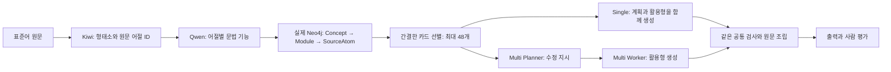

# 문법 카드 → 입력별 수정 계획

## 전체 그림

기존 버전은 721개 문헌 지식을 조회할 수 있었지만, `forms_for`에 구현된 17개 ID만 수정 후보가 됐다. 17개를 모두 만족해야 하는 구조는 아니었다. 이번 버전은 그 ID 제한을 없애고 **재사용할 문법 지식**과 **현재 문장에 적용할 수정 계획**을 구분한다.



## 선택 이유

| 선택 | 이유 | 남는 한계 |
|---|---|---|
| 문법별 Python 함수를 추가하지 않고 데이터 카드 + Qwen 사용 | 문법 형태 목록까지 재사용하고 새 규칙 추가 비용을 줄임 | 조건의 의미 판단과 활용 조합을 Qwen이 틀릴 수 있음 |
| Kiwi가 원문 어절 위치 결정 | 겹치거나 축약되는 형태소의 표제형을 원문 위치로 착각하는 문제 방지 | 한 어절 이상 합치기·분리·이동은 이번 범위 밖 |
| 문법 기능을 Qwen이 판단 | -까요의 의향 질문/추측 구별 등 형태만으로 부족한 정보 보완 | 실제 ID를 선택했다는 것만으로 올바른 분석은 아님 |
| 원본 Neo4j + 같은 ID의 실행용 카드 파일 | 공통 척추·12모듈·근거를 보존하고 생성 입력만 줄임 | Neo4j 원본 노드 자체는 이번에 재적재/덮어쓰기하지 않음 |
| 동일 분석·조회 결과를 두 조건에 공유 | 분석 변동을 제거하고 Single/Planner–Worker 차이 비교 | 공통 분석 오류는 두 조건 모두에 영향을 줌 |
| 생성 어절을 프로그램이 조립 | 계획 밖 원문 변형 및 전체 문장 복사 오류 감소 | 수정 어절 내부의 의미·높임·자연스러움은 사람이 확인 |

`single`은 **조회 후 계획·활용을 한 호출로 수행**한다는 뜻이다. 공통 분석까지 포함하면 정상 입력당 총 2호출이다. `multi`는 분석·계획·활용으로 3호출이다. 무작위 변환·화용 상황 추론·상용 모델 증류는 추가하지 않았다.

## 문법 카드와 수정 계획의 차이

카드는 7개 필드만 사용한다: 기존 ID, 모듈, 지식 종류, 제목, 조건, 형태 목록, 제약. `scope_profile`·활성화·승인 설명은 생성용 카드에서 제외하고 출처·검토 이력은 별도 파일에 보존한다. **받침·화계·시제·어휘 조건은 사족이 아니므로 남긴다.**

예를 들어 `GS_ENDRULE_KKI_PROM`은 “모음으로 끝나는 동사 어간 + 화자의 약속/의지 → -끼”라는 재사용 지식이다. “이 문장의 W8 `줄게`를 해당 조건에 따라 `주끼`로 바꾼다”는 입력별 계획이다. `-끼` 목록은 문헌 정보이고, 완성 어절 조합은 Qwen의 판단이다. 둘을 같은 확정 사실로 저장하지 않는다.

721개 항목은 설계 규칙 81, 형태 목록 433, 관찰 183, 분류 24개다. 721개를 모두 검증된 자동 치환 규칙으로 부르지 않는다. 모든 ID를 조회 대상으로 삼되, 최종 카드 선택은 문법 기능별 다양성과 점수 순위에 따른다. 선택되지 않은 ID와 점수도 보존한다.

## 실제 구현

- `src/kg_runtime/cards.py`: 원본 KG에서 카드·출처 보기를 만들고, 실제 Cypher 결과에 카드 ID를 연결한다. 기존 17개 목록을 사용하지 않는다.
- `src/kg_runtime/card_pipeline.py`: 분석·계획·활용 프롬프트, 공통 검증, 원문 조립.
- `src/kg_runtime/card_experiment.py`: 공유 분석과 두 조건 실행, 요청/응답·비용·동결 코드 보존.
- `tools/run_kg_cards.py`: 재실험 진입점.
- `tools/build_cards_report.py`: 실제 실행 파일에서 15건 대조표·통계·입력별 추적·평가지를 생성한다.
- `src/research_management/evaluation.py`: 사람 평가 저장과 입력 검증. 이전 저장 이력도 보존한다.
- `tools/score_cards_review.py`: 실제 사람이 저장한 점수만 집계한다.

공통 검사는 실제 어절 ID, 조회된 카드 ID, 중복·겹치는 수정, 단일 어절 출력, 입력 위치를 확인한다. **카드 조건을 모두 수식으로 판정하는 완성된 문법 엔진은 아니다.** 이 의미 판단은 이번 실험에서 Qwen의 몫이며, 남은 오류의 중요한 후보 원인이다.

## 실행과 열람

프로젝트 루트에서:

```powershell
python tools/run_kg_cards.py --project . --inputs data/derived_private/standard_inputs_50_20261023_v1/inputs.jsonl --credentials C:/Users/ciot28/Documents/Codex/neo4j-kg-local/credentials.json --qwen-config test.py --phase regression
python tools/research_manager.py serve
```

- [분석 보고서](http://127.0.0.1:8766/reports/grammar-cards/report.html)
- [방법 이름을 가린 사람 평가](http://127.0.0.1:8766/reports/grammar-cards/review.html)

평가를 마친 뒤:

```powershell
python tools/score_cards_review.py --reveal
```

평가 화면은 이전 Single·새 Single·새 Multi를 균형 있게 A/B/C로 섞는다. 방법표는 HTTP 허용 목록 밖에 둔다. 사람 평가는 실행 원본과 분리해 `experiments/analyses/grammar_cards_20261028/private/`에 저장한다. 브라우저 임시 저장과 PC 저장을 구별한다. 미평가는 0점으로 계산하지 않는다.

## 비교의 해석

새 Single/Multi는 동일한 입력·모델·시드·분석·조회·카드·검증을 사용한다. 실제 배치는 분석을 공유하므로 물리적 호출 수와 토큰 수를 별도로 집계한다. 방식별 표의 비용은 각 방식을 독립 서비스로 실행할 때처럼 분석 한 번을 포함한다. 대기열과 준비 시간은 입력별 지연시간에서 제외하고 전체 배치 벽시계 시간은 따로 기록한다.

이전 버전 대비로는 분석·후보 생성·출력 조립을 함께 바꿨다. 따라서 차이를 17개 제한 하나의 효과로 주장하지 않는다. 규칙 수·변경 수·형식 통과 수는 자연스러움 점수가 아니다. 50건은 이미 노출된 회귀 데이터이고, 독립 최종 평가 데이터가 아니다.


## 동결 실행 결과

배치 `20261028T011829489985Z`. 실행은 아래 두 폴더에 보존했다.

- `experiments/runs/20261028T011829489985Z_cards_single_regression`
- `experiments/runs/20261028T011829489985Z_cards_multi_regression`

| 방식 | 실행 검사 통과 | 변경 | 실패 | 호출 | 토큰 | 입력당 평균 초 (실패 포함) |
|---|---:|---:|---:|---:|---:|---:|
| 이전 Single | 49/50 | 33 | 1 | 61 | 70,233 | 4.218 |
| 이전 Multi | 47/50 | 30 | 3 | 112 | 97,846 | 6.479 |
| 새 Single | 38/50 | 37 | 12 | 100 | 577,900 | 40.012 |
| 새 Multi | 41/50 | 40 | 9 | 143 | 638,745 | 40.631 |

새 두 방식이 모두 완료한 33건만 비교하면 Single 21.723초, Multi 27.582초다. 전체 비용은 실패 비용을 포함하며, 성공 부분집합의 지연시간만으로 운영 비용을 대표하지 않는다. 실제 공유 배치는 193회·996,791토큰·1,796.9초였다. 개발·중단 시도는 보고서의 별도 비용 표에 남겼다.

기존 후보가 없던 15건 중 Single 11건, Multi 10건에서 출력이 바뀌었다. 실제 바뀐 어절에 사용한 카드 중 이전 17개 밖의 종류는 각각 20개·25개였다. 이는 범위 확장 확인이며 품질 개선율이 아니다.

21건의 실행 실패는 응답 길이 한도 16건, 한 어절 출력 제약 위반 4건, 전달되지 않은 카드 ID 사용 1건이다. 길이 한도 실패 16건 중 11건의 응답 끝에 수천 자의 공백이 관찰됐다. 내부 원인이 모델, 서버의 구조화 디코딩, 스키마 구성 중 무엇인지는 아직 분리 검증하지 않았다.

한 어절 제약 위반은 모두 언어적 오답을 뜻하지 않는다. `봐 가지고`, `재밌어 가지고`처럼 여러 어절의 표현을 허용하지 않는 이번 구현의 제약도 포함한다. 반면 `사었지`, `먹은지`, 카드에 없는 축약 설명 등은 별도의 활용·근거 적용 문제로 확인됐다. `제출하셨죠.`를 부정으로 분석하는 사례도 있어 위치 정렬과 의미 분석의 정확성을 구별해야 한다.

검증: 전체 Python 테스트 114개 통과, 두 실행의 원본 파일 무결성 통과, 실행 중 코드·원본 입력·KG 변경 없음, 50/50 동일 분석·조회 패킷 확인. 브라우저에서 15건 대조·50건 추적·50개 평가 항목·입력 임시 저장·모바일 가로 넘침 없음·방법표 HTTP 404를 확인했다. 점수 저장 API는 임시 테스트 폴더에서 확인했고 실제 사람 점수는 입력하지 않았다.

사람 평가 화면은 50개 입력에 이전 Single·새 Single·새 Multi를 섞어 총 150칸을 제시한다. 실제 출력이 있는 128칸을 평가할 수 있다. 평가자가 같은 과거 출력을 이미 보았을 수 있어 완전한 눈가림을 주장하지 않는다.

## 후속 우선순위

1. 별도 개발 예문으로 JSON 구조화 출력의 공백 반복 원인을 분리한다. 현재 50건을 몰래 보정하지 않는다.
2. 원문 형태와 Qwen의 기능 판단을 교차 검사한다. 부정·시제·주체 높임·화자 의지 등 보존 항목부터 확인한다.
3. 각 카드의 표준어 입력 조건과 목표 형태를 더 명시하고, 공통 조건 검사기를 만든다. 규칙마다 Python 함수를 복제하지 않는다.
4. 활용형 전체를 자유 생성하기보다, Qwen이 변경할 어미를 고르고 공통 조합기가 기존 어간·시제를 유지하며 실현하는 방법을 대조한다. 추가 모델 호출 없는 점검에서 `샀어→샀지`, `먹었어→먹었지`, `줄게→주끼`는 Kiwi 공통 조합으로 생성됐다. 전 방언 활용 검증은 아니다.
5. 원문 구간은 유지하면서 여러 어절로 실현하는 편집도 허용하고, 중복 문구를 검사한다.
6. 사람이 점수를 입력한 뒤 같은 입력끼리 비교하고, 새로운 미사용 문장으로 추가 평가한다. 현재 결과만으로 Single/Multi의 자연스러움 우열을 결정하지 않는다.
