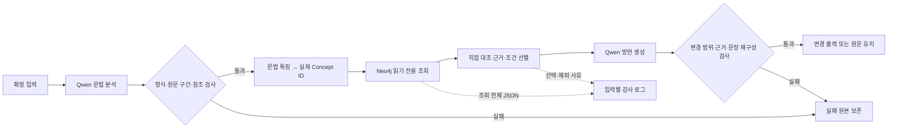

# KG·Qwen 파이프라인 구현 기록 — 2026-10-23

## 1. 큰 그림

Qwen이 문장을 읽고, 코드가 그 해석에 맞는 **실제 KG 개념**을 찾는다. 관련 문헌 근거를 골라 Qwen에게 전달하면, Qwen이 그 근거를 참고해 허용된 구간을 바꾼다. 마지막에 코드가 변경 구간과 근거 ID를 검사한다.



이것은 **문헌 참고 생성 파이프라인**이다. KG의 `runtime_active=false`를 true로 바꾸거나, 원래 저장된 설명 문자열을 검증된 실행 규칙으로 승격한 것이 아니다. 전체 721개 방언 항목 가운데 직접 대조 진술 29개와 연결된 근거를 우선 이용한다. 그중 현재 구현한 조건을 확인할 수 있는 것만 변환에 사용한다. 미지원 범위는 기록하고 보존한다.

## 2. 기존 자산에서 확인한 사실

| 확인 대상 | 관찰한 사실 | 구현에 미치는 영향 |
|---|---|---|
| 기존 `src/` | 초기 안내만 있고 분석·조회·생성 실행기는 없음 | 기존 실행기를 중복 작성한 것이 아님 |
| `tools/kg_v3/` | KG 생성·검증·실DB 적재 코드 존재 | KG 재생성 없이 기존 결과를 사용. Neo4j HTTP 접속 방식을 재사용 |
| 실제 DB와 r2 JSONL | 1,625개 노드, 6,167개 관계 | 매 실행 전에 노드·관계 전체 속성을 JSONL과 대조 |
| Concept 후보 | AnalysisConcept·GrammarFeature·Construction | 이 유형의 실제 ID만 연결. 모델에게 ID·쿼리 생성을 맡기지 않음 |
| 문헌 정보 | 직접 대조 Claim 29개와 자동 문맥 발췌가 함께 존재 | 자동 발췌를 의미 검증 근거로 사용하지 않음 |
| 확정 입력 | 원문 50개 항목, 일부 여러 문장 | 원문·ID·순서·공백 보존. 입력 파일 SHA 검증 |
| 정답 라벨 | 형태소·Concept·정답 방언·사람 평가 모두 없음 | 정확도·자연스러움 점수를 계산하지 않음 |
| 모델 | `/models`의 서빙 ID `Qwen3.8-27B` | 실제 가중치 revision·양자화·GPU·vLLM 버전은 서버 응답으로 미확인 |

50개 입력은 이전 대화에 공개되어 있었고 NEW007은 과거 설계 예시였다. 이번에는 별도 SMOKE001–005로 구현을 점검한 뒤 50개 실험 전에 코드·설정을 고정한다. 50개 결과로 성능을 조정하지 않는다. 다만 이전 노출을 없던 것으로 취급해 완전히 독립적인 미관측 시험셋이라 주장하지 않는다.

## 3. 대안과 선택 근거

| 방법 | 설명 가능성·정확성의 한계 | 복잡도·유지보수 | 선택 |
|---|---|---|---|
| 원문 키워드 검색 | 다의적 어미·인용 범위·발화 기능 구별이 약함 | 낮지만 예외가 누적됨 | 주 방식으로 사용하지 않음 |
| LLM이 개념·Cypher까지 생성 | 유연하나 ID·관계 발명 및 불안정한 검색 위험 | 결과 검증 부담과 호출 증가 | 사용하지 않음 |
| 임베딩으로 설명문 검색 | 의미 유사성과 문법 적용 가능성이 다름 | 별도 색인·평가 데이터 필요 | 이번 범위에 추가하지 않음 |
| **Qwen 분석 + 명시적 연결표 + 그래프 검색** | 모델 해석 오류는 남지만 연결 이유와 ID를 추적 가능 | 연결표 관리 필요, 외부 패키지 없이 구현 | **선택** |

### 문법 분석

문장 안의 절, 서술어, 조사, 대명사, 부사·명사를 구별한다. 서술어에는 종류, 시제, 선어말형 유무, 상, 부정, 높임, 문장 유형, 발화 기능, 의문 종류·범위, 보조용언·인용 구성을 요구한다. 모든 특징을 모든 단어에 붙이지 않고 단위 종류별 출력 계약을 둔다.

`anchor`는 원문 문자열과 등장 순서이다. 실제 문자 위치는 코드가 계산한다. 모델의 형태소 분석이 맞는지와 문자열이 원문에 존재하는지는 별개다. 범위·ID 검사에 통과해도 분석의 언어학적 정확성을 인증하지 않는다.

### Concept 연결과 우선순위

예: `question_type=wh` → 실제 `G_Q_WH`, `G_Q_SCOPE`; `constructions=[benefactive]` → `G_AUX_BENEFACTIVE`; `particle_function=topic` → `G_PARTICLE_TOPIC`.

입력의 어느 단위가 어떤 특징 때문에 각 ID로 연결되었는지 `mapping.json`에 기록한다. 구체적 구성은 100, 구체적 문법 특징은 60–90, 일반 개념은 10–40의 정렬 우선순위를 사용한다. 이는 확률이나 학습된 정확도 점수가 아니다. 지원되는 개념 후보를 하나로 강제하지 않고 모두 조회한다. 알 수 없는 특징은 후보를 추측해 보충하지 않는다.

### 실제 조회

1. 선택한 Concept에 `interpreted_as`로 연결된 Claim을 역방향 조회한다.
2. `analyzed_by` → SourceSpan → `part_of_document` → SourceDocument로 근거를 찾는다.
3. `documents_atom`으로 연결된 SourceAtom의 원래 조건·형태를 함께 보존한다.
4. `cross_reference`·`maps_to`의 1–2단계 이웃도 조회해 감사 로그에 남긴다. 관련성만으로 변환 허가를 부여하지 않는다.

Claim 경로는 잘라내지 않는다. 일반 이웃 조회는 최대 1,501개 경로로 제한하고 한도에 닿으면 별도 표시한다. 조회문과 매개변수는 각 입력의 `retrieval_raw.json`에 저장한다. Cypher는 코드에 고정되어 있으며 입력 문자열·모델 출력으로 쿼리를 조립하지 않는다.

### 근거 선별: 긴 JSON을 줄이는 이유

조회 JSON에는 중복 경로, 설계·시험 설명, 원래 조건 및 비관련 후보가 있다. 그대로 전달하면 모델의 문맥 한도를 소모하고 미검토 설명과 직접 근거를 혼동할 수 있다. 따라서 전체 원본은 저장하고 생성에는 다음만 전달한다.

- 정확한 Claim·SourceAtom·SourceSpan ID, 문헌·PDF 쪽수·문서 해시
- 문헌 진술과 직접 인용, 해석 주체·출처 범위
- 바꿀 수 있는 입력 단위와 확인한 적용 조건
- 문헌 형태 후보, 보존해야 할 제약, 원래 설계의 상태
- 현재 허가가 자동 규칙 실행이 아닌 문헌 참고 생성이라는 구분

문자 예산과 최대 16개 근거 제한을 적용하고, 생략 ID를 기록한다. 제약이 예산 때문에 빠지면 변환 참고 근거도 전달하지 않는다. 문자 감소율을 토큰 절약률이나 품질 향상률로 바꾸어 주장하지 않는다.

지역·시기는 출처로 보존하고 이번 선택에서 강제 필터로 쓰지 않는다. 반면 반말을 높임말로 바꾸거나 높임말을 반말로 낮추지 않도록 입력 말높임과의 거친 호환 조건을 둔다. 이 조건은 구현자의 연구 선택이며 문헌의 모든 화계 대응이 승인되었다는 뜻이 아니다.

### 알려진 제약을 처리하는 사례

- `C_D02_03`: 오다의 명령형을 다른 동사 전체로 확장하지 않는다.
- `C_D02_02`: 인용 원문의 시상 제한을 유지한다. 과거 문장에 -나/-노를 무조건 붙이지 않는다.
- `C_D02_05`: 선행 명령 맥락이 필요한 약속형은 현재 구현에서 보류한다.
- `C_D02_06`: 진술의 -제이와 연결 항목의 -자/-제를 자동으로 같은 형식이라 간주하지 않는다.
- 자동 문맥 발췌는 직접 의미 근거로 승격하지 않는다.

## 4. 모듈·입출력·오류 처리

| 파일 | 역할 | 저장 결과 |
|---|---|---|
| `contracts.py` | 두 프롬프트·분석/생성 JSON 계약 | 요청별 schema·프롬프트 |
| `io.py` | Qwen·Neo4j 접속, 비밀 없는 요청/응답 기록 | request/response/meta.json |
| `validation.py` | 사용 schema 키워드, ID·범위·변경 검사 | analysis_checks/generation_checks |
| `mapping.py` | 문법 특징을 실제 ID에 연결 | mapping.json |
| `retrieval.py` | 실제 DB·파일 대조와 읽기 전용 검색 | retrieval_raw.json |
| `selection.py` | 근거·제약 선별과 제외 사유 | reference_packet/selection_audit |
| `runner.py` | 실행 고정·병렬 처리·실패 보존·집계 | run 폴더·결과·metrics |
| `report.py` | 기록에서 HTML 보고서 생성 | private/report.html |

응답 형식 검사는 이 계약에 실제 사용하는 `type`, `enum`, `required`, `additionalProperties`, `items`, `minimum`, `minLength`, `anyOf`를 지원한다. 범용 JSON Schema 전체 구현은 아니다. 모르는 키워드는 검사에서 거부한다. 서버의 구조화 출력 기능은 [vLLM 공식 문서](https://docs.vllm.ai/en/latest/features/structured_outputs/)의 인터페이스를 따른다.

생성 모델은 전체 문장과 변경 목록을 함께 반환한다. 원문에 변경 목록을 적용한 결과가 모델의 전체 출력과 정확히 같아야 한다. 없는 근거·다른 단위의 근거·겹치는 변경·기록되지 않은 변경을 거부한다. 반면 실제 의미 보존, 선택된 근거의 언어학적 적절성, 활용형 자연스러움은 사람이 판단해야 한다.

API 실패·잘린 출력·JSON 실패·원문 구간 불일치·참조 오류·생성 검사 실패를 구별해 보존한다. 자동 재시도와 결과 수동 보정은 하지 않는다. 실패 시 승인 출력은 null이고, 원문 유지와 구별한다. 일부 실패가 있어도 나머지 입력을 계속 처리한다.

## 5. 실행·재현

Python 3.10 이상, 외부 Python 패키지는 필요 없다. `test.py`는 실행하지 않고 AST로 URL·토큰 상수만 읽는다. 비밀번호·토큰은 요청·실험 기록에 저장하지 않는다.

```powershell
python tests/test_kg_pipeline.py
python tools/run_kg_pipeline.py --project "." --inputs "experiments/templates/pipeline_smoke_inputs.jsonl" --credentials "C:/Users/ciot28/Documents/Codex/neo4j-kg-local/credentials.json" --qwen-config "test.py" --phase smoke --workers 2
python tools/run_kg_pipeline.py --project "." --inputs "data/derived_private/standard_inputs_50_20261023_v1/inputs.jsonl" --credentials "C:/Users/ciot28/Documents/Codex/neo4j-kg-local/credentials.json" --qwen-config "test.py" --phase first50 --workers 2
```

실행마다 `experiments/runs/<UTC timestamp>_qwen_kg_<phase>/`를 새로 만든다. 입력·모델 원문·문헌 발췌·문장 결과는 Git에서 제외되는 `private/`에 둔다. 코드·프롬프트·schema·설정·KG·입력 해시, 서버가 제공한 모델 목록을 보존한다. 모델 ID만으로 checkpoint와 하드웨어가 고정되었다고 볼 수 없으며, 동일 seed도 다른 서버 환경의 출력 동일성을 보장하지 않는다.

## 6. 시험 이력과 평가 원칙

별도 5개 예문의 첫 시험에서 문법 필드 생략을 발견해 단위 종류별 필수 schema로 바꿨다. 두 번째에서 빈 parent_cid 문제를 확인해 null 계약을 강화했다. schema 속성 순서를 보존해 단위 종류가 특징보다 먼저 생성되게 했다. 세 번째에서 생성 모델이 `runtime_rule_approved=false`를 참고 생성 금지로 오해해, 자동 규칙 승인과 문헌 참고 허용 필드를 분리했다. 이 기록은 삭제하지 않았다.

최종 50개 실험은 그 이후 코드·설정 고정본으로 수행한다. `freeze.json`과 `postflight.json`이 실행 전 고정과 실행 중 변경 여부를 보여준다. 별도 예문의 문법 분석에도 오류가 남아 있으며, 연결 시험 통과를 분석 정답률로 해석하지 않는다.

측정: 입력별 단계 성공/실패, 근거가 반환된 입력 수, 변환 참고 근거가 있는 입력 수, 원문 변경/유지, 서버 보고 토큰, 실제 지연시간, JSON 문자량, 실패 유형. 측정하지 않는 값: 정답 없는 Concept 정확도·검색 적중률·근거 적절성·최종 정확도·사람 자연스러움. 사람 평가용 빈 양식은 각 실행의 `private/human_review.json`에 있다.

이번 구현 결과는 기존 설계 보고서의 미구현 파이프라인 부분을 구체화한 것이다. 과거 보고서·KG 원본은 덮어쓰지 않는다. 활성 규칙 전체, 예외 전수 구현, 임베딩 RAG, KG 유무 비교실험, 사람 평가, 새로운 미관측 평가셋은 후속 범위다.
