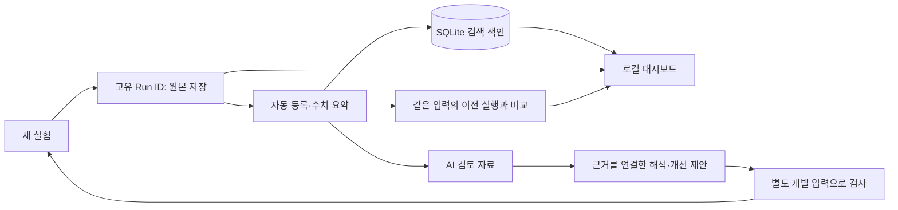

# 연구 관리 시스템

**2026-10-24 현행 정책:** 사용자 요청에 따라 기존 50건은 회귀 테스트셋으로 사용하며 오류 분석과 개선을 허용한다. 원문과 과거 실행은 보존하고 독립 최종 평가셋으로 주장하지 않는다. 아래 2026-10-23의 개발/평가 분리 문구는 당시 정책이다. 새 실행기와 비교 설계는 [실행층 재설계](RUNTIME_REDESIGN_20261024.md)를 따른다.
## 전체 그림

흩어진 실행 기록을 한 화면에서 찾고 비교한다. 기존 실행 폴더가 원본이며, 관리 시스템은 원본을 읽는 목차 역할을 한다. 모델을 다시 호출하거나 과거 출력을 고치지 않는다.



현재 등록 대상은 기존 Qwen–KG 실행 5회(개발 점검 4회, 확정 50건 평가 1회)다. 문헌 검토·Neo4j 적재 보고서는 문서로 연결하며 모델 실험으로 집계하지 않는다. 50건 첫 결과는 출력 형식 통과 35건, 분석 실패 15건이다. 통과한 35건 중 34건은 원문 유지, 1건은 부사 변경이다. **독립 자연스러움 점수와 KG 없는 통제 결과는 없다.**

## 선택 이유

| 대안 | 장점 | 현재 프로젝트의 추가 관리 비용 | 결정 |
|---|---|---|---|
| Streamlit | Python으로 위젯·표를 빠르게 제작 | 패키지·앱 환경 추가. 기존 기록 규격·비교 로직은 별도 구현 | 후보로 유지 |
| MLflow | 실행·파라미터·지표·산출물 추적 API와 UI | 기존 불변 실행 폴더와의 변환·중복 관리 | 팀 서버·모델 등록 요구가 커지면 재검토 |
| Python 표준 라이브러리 + SQLite + HTML/JS | 추가 설치 없음, 기존 기록 형식 보존 | 화면·비교 코드를 직접 유지 | **현재 선택** |

기능 확인: [Streamlit 공식 문서](https://docs.streamlit.io/get-started), [MLflow Tracking 공식 문서](https://mlflow.org/docs/latest/ml/tracking/). MLflow도 로컬 운영이 가능하다. 이번 선택은 기존 기록 체계를 이중 관리하는 비용을 줄이기 위한 프로젝트 판단이다.

### 연구 관리 Agent의 형태

| 방식 | 판단 |
|---|---|
| 상시 전용 AI Agent | 호출 비용·추론 변동·권한 관리가 추가되므로 지금은 상시 실행하지 않음 |
| Codex Skill | 여러 프로젝트에서 재사용할 때 유리. 현재 한 저장소의 절차를 별도 설치 Skill로 중복하지 않음 |
| 스크립트 + 저장소의 Agent 절차 | 숫자·이력은 코드, 해석·권고는 현재 연구 Agent가 담당. **구현한 방식** |

`research_manager.py brief RUN_ID`가 실제 기록과 비교 결과를 AI 검토 자료로 묶는다. Agent는 [작업 절차](../workflows/RESEARCH_MANAGEMENT.md)에 따라 관찰·가설·권고를 구분한다. 이 명령 자체는 AI를 호출하지 않는다. 자동 생성하는 것은 수치 요약이며, 자동 AI 해석까지 수행했다고 표시하지 않는다.

## 실제 구현과 근거

```text
experiments/runs/<Run ID>/            기존 불변 원본
experiments/management/
  report_navigation.json              기존 보고서 연결 목록
  private/index.sqlite3               다시 만들 수 있는 검색 색인
  private/summaries/<Run ID>.json      수치·오류·이전 같은 입력 실행과의 비교
  private/reviews/<시각>_<Run ID>.json AI 검토용 자료
  private/verification/<Run ID>.json  원본 해시 전체 대조 결과
docs/research/RESEARCH_STATUS.md       자동 갱신하는 실행 현황
docs/research/DECISIONS.md             설계 결정과 이유
```

실제 문장·오류가 들어가는 색인은 `private/`에 두어 Git에서 제외한다. Git clone만으로 비공개 실행 자료까지 복원되지는 않는다. 원본을 별도 백업해야 한다. 색인은 원본에서 `sync`로 다시 만들 수 있다.

### 자동 기록 흐름

1. 입력·설정·코드·KG 해시를 고정하고 시작 상태를 등록한다. 사전 접속 확인 실패도 등록한다.
2. 실행 후 원본과 전체 산출물 해시를 완성한다.
3. 완료 기록을 등록하고 같은 입력·용도의 이전 실행이 있으면 비교 요약을 만든다.
4. 연구 현황 문서를 갱신한다. 관리 단계가 실패해도 원래 실험 결과를 보존하고 경고를 남긴다.

강제 종료한 실행은 미완료로 남을 수 있다. `sync`는 남아 있는 입력별 결과를 읽으며 실행을 임의로 재개하지 않는다.

### 비교 타당성

| 조건 | 처리 |
|---|---|
| 입력 파일 해시·입력 ID 집합·용도·지표 정의가 다름 | 차이값을 계산하지 않음 |
| 미완료이거나 검사한 원본에 변경·누락 징후가 있음 | 직접 비교 차단 |
| 분석/생성 Schema 또는 검사 코드가 바뀜 | 출력 검사 통과 수의 차이값을 계산하지 않음 |
| 같은 입력에서 모델·KG·프롬프트·코드가 바뀜 | 변경 사항을 나열하고 관찰값만 비교. 단일 원인의 효과라고 주장하지 않음 |
| 서버 환경·부하·모델 revision 미확인 | 시간 차이는 관찰값으로만 표시 |
| 토큰 사용량이 누락된 호출이 있음 | 총 토큰 차이값을 계산하지 않음 |
| 독립 사람 평가 없음 | 자연스러움·정확도 미측정. 0점으로 대체하지 않음 |

점검용 5문장과 평가용 50문장은 직접 비교할 수 없다. 같은 5문장이라도 검사 계약이 바뀌면 통과 수를 직접 비교하지 않는다. 같은 입력은 통제 실험의 충분조건이 아니다. 여러 요소를 동시에 바꾸면 KG의 독립적인 효과를 분리할 수 없다.

### 실제 문장 추적 사례

대시보드 **문장별 추적 → 50건 실행 → DEV026**을 선택한다.

| 단계 | 실제 파일 | 확인할 것 |
|---|---|---|
| 입력 | `input.json` | 늦을까 봐 조금 일찍 나왔어요. |
| 분석 | `analysis_call/parsed.json` | 모델의 절·단위·문법 특징 판단 |
| 개념 연결 | `mapping.json` | 실제 Concept ID와 선택 근거 |
| 조회 | `retrieval_raw.json` | DB 관계·Claim·출처 원본 |
| 선별 | `reference_packet.json`, `selection_audit.json` | 생성에 전달된 내용과 탈락 이유 |
| 생성 | `generation_call/parsed.json` | 늦을까 봐 쪼께만 일찍 나왔어요. |
| 결과 | `result.json` | 변경·미해결 사항·호출·시간 |

이 사례는 부사 변경이다. 문법 방언화 성과로 확대하지 않는다. 형식 검사에 통과한 분석에도 의미상 오류가 있을 수 있어 원본을 함께 확인해야 한다.

### 재현·접근 범위

- 목록 갱신은 작은 메타데이터를 검사한다. 큰 조회 원본을 포함한 모든 해시는 `verify`로 대조한다. 저장 목록과의 일치 검사이며 외부 공인 서명은 아니다.
- 새 실행에는 Git HEAD뿐 아니라 실제 코드 사본·해시, 관리 코드 버전·사본을 기록한다. 미커밋 변경도 구분한다.
- 서버는 `127.0.0.1`에서만 열며 임의 경로·인증 파일을 제공하지 않는다. 웹 화면에 실험 실행·코드 수정 기능은 없다.
- 저장된 결과를 읽으므로 대시보드에는 Neo4j·Qwen 접속이 필요 없다.

## 남은 범위

구현 검증은 [검증 결과](../../experiments/validation/research_management_20261023/README.md)에 모았다. 테스트 59개, 기존 1,067개 파일 해시, 브라우저 링크 8개, 합성 200회×50건 색인을 확인했다. 합성 규모 점검은 모델 품질이나 생성 성능 측정이 아니다.

- 사람 평가 절차·평가자·척도를 확정한 뒤 별도의 불변 평가 기록과 가져오기 기능을 추가해야 한다.
- 개발/평가의 동일 문장·공백 차이 검사는 구현했다. 의미가 같은 재작성 문장의 중복은 사람 검토가 필요하다.
- 단일 연구자용 로컬 도구다. 다중 사용자 인증·서버 백업은 구현하지 않았다.
- 과거 HTML은 8765 보고서 서버, 대시보드는 8766이다. 기존 HTML 서버가 꺼져 있으면 해당 링크를 열 수 없다.
- 50건은 과거 대화·설계 노출이 있어 미공개 독립 평가셋이 아니다. 향후 최종 품질 평가용 새 입력·방언 화자 평가를 별도로 확보해야 한다.
