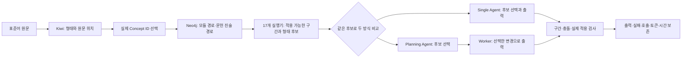

# KG 실행층 재설계 · 2026-10-24

## 1. 전체 그림

문헌을 찾아 보여주는 시스템에 **어느 글자를 어떻게 바꿀지 정하는 실행층**을 추가했다. 연구 KG의 공통 척추, 12개 모듈, 기존 ID와 연결은 보존한다. Neo4j는 기존 그래프 경로를 조회하며, 조회된 실제 SourceAtom ID에 Python 실행 명세를 결합한다. 원래 노드의 `runtime_active=false`를 일괄 변경하지 않는다.

이 구현은 모든 경상도 문법의 완성을 뜻하지 않는다. 721개 문헌 항목 가운데 현재 17개 ID에 입력 판정과 형태 조합 코드를 연결했다. 나머지 704개는 종류·원래 조건·출력형·연결·구현되지 않은 부분을 모두 목록으로 남겼다. 목록에 없다는 의미와 실행 코드가 없다는 의미를 구별한다.

결과 탐색: [새 비교 보고서](http://127.0.0.1:8766/reports/runtime/report.html), [실험 대시보드](http://127.0.0.1:8766/).



‘문장 전체를 상세 분석한 JSON’이 반드시 필요한 것은 아니다. 이번 실행층에서 사용하는 범위는 어절 위치, 형태·품사, 종결/연결 어미, 같은 문장에 속한 의문부호, 그리고 Qwen의 문장 기능 판단이다. 목적·결과·사동의 범위를 구별해야 하는 복잡한 규칙은 이 간결한 계약만으로 처리하지 않는다.

## 2. 선택 이유와 대안

| 방식 | 장점 | 한계 | 이번 결정 |
|---|---|---|---|
| 긴 문헌·설계 JSON을 그대로 제공 | 원문과 설계를 한꺼번에 확인 | 원문 위치, 적용 조건, 조합 방식이 여전히 불명확 | 연구 추적용으로 보존 |
| 짧은 자연어 규칙만 제공 | 읽기 쉬움 | 변경 위치·조건·충돌을 기계적으로 검사하기 어려움 | 후보 조건 설명에 사용 |
| 구조화된 구간 계획 | 정확한 위치·교체·실제 KG ID를 검사 가능 | 자유로운 표현 재구성 범위가 좁아짐 | 내부 표준 형식 |
| 계획에서 짧은 Worker 입력 생성 | 반복 근거·메타데이터를 줄임 | Worker가 계획을 누락할 수 있음 | 실제 누락 검사를 함께 구현 |
| 전면 LLM 형태·절 분석 | 유연한 의미 해석 | 원문과 다른 표제형을 위치로 출력하고 절 연결을 틀릴 수 있음 | 비교 진단 조건으로 유지 |
| Kiwi와 Qwen 역할 분담 | 구간은 코드, 문장 기능은 Qwen이 담당 | Kiwi도 오분석하며 의미 정답은 아님 | 새 두 아키텍처에 적용 |

### 위치와 조건을 어떻게 연결하는가

1. Kiwi의 `EF`(종결어미) → 실제 `G_END_FINAL` 등, `EC`(연결어미) → `G_CLAUSE_LINK`, `면/으면` → `G_END_CONDITIONAL`, `MAG`(일반 부사) → `G_LEX_SENSE`를 조회한다.
2. 두 실제 그래프 경로를 쓴다: `Concept -in_module→ Module ←in_module- SourceAtom`, `Concept ←interpreted_as- Claim -documents_atom→ SourceAtom`.
3. 같은 모듈이라는 관계는 **후보를 찾는 범위**다. 문법적으로 적용할 수 있다는 증명으로 사용하지 않는다. 조회 결과의 모든 관계 ID가 원본 JSONL에 실제로 존재하는지 확인한다.
4. 실행기는 형태·어미·표면 구간을 검사하고 완성된 치환 후보를 만든다. Qwen이 의문사 질문/판정 질문, 평서/명령 등의 용법과 원문 의미에 맞는 후보를 선택한다.
5. 같은 원문 구간에 두 후보가 선택되면 충돌로 중단한다. 서로 겹치지 않는 변경은 원문 뒤쪽부터 적용하여 앞쪽 글자 위치가 밀리지 않게 한다.
6. 생성 문장이 선택한 변경으로 정확히 재구성되지 않으면 실패로 기록한다. 결과를 몰래 고쳐 통과시키지 않는다.

예: `어디 갔어?`에서 `갔어`의 형태는 `가/VV + 었/EP + 어/EF`다. `GS_ENDRULE_Q_WH_V`가 제안하는 `갔노`와 `GS_ENDRULE_Q_POLAR_V`의 `갔나` 중 실제 설명 의문인 전자를 선택한다. ‘과거이므로 나/노를 금지’했던 이전 구현 조건은 D02 PDF 145쪽의 선어말어미 결합 설명과 맞지 않아 새 실행기에 계승하지 않았다. 이 예의 실제 실행 경로와 결과는 보고서에서 별도로 확인한다.

### 단일·두 Agent의 차이

| 항목 | Single | Planning + Worker |
|---|---|---|
| 기본 Qwen 호출 | 1회 | 2회 |
| 형태 분석·최초 조회·후보 | 동일 | 동일 |
| 규칙 선택 | 단일 Agent | Planning Agent |
| 최종 출력 | 같은 응답에서 생성 | 별도 Worker가 생성 |
| 추가 KG 조회 | 요청 시 1회까지 | Planner 요청 시 1회까지 |
| 계획 생략 | 선택할 때 판단 | Worker가 부적절한 항목을 추가로 생략 가능 |
| 실행 검사 | 같은 구간·출력 검사 | 같은 구간·출력 검사 + 미계획 항목 금지 |

추가 조회 1회는 이번 파일럿의 호출 예산이다. 언어학적 제약이나 사용자가 지시한 상한으로 표현하지 않는다. 최초 조회는 코드가 수행하고, Agent는 JSON의 `action=lookup`으로 추가 조회를 요청한다. 네이티브 tool-calling API에 종속시키지 않은 간단한 도구 실행 루프다.

Worker가 자유롭게 문장 전체를 바꿀 권한은 이번 버전에서 주지 않았다. 적용을 생략하거나 겹치는 후보 중 하나를 선택할 수 있지만, 허용된 구간 밖 표현은 유지한다. 이는 의미 변화의 추적을 우선한 선택이며 자연스러운 문장 재구성 능력의 상한이 된다. 문장 재구성이 필요한 새 규칙에는 다중 구간 계획과 보존 검사를 추가해야 한다.

## 3. 구현과 기술 근거

| 파일 | 역할 |
|---|---|
| `src/kg_runtime/morphology.py` | 실제 원문 구간·어절·형태소 분석, 형태 결합 |
| `src/kg_runtime/rules.py` | 17개 기존 ID에 대응하는 적용 조건과 형태 생성기 |
| `src/kg_runtime/graph.py` | 실행층 생성, 실제 Cypher 조회, 후보·계획·충돌 검사 |
| `src/kg_runtime/prompts.py` | 두 아키텍처의 프롬프트와 응답 형식 |
| `src/kg_runtime/experiment.py` | 동결·실행·로그·계측·관리 시스템 등록 |
| `tools/run_kg_runtime.py` | 실행 진입점 |
| `tools/analyze_runtime_experiment.py` | 과거 50건 오류 추적, 모듈별 범위, 새 실행 비교 |
| `knowledge/authored/kg_runtime_20261024/` | 원본과 같은 1,625노드·6,167관계의 간결한 실행용 뷰, 규칙·근거·범위 명세 |
| `experiments/analyses/redesign_20261024/private/` | 실제 입력이 포함된 분석 원본과 상세 보고서 |

`candidate_id`는 `기존 규칙 ID:원문 위치 ID:대안 번호`로 만든 **실행 중 후보 식별자**다. 새로운 KG Concept ID나 관계로 등록한 것이 아니다. `source_refs`는 문헌 근거, `surface_origin=implementation_composition_not_source_quote`는 해당 완성형을 구현 코드가 조합했다는 표시다. 모델이 만든 설명과 원문 사실을 합치지 않는다.

Kiwi 토큰의 원문 범위는 겹치거나 길이가 0일 수 있다. 예를 들어 ‘했’ 한 글자에 `하`와 `었`이 겹친다. 그래서 형태소 표제형을 문자열 위치로 사용하지 않고 실제 어절 구간에 편집을 묶는다. [공식 Kiwi 설명](https://github.com/bab2min/kiwipiepy), [0.23.1 API](https://bab2min.github.io/kiwipiepy/v0.23.1/kr/).

### kg_v2와의 관계

원본 저장소를 읽기 전용으로 확인했다. 고정 커밋 `0422b027ee92aaf461c29244987d4d8d2e094284`의 `kg_v2/run_translation.py`, `sentence_retrieval.py`, `terminal_retrieval.py`, `transformation_plan.py`에 Kiwi와 Qwen, 표면 위치 보정, 종결 기능 검색, 변환 계획이 이미 있다. 따라서 ‘계획’이라는 아이디어 자체를 새 기여라고 주장하지 않는다. 이번 변경은 현재 v3의 실제 ID·Neo4j·데이터·관리 도구와 연결한 구현이다. 열람 사본은 분석 폴더의 `private/v2_snapshot`에 보존했다.

이전 v3는 문법 분석·생성을 Qwen이 수행한다는 당시 요청을 반영하여 Kiwi를 필수 단계로 두지 않았다. 코드와 이전 설계는 이를 확인해 주지만, Kiwi를 제외하면 성능이 좋아진다는 실험 근거는 없었다. 이번 사용자의 가설을 검토하기 위해 기존 분석 계약에 Kiwi 정보와 원문 정렬 지시를 추가하는 진단 조건을 함께 실행한다. 이는 Kiwi 유무만 바꾼 완벽한 순수 절제 실험은 아니다.

## 4. 실험·지표 해석

- **과거 기준 기록**: 2026-10-23 첫 50건, Qwen 분석 → 기존 문헌 참고 선택 → Qwen 생성. 재실행하거나 수정하지 않는다.
- **분석 보조 진단**: 같은 50건, 기존 분석 프롬프트·스키마에 Kiwi 토큰과 정렬 지시 추가. 기존 검색·선별까지 실행하고 생성하지 않는다. 따라서 최종 출력 수가 0인 것은 생성 실패가 아니다.
- **신규 Single / Multi**: 같은 입력·실행 규칙·모델명·온도 0·top_p 1·seed 20261023·thinking off. 문장별 조건 순서를 순환하고 동시 작업 수 2로 실행한다.
- 모든 요청·응답·사용 토큰·단계 시간·KG 조회 횟수·코드/KG/입력 해시를 보존한다. 한 조건의 단독 전체 시간은 측정하지 않았으므로 `wall_seconds=null`; 공유 배치 시간과 입력별 지연을 별도 기록한다.
- 서버는 `Qwen3.8-27B` 모델명을 반환했다. 체크포인트 해시, 원격 GPU 사용량과 다른 사용자 부하는 확인할 수 없다. 같은 하드웨어가 완전히 통제된 실험으로 부르지 않는다.
- 로컬 CPU·최대 작업 메모리는 전체 혼합 배치 값이며 조건별 자원 효율로 분배하지 않는다.
- 형식 통과, 변경 수, 후보 제공 수는 정확도와 다르다. 자연스러움·의미 보존·검색 정확도에는 아직 사람 점수나 정답이 없으므로 수치를 만들지 않는다.
- 원래 50건은 2026-10-24 요청에 따라 **회귀 데이터**로 재분류했다. 원문과 과거 기록은 그대로 보존한다. 향후 최종 품질 평가는 새로운 문장과 블라인드 화자 평가가 필요하다.

KG 원본/새 뷰의 바이트 수는 실제 파일 크기지만 직렬화 형식도 다르다. 노드 수 감소나 의미 손실 없는 완전한 압축률로 해석하지 않는다. LLM 토큰은 서버 응답의 usage로 계측하며 문자·바이트 수를 토큰 수 대신 쓰지 않는다.

## 5. 실행 방법

프로젝트 루트에서 Python 3.11 이상과 `requirements-runtime.txt`의 Kiwi 패키지를 설치한다. 기존 `test.py`는 인증 상수만 읽으며 실행하지 않는다. 인증값을 복사해 문서나 커밋에 넣지 않는다. Neo4j는 기존 연구 데이터가 적재된 상태여야 한다.

```powershell
python -m pip install -r requirements-runtime.txt
python -m unittest discover -s tests -p 'test_*.py'
python tools/run_kg_runtime.py --project . --inputs data/derived_private/standard_inputs_50_20261023_v1/inputs.jsonl --credentials "C:/Users/ciot28/Documents/Codex/neo4j-kg-local/credentials.json" --qwen-config test.py --conditions analysis_kiwi single multi --phase regression --workers 2
python tools/analyze_runtime_experiment.py --batch <실행이 출력한_batch_id>
python tools/research_manager.py sync
python tools/research_manager.py serve
```

이 PC에서는 Kiwi를 `local/python`에 설치했고 실행 진입점이 해당 경로를 읽는다. 원본 50건·PDF·인증정보는 Git에 포함되지 않으므로 다른 PC에서는 허가된 자료를 별도로 배치해야 한다. 과거 실행과 같은 코드를 재실행하려면 해당 Run의 `code_snapshot`을 사용하며, 서버 모델 체크포인트가 달라지면 결과의 완전한 재현은 보장되지 않는다.

## 6. 남은 범위

조사 101개 형태 목록, 18개 활용 설계, 복잡한 `-거로` 구성 등은 후보 목록을 모두 켜는 방식으로 처리하지 않았다. 각 항목의 조건과 코드 누락을 보고서의 검색 가능한 대장에 표시한다. 12개 모듈 전체에 실행 규칙이 구현됐다고 주장하지 않는다. 향후 조사·활용·보조용언을 확장할 때는 문헌의 의미 대응과 원문 구간 조합을 먼저 구현해야 한다.

정말 KG 관계가 도움이 되는지 입증하려면 같은 근거·후보를 쓰는 텍스트 검색이나 관계 제거 비교가 추가로 필요하다. 이번 실험은 실행 가능성과 두 Agent 구성의 비용·오류를 확인하며, KG 우월성을 증명하는 실험은 아니다. 문맥·감정 기능과 외부 Reference LLM 호출·지식 증류는 이번 작업에 포함하지 않았다.
