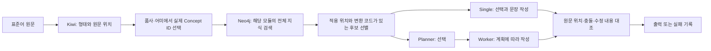

# 검색 가능한 지식과 실행 가능한 규칙의 분리

현재 버전은 `kg_runtime 0.3.0`이다. 공통 척추·12개 모듈·원본 ID/관계는 유지한다. Neo4j 원본을 덮어쓰지 않고 `knowledge/authored/kg_runtime_20261025`에 실행용 정보 구성을 만들었다. Neo4j가 반환한 실제 ID와 관계를 이 구성에 연결한다.

## 전체 그림



검색은 자료를 찾는 일이고 적용은 문장을 바꾸는 일이다. 721개 문헌 항목과 125개 공통 개념을 모두 주소로 조회할 수 있다. 그러나 721개가 모두 치환 규칙인 것은 아니다. 관찰·분류·형태 목록도 포함되어 있다. 현재 원문 위치와 출력 형태를 계산하는 코드는 17개 SourceAtom에 연결되어 있다. 나머지 자료는 삭제하거나 검색에서 막지 않으며, 문장별 조회 결과에 남긴다.

## 기존 방식에서 바뀐 부분

| 구분 | 0.2.0 | 0.3.0 |
|---|---|---|
| 검색 대상 | Cypher의 `$rules`에 넣은 17개 ID | 해당 모듈의 모든 SourceAtom. 활성화·지역 승인 여부로 검색을 제한하지 않음 |
| 공통 개념 | 어미·부사 중심 진입 | 조사·명사·서술어·관형절·시상·높임·보조용언 진입 추가 |
| 별도 조회 | 125개 Concept 목록을 매번 전달 | 아직 조회하지 않은 모듈 ID/이름만 전달; 중복 영역 요청 거절 |
| 말단 내용 | 간소화 과정에서 조건 일부가 실행 뷰에서 빠짐 | 문헌 조건·입력·동작·출력·차단·보존 정보를 유지; 출처/지역/검토 이력은 ID별 별도 파일 |
| 생성에 전달 | 전체 개념 목록+후보+형태 정보 | 원문+형태 정보+현재 후보+관련 조건+미조회 영역 |
| 오류 기록 | 불일치 오류 메시지 | 계획을 적용한 기대 문장과 모델의 실제 문장도 함께 저장 |

`scope_profile`, 일반적인 승인 요구, 테스트 설계, 장황한 불확실성 설명을 매번 모델에 보내지 않는다. 원본 속성은 보존하며 `field_changes.json`에 옮긴 항목을 기록한다. 원래의 `match`, `block`은 선언된 설계 지식으로 보존한다. `profile_not_selected` 같은 과거 배포 조건을 검색 차단 코드로 실행하지 않는다. 실제 적용은 17개 연산자의 형태 조건과 Qwen의 문장 기능 판단을 거친다. 문헌의 지역·시기 정보가 사라지거나 보편적인 현대 방언 사실로 바뀌는 것은 아니다.

## 대안과 선택 이유

| 대안 | 장점 | 문제 | 선택 |
|---|---|---|---|
| 검색부터 17개만 허용 | 작고 단순 | 다른 자료의 존재를 확인할 수 없음 | 제거 |
| KG 전체 JSON을 모델에 전달 | 정보 누락 위험 감소 | 많은 불필요한 목록·설계 메타 정보, 높은 토큰 비용 | 사용하지 않음 |
| 전부 검색 가능 + 문장별 모듈 조회 + 실행 후보 선별 | 자료를 숨기지 않으면서 적용 범위 설명 가능 | 검색 원본 JSON과 로컬 로그는 커짐; 실행기 확장 필요 | 채택 |
| Qwen이 임의의 Cypher/치환 실행 | 유연함 | 존재하지 않는 ID·부적절한 수정 위험, 재현 어려움 | 고정 조회문·실제 ID·구간 검증 사용 |

Neo4j 경로가 연결되어 있다는 사실은 그 규칙을 현재 문장에 적용해도 된다는 뜻이 아니다. 모듈 경로는 검색 범위를 정하고, Kiwi가 원문 위치와 형태 후보를 지정하며, Qwen이 판정 의문/설명 의문·명령/평서 등 용법을 판단한다. Kiwi 역시 통사 정답이 아니다. 완전한 구문 분석기나 모든 문법 제약을 판정하는 엔진을 구축했다고 주장하지 않는다.

## 계획과 검사의 범위

계획에는 실제 SourceAtom ID, 대상 어절 ID, 시작/끝 문자 위치, 원문, 바꿀 형태, 조건, 출처, 실제 검색 경로를 둔다. 서로 겹치는 구간의 후보는 동시에 선택할 수 없다. 수정은 원문의 뒤쪽부터 적용하여 앞쪽 위치가 밀리지 않게 한다. 이번 연산자는 모두 **원문에 독립적으로 적용하는 구간 치환**이다. 한 규칙의 출력이 다음 규칙의 입력이 되는 연쇄 활용이나 복잡한 통사 재배열은 구현하지 않았다. 이를 임의의 실행 순서 그래프로 가장하지 않는다.

Worker는 계획에 없는 수정을 추가할 수 없으며 부적절하다고 본 계획을 생략할 수 있다. 어느 방식이든 실제 모델 출력과 선언한 수정 결과가 다르면 실패다. 실패를 코드로 몰래 고친 뒤 성공으로 계산하지 않는다. 의미·높임·부정 보존을 프롬프트에서 요구하지만, 자동 검사가 증명하는 것은 **수정 구간과 출력의 일치**다. 수정된 구간 안의 의미와 자연스러움은 사람이 따로 확인해야 한다.

## 실험을 시작하기 전에 정한 비교

1. **회귀 50건:** 같은 원문, KG, 17개 연산자, Kiwi, Qwen, 온도/seed에서 Single와 Planner/Worker를 입력별 교대 순서로 실행한다. 프롬프트 역할과 호출 수만 아키텍처에 따라 달라진다.
2. **미사용 12건:** 모델 호출 전에 원문과 해시를 고정했다. 과거 입력과 정확 일치 0건. 구현된 문법 범주를 보고 작성한 편의 표본이므로 대표성·독립 사람 정답은 없다. 출력에 맞춘 수정이나 재시도는 하지 않는다.
3. **분석 비교 50건:** 기존 구조화 분석 계약과 동일한 공통 프롬프트·원문 정렬 지시를 사용한다. 한 조건에만 Kiwi 토큰 정보를 추가한다. 두 조건 모두 로그용 Kiwi 계산은 수행하므로, 모델에 전달하는 정보의 효과를 비교한다. 분석 이후 기존 매핑·조회·선별까지 추적하며 이 진단에서는 최종 생성을 하지 않는다. 따라서 최종 자연스러움의 인과 효과를 측정한 실험은 아니다.

서버 모델 이름은 실행 전 `/models`로 확인한다. 실제 체크포인트 해시·GPU 부하·서버 캐시는 공개되지 않으므로 완전히 통제했다고 말할 수 없다. 원격 호출 2개 동시 처리, 입력별 조건 순서 교대, 동일 token 상한, 자동 재시도 0회를 기록한다. 기존 50건은 회귀용이며 학습에 사용하지 않았다. 사람 점수·Concept 정답 라벨이 없으면 정확도/자연스러움은 null로 보존한다.

## 코드와 실행

- `src/kg_runtime/catalog.py`: 전체 지식의 실행 뷰 구성과 문장 특징→개념 경로.
- `src/kg_runtime/graph.py`: 실제 Neo4j 검색, 원본 ID 확인, 적용 후보·계획·출력 대조.
- `src/kg_runtime/experiment.py`: 두 아키텍처, 분석 대조 실험, 실행 원본·버전·오류 기록.
- `src/kg_runtime/prompts.py`: 역할별 Qwen 명령과 JSON 계약.
- `tests/test_kg_search.py`: 검색 개방과 무조건 적용 방지 검사.

실행 예시(프로젝트 루트):

```powershell
python tools/run_kg_runtime.py --project . --inputs data/derived_private/standard_inputs_50_20261023_v1/inputs.jsonl --credentials C:/Users/ciot28/Documents/Codex/neo4j-kg-local/credentials.json --qwen-config test.py --conditions single multi --phase regression --workers 2
python tools/run_kg_runtime.py --project . --inputs data/derived_private/runtime_unseen_12_20261025/inputs.jsonl --credentials C:/Users/ciot28/Documents/Codex/neo4j-kg-local/credentials.json --qwen-config test.py --conditions single multi --phase evaluation --workers 2
python tools/run_kg_runtime.py --project . --inputs data/derived_private/standard_inputs_50_20261023_v1/inputs.jsonl --credentials C:/Users/ciot28/Documents/Codex/neo4j-kg-local/credentials.json --qwen-config test.py --conditions analysis_qwen analysis_kiwi --phase regression --workers 2
```

Python 환경은 `requirements-runtime.txt`를 따른다. 위 인증 파일의 값은 보고서·코드 스냅샷에 복사하지 않는다. 실행 결과는 고유 Run ID로 보존되며 기존 연구 관리 대시보드에 자동 등록한다.
