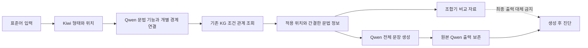

# 개별 경계 분석 → KG 조회 → Qwen 최종 생성

사용자 지시: 최종 문장을 생성하는 주체는 Qwen이다. 조합기는 보조 도구로만 사용한다.

## 실제 동작



`runtime.py`는 관찰된 모든 EC/ETM/ETN에 `Wn:Mi` ID를 붙인다. 한 어절의 EC+EC 또는 EC+ETM을 각각 질문한다. 어절 ID(Wn)와 형태소 ID(Wn:Mi)는 답변 칸별로 구분한다. 관계와 연결 대상의 조합을 검사하되 unknown을 허용한다.

바로 인접한 VX를 건너뛰는 답은 지원하지 않는다. 이는 Kiwi 관찰에 기초한 처리 계약이며 모든 한국어 구문의 진리를 새로 확정한 KG 규칙이 아니다. 멀리 있는 VX는 그에 들어오는 명시적 보조 연결이 있을 때 별도 연결을 허용한다. 미해결 경계가 목표와 무관하다는 자동 판단은 도입하지 않았다.

기존 `semantic_grammar_20261103_r4`를 그대로 조회한다. 새 문법 용법이나 실현형은 추가하지 않았다. source/target/conditions/REALIZES 관계를 따라 얻은 정보만 적용 지시로 만든다. Neo4j 실DB 쓰기는 없다.

## Qwen이 받는 것과 받지 않는 것

- 받음: 전체 원문, 적용 위치·원문 어절, 실제 형태소·어간·선어말·기존 종결어미, 규칙 ID와 뜻, 선택된 결합형, 조건별 관찰값, 보존할 내용, KG 결합 설명·구조 인용.
- 받지 않음: Claude 정답 문장, 조합기의 완성 어절, 자동 계산한 expected_surface, 긴 KG 전체.
- 현재 지원 위치만 변경하도록 지시한다. 지원 정보가 없으면 원문을 유지하되 Qwen이 전체 출력을 반환한다.
- Qwen 응답은 보존 검사에서 경고가 발생해도 유지한다. 검사기 예외 역시 원본 출력을 지우지 않는다. 조합기로 자동 수정하지 않는다.

## 파일과 실행

| 파일 | 역할 |
|---|---|
| runtime.py | 개별 경계 질문·검사, 기존 분석 값과 KG 연결, 생성 프롬프트 |
| run.py | 개발12건/기존50건 실행, Qwen 최종 생성, 원본·버전·진행 기록 |
| test_runtime.py | 17개 구현 검사와 실제 반례 검사 |
| report.py | 실제 실행에서 집계·위치별 예시·50출력 비교 보고서 작성 |
| private/reviewers | 기존 Orca Codex·Claude 지시와 검토·반영 확인 |

저장소 루트에서 프로젝트 Python으로 실행:

```powershell
python experiments/analyses/boundary_qwen_20261103/test_runtime.py
python experiments/analyses/boundary_qwen_20261103/run.py dev
python experiments/analyses/boundary_qwen_20261103/run.py full50
python experiments/analyses/boundary_qwen_20261103/report.py
```

Qwen 접속 설정은 기존 로컬 `test.py`에서 읽는다. 키는 실행 산출물에 넣지 않는다. 매 실행마다 새 run_id, 입력·KG·코드 사본과 해시, 모델 요청/응답, 조회 trace, 실제 생성 packet, 조합 비교, 결과·오류를 저장하고 관리 workflow에 등록한다. 2개 작업을 병렬 처리하며 자동 재시도는 없다.

## 실행 이력을 숨기지 않는 이유

개발12건을 수정 후 반복했으며 매번 새로운 ID로 저장했다. 첫 실행은 어절/형태소 ID 혼동으로 11건이 조회 전에 실패했다. 다음 실행에서 관계 판정·중복 질문 문제를 확인했다. 이후 검토에서 인접 VX를 건너뛰는 검사 우회를 추가 발견했고, 첫50 실행도 보존한 채 수정 후 다시 실행했다. 중간 실행을 최종 코드의 성과로 소급하지 않는다.

개발12건과 기존50건은 목적이 다르다. 기존50건은 이미 오류 분석에 사용된 회귀 검사셋이며 독립 평가셋이 아니다. 조합기였던 이전 실행과 분석·전달·생성이 함께 바뀌었으므로 한 변화의 인과 효과나 우열을 주장하지 않는다.

## 남은 한계

- 존재하는 ID로 연결했다고 의미 해석까지 맞는 것은 아니다. 개발 B07 `누가 왔는지 알아?`의 바깥 질문을 wh로 오판한 사례는 검토자들이 지적한 의미 오류다. 보류 사례로 잘못 집계하지 않는다.
- 어휘적 높임은 EP 시/으시 관찰만으로 증명되지 않는다. Qwen 판단 출처를 따로 남긴다.
- unknown 경계는 보수적으로 보류한다. 목표와 무관한 경계를 분리하는 후속 연구가 필요하다.
- Qwen의 형태 조합 오류가 다시 발생할 수 있다. 보조 조합기와 다른 결과는 원인 진단 자료이지 그 자체가 정답/오답 판정은 아니다.
- 현재 실험은 지원하는 종결형 중심이다. 미지원 부분의 자연스러운 어휘·문맥 변환까지 완료한 시스템이 아니다.


## 최종 실행 결과 — 2026-11-03

- Run ID: `20261103T111250623634Z_boundary_qwen_full50`.
- 50입력, 62위치 분석, Qwen 최종 생성50회. 13입력/14위치에 KG 적용 정보 전달, 37입력에는 적용 정보 없어 원문 유지 지시. 전체 최종 출력은 실제 Qwen 응답과 동일.
- 62위치 중14지원,46현재 범위밖,2분석보류. 원문과 달라진 입력13개는 품질 점수가 아니다.
- 196.5초,112모델 호출,서버 보고170722토큰. 자동 경고6입력. LONG001 동사 누락과 ADVCE006A/B 과거형 누락은 전달 정보가 있었으나 생성에서 지키지 않은 사례다. 다른 경고는 별도 검토 필요.
- 17구현 검사 통과. 7실행의 파일3266개 해시검증, 모든50 실제 생성 요청과 packet 일치 및 출력=Qwen응답 확인. HTML50행/로컬링크/JS문법 검사 통과. 브라우저 시각 검사는 파일 URL 정책 차단으로 미수행.
- 보고서: [50건 결과와 단계별 설명](private/report.html), [구체적 문제와 실제 전달 정보](private/representative_findings.json).
- 기존 Orca 검토자들은 코드·개발 결과를 검토했다. 최종50의 독립 품질평가는 하지 않았다.
- 관리 현황표가 위치별 실패를 읽지 않아 첫개발 실행의11실패를0으로 표시하던 집계 오류도 수정했다. 실행 원본은 변경하지 않았고 단위(위치/입력)를 구별했다.
- 다음 우선순위: 생성 오류는 동일 분석·KG를 고정한 전달/재검사 비교, 분석 오류는 의문사 소속 별도 개발 검사. 실패하면 입력형식보다 모델 조합 능력/지식 불충분 가설을 비교하며 단순50재실행을 반복하지 않는다. 추가 KG 범위 확장은 이 결과와 구별해 진행한다.
