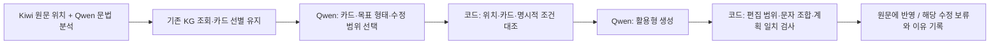

# 승인된 세 항목: 적용 전 변경 명세

**최신 상태:** 2026-10-30 Codex 8건·Claude 7건 독립 검토 수신. 아래 초안에 대한 구체적 보완·채택 여부는 [검토 반영 명세](REVIEW_RESOLUTION.md)가 우선한다. 검토자가 읽은 초안·근거는 `private/review_packet.txt`에 고정 보존한다. 현재 생산 코드와 KG에는 미적용이다.

이번 작업은 **카드·계획 연결, 활용·편집 처리, -지/-제 선택 조건**의 변경표와 재현 테스트를 작성하고 두 Reviewer에게 검토받는 단계다. 실제 KG/생성 코드는 변경하지 않는다. 카드 선별 점수 및 48개 한도 변경은 사용자 보류 상태다.

## 전체 흐름과 역할

Single은 계획과 활용형을 한 호출에서 제안한다. Multi는 계획을 먼저 제안하고 별도 생성 호출에 넘긴다. 둘 다 같은 카드·조건·검사를 사용하도록 제안한다. 코드는 자연스러움 전체를 인증하지 않는다.

## 변경표

| 대상 | 현재 | 제안 | 확인 방법 |
|---|---|---|---|
| 카드의 조건 | `when`에 목표 어미 계열, 입력 조건, 미확인 사항, 출처 범위가 혼재 | 입력에 요구하는 조건과 목표 표현을 분리. 출처·판단 주체는 별도 근거표에 보존 | 실제 사용된 모든 카드의 원본 필드와 비교. 미확인 항목을 임의 확정하지 않음 |
| 수정 계획 | word_id·rule_ids·자유문장 instruction·after | 편집 ID·연속 원문 어절 ID·카드/목표형 선택·보존할 특징·조건 판단을 연결 | ID/원문 범위/선택 목표형과 카드 목록의 일치 검사 |
| 의미 조건 | 모델의 설명에 의존 | 실제 원문/분석의 어느 값으로 판단했는지 기록. 분석도 추론임을 표시 | 코드로 확인된 사실과 Qwen 판단을 분리. 모순은 표시하고 중요 불확실성은 해당 수정만 보류 |
| 활용·편집 | 원문 한 어절 → 결과 한 어절, 공백 금지 | 한 어절 → 여러 어절 허용. 여러 원문 어절은 연속·같은 절/구성일 때 하나의 편집으로 묶기 | 원문 위치·문장부호·중복/겹침·빈 출력·변경 밖 보존 검사 |
| 활용 출력 검사 | 형식이 맞으면 `사었지`, `되ㄴ가`도 통과 | 구조 검사와 언어적 경고를 분리. 잘못된 자모 조합 경고, 축약/어휘/시제 보존은 별도 검토 | 경고를 오답 확정으로 계산하지 않음. 잘못된 활용을 자동 교정했다고 주장하지 않음 |
| 미적용·동일형 | edits에 남기도 함 | `apply`, `keep`, `needs_review`를 구분. 실제 변경 없으면 수정 수에서 제외 | 원문 유지와 실패 구별, 원문/설명 불일치 기록 |

## 카드별 구체적 제안

### GS_PART_ACC_03 — 목표가 -를인 카드

- 원본 forms는 `[-를]`, 받침 조건은 `not_yet_verified`다.
- 제안: 목적격 조사라는 입력 기능과 목표 형태 `-를`을 분리한다. 받침에 따른 사용 가능성은 **미확인 상태 유지**.
- `-을`을 목표로 선택한 계획은 이 카드의 목표형과 불일치한다. `-을` 자체가 방언에서 불가능하다는 판단은 하지 않는다.
- 표면 문자열이 `를`로 끝나는지만으로 모든 활용의 정당성을 판정하지 않는다. 코드 검사는 계획의 명시적 목표형과 카드에 기록된 형태의 일치부터 수행한다.

### GS_ENDRULE_JI_ASSERT / GS_ENDRULE_JI_CONFIRM — 서술과 확인 질문

- 문헌 PDF 200쪽의 서술·답변 용법과 210–211쪽의 확인 질문 용법은 함께 보존한다.
- `ending_family=JI`를 원문이 반드시 `-지`여야 한다는 조건으로 자동 해석하지 않는다. 기존 필드의 의미가 불명확하므로 목표 계열 설명으로 분리하되 그 매핑 판단은 제안으로 표시한다.
- 사용자 피드백: DEV002의 중립 사실 전달 `샀어 → 샀지/샀제`는 허용하지 않음. `샀다`·`샀데이`는 이 입력에 대한 사용자 제공 대안이다. 이를 모든 평서문의 자동 변환 규칙으로 확대하지 않는다.
- `그거 니 책이제?`는 기존 확인 질문 카드의 **사용자 용례**로 연결할 제안이다. 문헌 인용으로 표시하지 않는다.
- 제안할 선택 기준: 해당 입력에서 단순 서술 분류만으로 JI_ASSERT를 선택하지 않는다. 답변/확인된 사실이라는 기능에 대한 별도 근거가 필요하다. 이런 추가 기능의 판정이 불명확하면 이 수정만 보류하며, 지역·시대·화자 프로필을 필수 관문으로 추가하지 않는다.
- **현재 사용 가능한 -다/-데이 카드와 정확한 연결 근거를 확인하기 전에는 새 실행 규칙으로 승격하지 않는다.** 사용자의 이번 답은 중요한 범위 지정이지만 전체 활용표를 제공한 것은 아니다.

### GS_CONNECT_CAUSE_03 / GS_HAM_AUX_PROGRESS 등 여러 어절 구성

- 공백이 들어가는 목표 표현이 있다는 것과 해당 입력에서 그 표현을 적용해도 된다는 것은 별개다.
- 새 편집 구조는 여러 어절을 표현할 수 있게 한다. `먹고 있을 테니까`의 진행·미래/예정·이유 관계를 잃고 `먹고 있다`로 바꾸는 것을 자동 허용하지 않는다.
- 절/구성 경계가 현재 분석에 없으면, 연속 어절이라는 이유만으로 묶지 않는다. 분석 형식에 구성 범위·부정 범위·관련 논항을 어떻게 제공할지 명세하고, 이번 검토에서 구현 가능성을 확인한다.

## 제안하는 공통 계획 형식 (아직 실제 파이프라인에 미적용)

| 항목 | 누가 작성/확인하는가 | 의미 |
|---|---|---|
| edit_id | 코드가 요청 단위에서 부여 | KG 노드 ID가 아닌 지역적인 편집 식별자 |
| target_word_ids | Qwen 선택, 코드가 위치 계산 | 실제 제공된 연속 어절 ID. 문자 위치는 Qwen이 새로 만들지 않음 |
| operation | Qwen 제안 | 조사/종결어미/연결어미/구성 중 무엇을 바꾸는지 |
| card_id + card_hash + form_index | Qwen 선택, 코드 확인 | 실제 카드와 그 버전의 forms 위치. 새 KG ID를 만들지 않음 |
| condition_checks | Qwen 판단 + 코드 대조 | 조건 이름, 근거 필드/원문 범위, 일치/불일치/미확인. `미확인`을 참으로 취급하지 않음 |
| preserve | 분석에서 추출, Qwen 참조 | 어휘 뜻, 시제·상·양태, 부정 범위, 높임, 논항 등. 모델의 자기보고만으로 보존 확인을 끝내지 않음 |
| decision | Qwen 제안, 코드 구조 검사 | apply / keep / needs_review. 실패한 편집이 있으면 상태를 숨기지 않음 |
| after | Qwen 생성 | 실제 표면형. 분석용 형태소를 단순 이어 붙인 것이 아님 |

자유문장 instruction은 보조 설명으로 남기고, 구조화된 목표와 충돌하면 실행 기준으로 쓰지 않는다. 명세에 없는 문법 지식은 코드의 임의 규칙으로 채우지 않는다. **카드마다 Python 함수 하나를 만드는 방식이 아니다.**

## 검사 범위와 남는 한계

1. 코드로 확정 가능: 존재하는 ID, 카드 버전, 목표형 선택, 원문 위치, 편집 겹침, 반환 누락, 수정 밖 원문 보존.
2. 원문 분석을 조건부로 신뢰해야 하는 항목: 시제·절 범위·문법 기능. Kiwi/Qwen 분석이 서로 다르면 불일치를 남긴다.
3. 코드만으로 확정 불가: 자연스러움 전체, 함축된 시제/높임, 의미 등가성, 문헌에 없는 형태의 정당성.
4. 고립 자모는 인용/메타언어/웃음 표현일 수도 있다. 이번 일반 대화체 입력의 **새로 생성된 활용 구간**에 한해 경고하며, 문헌이나 사용자 원문에 있는 자모까지 삭제하지 않는다.
5. `사었지`의 재현은 현 검사 누락을 보여준다. 개선된 활용기가 이미 구현됐거나 올바른 방언형이 검증됐다는 뜻이 아니다.

## 이번 검토의 완료 기준

- 50개 입력/100개 기존 실행에서 승인 항목에 관련된 위치와 실제 카드 목록을 연결한다. 자동 검색은 문법 정확도의 판정이 아닌 위치 찾기다.
- 재현 테스트는 **기존 검사가 문제를 허용/거부하는 방식**을 재현한다. 통과 수를 수정 성공 수로 보고하지 않는다.
- Codex·Claude가 동일한 변경 명세·근거·테스트를 독립 검토한다. 검토자의 의견은 새 사실이 아니라 확인할 지적이다.
- 총괄이 근거와 대조하여 채택/수정/보류한다. 검토되지 않은 부분은 완료로 표시하지 않는다.
- KG 내용, 카드 선별 코드, 생성 프롬프트, 원본 실행·입력은 보존한다. Qwen 호출은 하지 않는다.

## 재현

`build_evidence.py` → `test_reproduction.py` 순서로 실행한다. 결과와 검토 원문은 `private/` 아래에 둔다. 기존 50건은 회귀 자료이며 독립 최종 평가 자료가 아니다.
