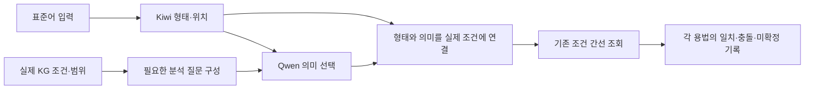

# KG 조건과 문장 분석 연결: 실제 비교 결과

**2026-11-03. 분석·조회만 실행했다. 방언 생성은 0회다.**

[32건 비교 보고서](private/report.html) · [조건 연결 및 진단 원본](private/audit.json)

## 전체 그림

기존 정제 의문문 그래프에는 조건 7개가 이미 실행 가능한 관계로 저장돼 있었다. 새 문법 규칙을 만드는 대신 실제 조건을 읽고 분석 결과를 연결했다. 동결 JSON 그래프를 사용했고 실시간 Neo4j 조회는 하지 않았다. 원본 KG와 이전 실험을 수정하지 않았다.

이 단계의 입력은 한 절 중심의 간단한 문장이다. 복잡한 구성은 자동으로 한 절처럼 간주하지 않고 분석 보완 표시를 남긴다. 현재 그래프에 구성 하나만 있으므로 전체 문법군의 구성 탐색기까지 완성한 것은 아니다.

## 바꾼 부분과 이유

| 부분 | 수정 | 이유 |
|---|---|---|
| 질문 구성 | 실제 KG의 조건·지원 범위·기존 보존 필드에서 요구 항목을 읽음 | 별도 문장별 허용표를 두지 않음 |
| Qwen 응답 | 정의와 한국어 선택지를 제공하고 짧은 응답을 받음 | 정보 질문과 행동 요청의 분류 혼동 감소 목적 |
| 형태 연결 | 서술어 품사·선어말은 Kiwi에서 공급 | 이미 관찰한 형태를 Qwen 재작성 중 잃지 않음 |
| 파생 서술어 | NNG/XR 등 + XSV/XSA를 대상 어간으로 연결 | 도착+하 같은 분석을 기존 연결기가 거부했던 문제 |
| 높임 | 시 형태의 존재와 Qwen의 어휘·의미 판단 결합 | 주무시다처럼 별도 시가 없어도 높임일 수 있음 |
| 조회 추적 | 탈락한 분기를 포함한 모든 조건·분기 판정 보존 | 후보가 왜 없어졌는지 숨기지 않음 |

실제 조건은 `Condition → ACCEPTS → FeatureValue`, 용법 분기는 `ANY_BRANCH → ALL → Condition`이다. 조건의 미확정과 불일치를 구별한다. `ProcessingScope`는 구현 지원 범위이며 방언의 언어학적 금지 규칙이 아니다. 시간 의미·부정은 현 그래프의 용법 선택 조건이 아니라 전달 시 보존 정보다.

`DEFINITIONS`는 분석 용어의 뜻을 설명하는 어댑터다. 문장 ID나 방언 정답, 용법의 허용 조합을 담지 않는다. 새로운 의미 차원이 생기면 정의와 담당이 필요하다는 오류를 명시한다. 새 용법이 기존 조건 표현을 사용하면 조회 코드를 용법별로 추가하지 않는다. 합성 용법을 추가하는 코드 검사로도 확인한다.

## 비교 결과

Run ID: `20261103T013538252748Z_condition_bridge_development`

기존16 + 신규16 = 32사례ID, 원문31종. Q16은 Q05 중복 기술 사례다. 두 방식에 동일 모델·Kiwi·KG·토큰 한도2048·seed20261103·temperature0·재시도0을 사용했다. 여러 연결 요소를 묶어서 변경한 비교이므로 어느 하나만의 인과 효과로 해석할 수 없다.

| 항목 | 기존 | 수정 |
|---|---:|---:|
| 분석 응답 형식 통과 | 31/32 | 32/32 |
| 형태 연결·조회 완료 | 30/32 | 32/32 |
| 생성 지시 준비 가능 | 0/32 | 24/32 |
| 사전 작성 분석과 전체 일치 | 1/29 | 22/29 |
| 새 기본 질문에서 준비 가능 | 0/12 | 10/12 |
| 새 범위 밖 사례를 범위 밖으로 처리 | 4/4 | 4/4 |
| 토큰 | 23,299 | 30,855 |
| 각 호출 시간 합 | 190.192초 | 106.710초 |

전체 경과151.291초, 분석 호출64회. 병렬 호출 시간 합은 경과 시간과 다르다. 입력 정의가 길어져 수정 방식 총 토큰은 증가했다. 독립 품질·지연 벤치마크는 아니다.

29건은 모호성 진단 Q13/Q15와 중복 Q16을 제외한 비교다. **연구 리드가 실행 전에 작성한 기준과의 일치이며 사람 검증 정확도가 아니다.** 새16건도 소규모 개발 사례이며 독립 최종 평가셋이 아니다. 기준값은 모델 입력에 주지 않았다.

## 남은 차이를 모델 오류로만 보면 안 된다

- Q09/N07/N09/N15: 정보 질문과 확인 태도는 겹칠 수 있다. 현재 `speech_act`는 둘 중 하나만 고르게 해 범위 차단을 유발한다. N15는 부정 계사도 현재 범위 밖이다.
- Q14/N11: 과거 형태는 정확히 보존했지만 현재 미완료 상태로 시간 의미를 해석했다. 형태와 사건·기준 시점을 한 값으로 판단하면 기준 자체가 모호하다.
- N07: 지칭어 `그분`의 존대와 서술어 높임을 구별해야 한다.
- N16: 행동 요청의 시제를 present로 정한 사전 기준이 부적절할 수 있다. Qwen의 null을 무조건 오답이라고 할 수 없다.

실행 후 기준이나 결과를 바꾸지 않았다. 후속은 이 의미 구분을 먼저 검토하고, 승인된 정의로 다시 분석을 비교하는 것이다. 생성의 어미·시제 조합 실패는 이번에 고치거나 재시험하지 않았다.

## 파일과 재현

- `bridge.py`: KG 조건 목록 추출, 분석 계약, 형태·의미 연결, 전체 조건 추적
- `prepare.py`: 입력·분석 기준 사전 작성 및 동결
- `run.py`: 기존/수정 분석 호출 및 기존 관리 시스템 등록. 생성 호출 코드 없음
- `test_bridge.py`: 연결 검사. 실행 전12개, 추가 용법 확장 검사1개
- `analyze.py`: 저장된 결과 집계와 사람이 읽는 보고서. 모델 호출 없음
- `private/preparation_v1.json`, `cases_v1.json`: 호출 전 초기 기준 보존
- `private/preparation.json`: 호출 전 수정 기준. N14는 Kiwi가 주무시+었으로 분석한 것을 보고 선어말 기대값을 other→eoss로 수정. 주체 높임은 present 유지. 문장은 바꾸지 않음
- [동결 실행 원본](../../runs/20261103T013538252748Z_condition_bridge_development/): 요청/응답·분석·조회·전달·입력·프롬프트·코드 스냅샷·해시

실행에 쓰인 코드 스냅샷은 변경하지 않는다. 이후 작성한 진단·문서·추가 검사는 별도 파생 산출물이다. 원본 문헌과 사용자 방언 표현을 이번 작업에서 새 규칙으로 승격하지 않았다.

검증은 구조·기록·집계에 대한 것이다. HTML은 로컬 파일로 열 수 있으며 브라우저 화면 렌더 검수는 하지 않았다.
