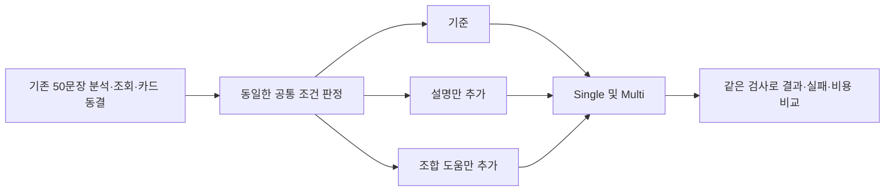

# 판정 기준 통일과 설명·조합 도움 분리 비교

사용자 승인: 직전 제안인 “판단 기준 불일치를 먼저 수정하고, 카드 설명 오해와 어미 결합 문제를 분리 검증”에 대한 **진행해**.

## 현재 완료 범위

- 추천과 적용 검사에서 문법 기능을 해석하는 코드를 공통화했다.
- 금지 표현의 말/VX와 앞 지 구성을 보호하는 범위를 추가했다. 일반 부정문을 모두 명령문으로 허용하지 않는다.
- 전체 50문장 × 두 방식의 저장 응답100개를 고정해 재검증했다. 새 모델 호출은 없었다.
- 168개 검사를 통과했다. 실제 연결 코드에 모의 응답을 주는 Single/Multi × 세 전달 조건 검사도 포함한다.
- 실제 Qwen 비교는 모델 목록 요청의 **HTTP503**으로 아직 시작하지 못했다. `private/preflight_history.jsonl`에 확인 시각·상태만 기록하며 인증정보는 기록하지 않는다.

| 재검증 | Single | Multi |
|---|---:|---:|
| 저장 응답으로 조립 가능 | 50 | 47 |
| 최종 문장이 달라진 입력 | LONG004 1개 | 0개 |
| 편집 판정·사유가 달라진 항목 | 2 | 2 |

3개 기록(DEV020 Single, LONG004 Single/Multi)의 판단이 바뀌었다. LONG004 Single의 저장된 `말이소` 제안이 새 검사에서 반영되지만, 이것을 자연스러움 검증이나 새 Qwen 결과로 보지 않는다. 기존 응답 누락2개와 잘못된 카드 형태 번호1개를 성공으로 바꾸지 않았다.

## 구현과 판단

| 파일 | 역할 |
|---|---|
| `src/kg_runtime/function_semantics.py` | 기능 이름·조건 읽기·확인/불일치/미확인을 공통 처리 |
| `src/kg_runtime/compatibility.py` | 공통 결과로 후보를 대조·안내 |
| `src/kg_runtime/edit_contract.py` | 같은 결과와 위치·조합·보존 검사로 실제 반영 판단 |
| `src/kg_runtime/prohibitive_scope.py` | 말/VX의 종결어미만 바꾸는 범위와 지 동반 편집 보호 |
| `src/kg_runtime/delivery_aids.py` | 설명 도움과 조합 도움을 독립적으로 추가 |
| `src/kg_runtime/card_experiment.py` | 조건을 명시적으로 받아 실제 요청에 연결, 전달량 기록 |
| `tests/test_function_delivery.py` | 반례 및 여섯 조합의 연결 검증 |

`intention_or_purpose`처럼 더 넓은 조건, 미지원 선택지가 섞인 조건은 불일치로 단정하지 않는다. `required/resolved/not_yet_verified`는 구체 문법 기능이 아닌 설계 표기로 구별한다. 이 정리는 문헌 사실을 추가하거나 모든 카드를 실행 허용하는 변경이 아니다.

금지의 경우 원문 말/VX와 EF가 있어야 한다. 어미만 바꾸는 구조와 원래 형태소를 유지한 조합 근거를 확인한다. 앞 지 어절을 다른 편집이 바꾸면 두 편집을 함께 미확인으로 둔다. 조합기가 만든 표면형이나 Kiwi 재분석을 방언 자연스러움의 정답으로 쓰지 않는다.

기존 Reviewer가 두 기능 사전의 누락·차이와 금지 보존 위험을 검토했다. 미지원 대안이 남아 있는데도 미확인 기능으로 차단하던 합성 반례를 지적했고, 우선순위 수정 및 반례 검사를 추가했다. Reviewer는 읽기 전용이며 새 모델 호출을 하지 않았다. 검토 범위와 결과는 `private/reviewer.json`에 기록한다.

## 실험 설계



50 × 3조건 × 2방식 = 300개 처리 결과를 계획한다. 두 도움을 합친 조건은 이번에 없다. 공통 판단 수정 자체의 효과는 저장 응답 재검증으로 구분하고, 실제 모델 비교에서는 모든 조건에 똑같이 적용한다.

- 원문·Kiwi·Qwen 문법 분석·조회 결과·카드 ID/순서/본문·모델 설정·후처리를 고정한다.
- 원본: `20261030T085346443103Z`. 새 요청 ID와 공통 후보 안내는 같은 코드로 다시 계산한다. 카드 재조회·재선별은 하지 않는다.
- 설명 조건은 후보별 말높임과 기능 대조 결과, 설계용 표시의 의미만 추가한다.
- 조합 조건은 원문 형태소·선택 어미·기존 조합기 후보만 추가한다. 플래너에는 어절별 상위3후보 카드×최대3형태, 워커에는 실제 선택된 형태의 도움을 준다. 도움 자료가 없다고 다른 전달 카드를 금지하지 않는다.
- 승인 정답 문장은 실행기나 도움 모듈이 읽지 않는다. 이 50개는 회귀 데이터이며 독립 최종 평가가 아니다.
- 호출별 원본 요청·응답·실패·실제 토큰을 보존한다. 과거 분석 호출 비용은 새 실험에서 제외한다.
- 실제 요청량은 `effective_agent_packet_chars`, `effective_worker_packet_chars`와 요청별 토큰으로 확인한다. 전체 문장 변경 수를 품질 점수로 사용하지 않는다.

## 재현

프로젝트 의존성이 있는 Python으로 저장소 루트에서 실행한다.

```powershell
python experiments/analyses/controlled_delivery_20261031/preflight.py
python experiments/analyses/controlled_delivery_20261031/run.py
python experiments/analyses/controlled_delivery_20261031/run.py --execute
python experiments/analyses/controlled_delivery_20261031/report.py
```

`run.py` 기본 실행은 준비 확인만 한다. `--execute`만 실제 Qwen을 호출한다. 서버 확인 후 매번 새 Run ID를 만들며 과거 실행을 덮어쓰지 않는다. 이번 승인된 비교를 실행할 때 사용하는 명령이며, 다른 목적의 후속 연구를 자동 시작하지 않는다.

`replay.py`는 네트워크 없이 기존 응답을 재검증한다. 원래 요청 ID·계획 ID가 정상인 경우에만 새 계약 ID에 대응시키며, 잘린 응답이나 잘못된 번호를 추측해 고치지 않는다. 이전 재검증 산출물은 `private/replay_revisions/`에 보존한다.

보고서: <http://127.0.0.1:8767/reports/controlled-delivery-20261031/report.html>

## 이전 진단 정정

DEV012 Multi의 `invalid_target_index`는 형태소 위치 오류가 아니라 **GS_ENDRULE_Q_WH_V의 형태가1개인데 form_index=1(두 번째 형태)을 지정한 오류**였다. `morph_index`와 `form_index`를 혼동한 이전 설명을 정정한다. 실행 원본·오류 코드는 변경하지 않았다.

`private/`의 문장·응답·보고서는 Git 제외 자료이며 clone만으로 복원되지 않는다.
