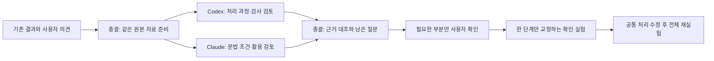

# 2026-10-29 기존 결과 진단

최신 완료 배치 `20261028T011829489985Z`의 Single/Multi 각 50건을 실행 원본에서 다시 분류했다. 새 Qwen 호출, 재실험, KG·생성 파이프라인 수정은 하지 않았다.

## 사용자 후속 답변 반영

2026-10-29 사용자가 ADVCE008A의 입력 교체와 ADVCE008A·ADVCE006A의 선호 대안을 제공했다. [답변 원문·해석 구분 기록](private/human_feedback/20261029_reply01.json)에 보존했다. 대안은 유일한 정답이 아니며, 기존 네 출력의 허용·불허나 점수를 명시적으로 제공한 답변으로 취급하지 않는다. 기존 32개 점수 기록과 별도인 2개 입력에 대한 정성 의견이다.

다음 실험용 입력은 `data/derived_private/standard_inputs_50_20261029_v2/inputs.jsonl`이다. ADVCE008A만 바뀌었고 나머지 49건은 이전 파일의 줄 바이트까지 동일하다. [새 버전 검증](../../../data/derived_private/standard_inputs_50_20261029_v2/validation.json)을 확인할 수 있다.

아래 진단 대장과 대표 검토 자료는 **이전 입력으로 실제 실행했던 결과**를 설명하는 동결 기록이다. 새 입력으로 소급해 바꾸지 않는다. 새 버전 실행 결과와 비교할 때는 ID만이 아니라 입력 문자열·해시도 확인한다. 변경된 ADVCE008A는 문장 분석부터 새로 실행해야 한다. 아직 새 실험은 수행하지 않았다.

## 사람이 읽을 자료와 재현 자료

- [진단 대장](private/casebook.md): 전체 50개 입력·100개 시도의 실제 출력, 실행 실패, 기존 사람 판단, 선택 카드, 초기 검토 메모.
- [집계](private/summary.json), [구조화된 대장](private/cases.json): 자동 계산 가능한 결과. 초기 AI 판단과 사람 평가를 구분한다.
- [검증](private/validation.json), [원본·산출물 해시](private/manifest.json): 입력·출력·평가 연결과 원본 보존 확인.
- [검토 메모 원본](screening_notes.json): 총괄의 초기 해석이다. 독립 검토자의 결론이나 사람 정답이 아니다.
- `private/review_packets/`: 대표 입력 8건의 실제 분석·전달 카드·계획·출력·근거 경로. 총괄의 해석과 사람 점수는 1차 독립 판단용 묶음에서 제외했다. 아직 검토자에게 전달하지 않았다.

문장·실행 원문이 담긴 `private/`는 기존 프로젝트 관례에 따라 Git에 올리지 않는다. 동일 ID의 원문과 과거 출력은 고치지 않는다.

## 초기 결과

| 구분 | Single | Multi |
|---|---:|---:|
| 출력 없음 | 12 | 9 |
| 원문과 동일 | 1 | 1 |
| 변경된 출력 | 37 | 40 |

출력 없는 21개 시도는 17개 입력에 해당한다. 응답 길이 제한 16건, 한 어절 출력 제한 4건, 빈 근거 카드 목록 1건이다. 길이 제한 16건 중 11건에 1,000자 이상의 후행 공백이 관찰됐다. 서버·모델·구조화 디코딩 중 무엇이 원인인지는 이 관찰만으로 확정하지 않는다.

기존 사람 평가 32건을 발견했다. 현재 Single 9건·Multi 11건, 이전 Single 12건이다. 현재 평가 20건 중 12건의 점수는 1~2점이지만, 일부 입력만 평가한 결과이므로 전체 품질·방식별 우열로 확대하지 않는다. 출력이 있는 79건 중 사람 미평가는 59건이다.

Multi DEV026의 `unretrieved_rule_reference`는 실제로 W2의 빈 `rule_ids` 때문에 발생했다. 비어 있지 않은 ID들은 모두 전달 목록 안에 있었다. 기존 보고서의 “전달하지 않은 카드 사용” 설명은 이 대장에서 정정한다. 과거 실행 원본은 변경하지 않았다.

## 앞으로의 보고 방식

| 목적 | 관리 방식 |
|---|---|
| 이번에 무엇을 발견했고 무엇을 결정할지 | 현재 대화에서 핵심 표·대표 사례·판단 요청 |
| 사례별 문제, 근거, 사용자 대안, 수정·재검증 상태 | 같은 입력 ID와 Run ID를 잇는 누적 진단 대장 |
| 입력·모델 응답·수정 계획·카드·설정·버전 | 기존 실행 폴더 원본과 구조화 기록 |
| 추세·필터·단계 추적 | 기존 연구 대시보드 확장 |
| 사람이 여러 사례에 표현·이유를 입력해야 할 때 | 진단용 UI. 자연스러움 성능 비교용 눈가림 평가와 분리 |
| 설계 확정이나 주요 실험 회차 완료 | 그 시점의 요약 HTML. 매 작업마다 같은 설명을 다시 쓰지 않음 |

이번에는 진단 대장과 채팅 질문으로 시작한다. 대량 평가용 HTML을 새로 만들지 않았다. 기존 HTML은 당시의 기록으로 보존하고 현재 집계와 혼동하지 않는다. 기존 자동 현황 생성기의 고정 문구 “사람 평가 없음”은 실제 저장 상태를 반영하지 못하므로 후속 관리 코드 보완 대상으로 남긴다.

## 두 검토자에게 제안하는 첫 작업

총괄은 현재 연구 대화의 Codex다. 다음 역할 배정은 제안 상태이며, 이번 단계에서 실제 독립 검토는 시작하지 않았다.

| 검토자 | 첫 질문 | 제출할 결과 |
|---|---|---|
| Orca Codex | 분석·조회·카드·수정 지시·완성형 중 기록이 처음 불일치하는 곳은 어디인가? 공통 검사에서 무엇이 빠졌는가? | 근거 위치, 재현 가능한 모순, 다른 가능한 원인, 한 단계만 바꾸는 확인 실험 |
| Orca Claude | 선택 카드가 실제 문장의 기능·받침·높임·시제와 맞는가? 완성형과 의미가 적절한가? | 확실한 기능·조건 불일치, 지역 표현상 판단 유보, 사용자에게 물을 최소 질문, 필요한 문헌 범위 |

대표 입력: DEV002(축약), DEV012(카드와 지시), DEV019(활용), DEV020(원문 유지), DEV026(구성·실행 검사), DEV030(공통 분석), ADVCE006A(시제), ADVCE008A(약속·회상).

두 검토자에게 같은 원본 묶음을 먼저 전달한다. 총괄의 가설이나 상대 검토자의 결론을 먼저 보여 주지 않는다. 독립 결과를 모은 다음 기존 사람 의견과 대조하고, 다른 판단이 나온 부분만 반론을 교환한다. 다수결로 문법적 진실을 정하지 않는다.

Orca Codex의 파일 접근 복구는 보류한다. 총괄이 원본 발췌와 ID·경로를 메시지로 전달하고 누락 자료 요청을 처리한다. Claude가 추가 확인한 자료도 두 검토자에게 동일하게 공유한다. 검토자는 연구 소스·KG·기존 실험을 수정하지 않는다.



## 검증 및 재생성

100개 결과의 입력 집합·개별 결과·집계 파일을 대조했다. 기존 사람 평가 20건의 대상 출력이 실제 실행 출력과 같음을 확인했다. 읽은 원본 652개 파일의 해시가 생성 전후 동일하다. 원본을 다시 쓰는 코드는 없다.

```powershell
python tools/build_error_triage.py --output experiments/analyses/error_triage_20261029/private_next
```

이미 결과가 있는 폴더로의 덮어쓰기는 거부한다. 위 명령은 모델을 호출하지 않는다. 사용자 의견이 추가되면 해당 의견의 출처·시각을 별도로 보존한 새 진단 버전을 만든다.
