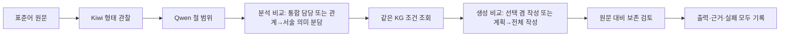

# 50문장 결과에서 무엇을 먼저 고칠까

2026-11-09 · 설계 제안. **연구 코드와 KG를 수정하거나 새 Qwen 실험을 실행한 문서가 아니다.**

## 먼저 알아야 할 결론

현재 문제를 ‘문장 분석이 틀렸다’ 하나로 설명할 수 없다. 분석 때문에 필요한 규칙을 못 찾은 사례도 있고, 올바른 정보를 전달했는데 작성자가 무시한 사례도 있다. 문장은 만들었지만 사용 규칙의 신고가 모순되어 중단된 경우도 있다. 따라서 모든 문제를 분석 워커 추가로 해결하려는 방식은 권하지 않는다.

검토 대상은 11월 9일 전체 50문장 실행이다. 48건은 전체 처리가 끝났고, 2건은 중단됐다. 완료 48건 중 원문과 다른 출력은 39건, 동일한 출력은 9건이다. **이 숫자는 자연스러운 번역의 수가 아니다.** 단어 하나나 문장 부호만 달라져도 ‘변경’으로 집계된다. 반대로 표준어와 방언이 공유하는 표현이 있으므로 원문 유지 자체를 문법 오류로 단정하지 않는다.

## 1. 실제로 어디에서 문제가 생겼나

| 구분 | 실제 사례와 확인한 기록 | 무엇을 뜻하나 |
|---|---|---|
| 분석값 오류 → 조회 실패 | DEV012 ‘뒀어’를 반말이 아닌 formal로 기록. ‘-노’ 규칙의 다른 조건들은 맞지만 높임 조건만 불일치. ‘어디→어데’ 지식은 전달됨 | KG 전체가 없어서가 아니라, 이 규칙을 찾는 입력값이 틀렸다 |
| 분석값 오류 → 잘못된 규칙 전달 | LONG002의 평서 표현 ‘맛있더라’를 질문으로 분석. 질문 규칙 SEM_Q_V_POLAR가 A3로 전달되고 ‘맛있더나’로 출력 | 단순히 필요한 정보를 못 찾는 문제뿐 아니라, 틀린 규칙까지 찾아 전달하는 문제도 있음 |
| 설명성 경고 → 후보 제외 | DEV007·DEV030·LONG004·QUAL005·QUAL020의 후보가 각 1개씩 제외. 전체 후보 발생 63건 중 58건 전달 | 그래프에 지식이 있어도 설명·이의 처리 때문에 전달이 끊김. 이 5개가 모두 사용돼야 맞는다는 뜻은 아님 |
| 관계 정보 누락 → 조회 보류 | 연결어미 앞·뒤 용언 관계 부족으로 9문장의 규칙 후보 12건 보류. EC 연결 단위 59개 중 오른쪽 용언 연결은 25개에만 기록 | 관계 담당을 나눌 이유가 있는 실제 문제. 다만 기록이 없는 34개 모두를 무조건 오류로 세지는 않음 |
| 절 구조 기록 오류 | LONG001에서 앞의 ‘…만나자고 했는데’를 뒤의 ‘왜 아직 안 와?’ 안에 포함된 절로 기록. 실제 범위는 포함되지 않음 | 조회·생성 전에 중단. 생성 모델 실패로 세면 안 됨 |
| 분석과 생성에 문제가 함께 있음 | DEV026 ‘늦을까 봐’를 질문으로 분석. 그런데 ‘나왔어요’의 과거·존댓말은 전달됐는데 출력은 ‘나왔어’ | 앞 구절의 분석 수정과 뒤 구절의 높임 보존은 별도 확인 필요 |
| 정보 전달 후 생성 오류 | QUAL020 ‘들었어요’의 과거, 들+었+어요, 선어말 보존 지시를 전달했지만 ‘들어예’ 출력 | 과거 정보가 없었다는 설명은 맞지 않음. 작성자가 지키지 못함 |
| 지식 지원 공백 + 생성 오류 | DEV011 ‘출발했나요’의 공손함과 과거는 분석됨. 현재 공손 질문 규칙은 ‘나요·ㄹ까요’를 범위에서 제외. 출력 ‘출발했나’는 공손함을 잃음 | 지식 범위 확장도 필요하지만, 규칙이 없다는 이유로 원문의 높임을 버려도 되는 것은 아님 |
| 자기 지식으로 잘못 변경 | DEV002 ‘샀어→샀다’ 지식은 전달했지만 미사용. 대신 규칙에 없는 ‘가는 길→가노 길’ 변경 | 카드 조회를 늘리는 것만으로 해결하기 어려운 생성 오류 |
| 사회적 관계를 임의 변경 | LONG004에서 ‘제가→내가’, ‘마세요→마라’. 작성자가 겸양 보존 지시를 언급하면서도 가족 관계를 추정해 변경 | 지시를 못 본 것과, 보고도 잘못 해석한 것을 구별해야 함 |
| 전달은 됐지만 선택하지 않음 | DEV020 ‘마→마라’ 후보를 전달했지만 ‘마’ 유지 선택. 별도로 금지 구성의 보조 의미는 진행으로 잘못 분석 | 미조회가 아니다. 원문 유지의 문법 허용 여부와 원하는 방언 변환 정도를 분리해 평가해야 함 |
| 여러 단계의 공동 원인 가능 | NEW007 ‘먹고 있을 테니까→먹고 있는 거니까’. 분석의 시간 표시는 현재, 생성자는 자체 지식 변경으로 신고 | 예정·의지의 해석 부족과 생성 변경이 모두 보임. 어느 것이 결정적 원인인지는 비교 필요 |
| 생성 결과와 기록 형식 실패 | ADVCE005B ‘…도와예’ 초안은 있음. A1을 썼다는 결정과 실제 사용 목록이 충돌하여 중단 | 문장을 못 만든 실패와 구분. 초안은 보존하고 형식 합격으로 몰래 올리지 않음 |
| 검토자도 오판 | DEV002의 검토자는 ‘가노’를 과거/완료 변화라고 설명 | 검토 워커의 의견을 그대로 자동 수정 명령이나 정답 판정으로 쓰면 또 틀릴 수 있음 |

이 표는 실제 기록을 대조한 대표 원인이다. 50개 출력 전체를 읽었지만, 모든 문장의 모든 문법 분석을 정답과 대조한 전수 정확도 평가는 아니다. 한 문장에 오류가 여러 개 있을 수 있으므로 표의 행을 더해 오류율을 계산하지 않는다.

## 2. 먼저 고칠 것은 ‘워커 수’가 아니라 전달 규약의 모순이다

**전달 규약**은 각 담당자가 무엇을 받아 무엇을 반환하며, 무엇을 바꿔도 되는지에 관한 약속이다. 다음 문제를 정리한 동일한 약속으로 단일 담당과 분업을 비교해야 한다.

| 우선 점검 | 제안하는 보완 | 하지 않을 일 |
|---|---|---|
| 반말·존댓말, 절 포함, 금지·보조 의미의 질문 정의 | 원문의 근거 구절과 판단 대상을 분명히 한다. 절 포함 관계와 앞뒤 연결을 구분한다 | 모델이 틀린 값을 코드가 문장별 정답으로 덮어쓰기 |
| 분석 경고의 영향 | 실제 어떤 조건·위치가 불확실한지 기록. 설명 경고 하나로 관계없는 지식까지 제외되는지 점검 | 모든 미확정 조건을 참으로 통과시키기 |
| 생성 지시와 실제 담당 불일치 | KG 결합 설명에 남은 ‘Kiwi로 결합’은 실제 Qwen 작성 역할과 맞도록 정리할 후보. 같은 문법 의미는 유지 | 이 문구가 과거 손실의 원인이라고 미리 확정 |
| 긴 분석 내용의 중복 | 원문 전체 + 수정 위치별 필요한 조건 + 지킬 시제·부정·높임·관계 + 실제 KG 지식을 간결하게 전달하는 후보 마련 | 원문 맥락이나 실제 문법 제약을 토큰 절감을 위해 삭제 |
| 사용 기록 중복 | ‘검토했음’과 ‘변환에 사용했음’을 구별. 같은 사용 여부를 두 번 적게 하지 않는 형식을 비교 후보로 검토 | 신고가 맞으면 번역도 정확하다고 간주 |

생성 요청 49건의 사용자 메시지는 중앙값 7,238자, 최소 3,043자, 최대 32,152자였다. 토큰 수가 아닌 문자 수다. QUAL020은 28,058자이며 분석 자료의 비중이 크다. 정보량이 원인이라는 가설은 가능하지만, 길다는 사실만으로 망각이 원인이라고 증명할 수 없다. 짧은 DEV002에서도 오류가 발생했다. 실제 전달된 후보 58건 중 ‘Kiwi로 결합’이라는 과거 담당 설명이 들어간 것은 7건이다. 단순히 Kiwi라는 단어를 포함한 22건과 구별했다.

## 3. 멀티 에이전트는 어디에 사용할까

여기서 에이전트는 서로 다른 사람이 아니라 **같은 Qwen을 역할별로 따로 부르는 것**이다. 역할을 나누면 질문에 집중하기 쉬울 수 있지만, 앞 담당의 잘못을 다음 담당이 믿거나 호출 비용이 늘 수 있다.

### 분석 후보: 관계 담당 + 서술 의미 담당

- **관계 담당:** 어느 말이 어느 명사를 꾸미는지, 본동작과 보조동작이 어떻게 이어지는지, 인용·안긴절의 관계를 정리한다.
- **서술 의미 담당:** 같은 서술 표현의 질문/평서/금지, 시제·양태, 부정, 주체 높임과 상대 높임을 함께 판단한다. 시제 담당과 높임 담당을 따로 쪼개지 않는다.
- 각 담당은 원문 전체와 Kiwi 관찰을 본다. 앞 담당의 판단은 추정이며 정답이 아니다. 서로 같은 항목을 덮어쓰지 않는다.
- 절 범위는 공통 입력으로 먼저 고정한다. 분업 비교 중 절 분석까지 달리하면 무엇이 개선됐는지 알 수 없다.

이 분업은 DEV012 같은 조건값 오류나 본/보조 연결 오류에 도움이 될 가능성이 있다. QUAL020처럼 올바른 과거가 도착했는데 생성자가 버리는 문제를 분석 분업만으로 해결한다고 기대하지 않는다.

### 생성 후보: 짧은 계획 + 문장 전체 작성 + 보존 검토

- **계획 담당:** 실제 받은 KG 후보 중 어떤 위치에 무엇을 적용할지와 지킬 정보를 짧게 작성. 출처 설명을 반복하지 않고 규칙 ID로 추적한다.
- **작성 담당:** 계획과 원문 전체를 보고 Qwen이 최종 문장 전체를 만든다. 단어마다 다른 워커가 번역한 조각을 코드로 이어 붙이지 않는다.
- **검토 담당:** 원문과 출력의 구절을 나란히 들어 과거·부정·높임·내용 손실을 지적한다. 근거 없는 ‘자연스럽지 않다’만으로 재작성을 시키지 않는다.

현재도 작성 뒤 별도 검토 호출은 있다. **검토자 한 명을 추가하는 것 자체가 새 해결책은 아니다.** 검토의 근거 정확성과 지적이 수정으로 이어지는 절차를 따로 검증해야 한다. 초기 비교에서는 자동 재작성 없이 진단만 하고, 근거 정확성이 확인된 뒤 최대 1회 수정 후보를 별도 실험으로 둔다. 무한 반복은 하지 않는다.

| 경로 | 분석 Qwen 호출 | 계획·작성·검토 호출 | 정상 1문장 총 호출 |
|---|---:|---:|---:|
| 현재 | 절 1 + 의미·관계 1 | 작성 1 + 검토 1 | 4 |
| 분석만 분업 | 절 1 + 관계 1 + 서술 의미 1 | 작성 1 + 검토 1 | 5 |
| 생성만 분업 | 현재 분석 2 | 계획 1 + 작성 1 + 검토 1 | 5 |
| 둘 다 채택 시 | 분석 3 | 계획 1 + 작성 1 + 검토 1 | 6 |

Kiwi와 코드 검사는 모델 호출 수에 포함하지 않았다. 실제 비용·시간은 호출 수만으로 예측하지 않고 측정한다. 실패·추가 진단 호출도 별도 합산한다. 둘 다 분업한 경로부터 한 번에 도입하지 않는다.

## 4. 승인 후 진행할 묶음과 끝나는 기준

| 순서 | 실제 작업 | 산출물·종료 기준 | 기대와 다르면 |
|---|---|---|---|
| 1. 공통 약속 정리 | 질문 정의, 경고 차단 범위, 전달 문구, 사용 기록을 실제 코드와 대조. 변경 전후를 기록하고 최소 수정 후보 작성 | 바뀌는 항목·그대로 두는 항목·재현 사례표. 저장 기록만으로 오류가 재현되는지 확인 | 언어학적 판단이 필요한 항목은 사람 확인으로 남김. 임의 허용/금지 추가 안 함 |
| 2. 분석 방식 비교 | 질문을 정리한 통합 담당과 관계/서술 의미 분담 비교. 원문·Kiwi·절 범위·KG 조건·생성 방식 고정 | 위치별 분석과 조회 경로, 미확정/차단/실패, 호출·비용 비교. 50건과 다른 새 개발 문장에서도 반복 오류가 줄어드는지 확인 | 분업 이익이 없으면 통합 담당 유지. 같은 프롬프트 변형 반복 중단 |
| 3. 생성 방식 비교 | 같은 분석·같은 KG 후보를 고정. 기존 전달 대 간결한 전달 먼저 비교. 그다음 같은 간결한 입력에서 계획 분담 유무 비교 | 원문·전달 정보·선택 계획·최종 출력·보존 오류 표. ‘전달 축약 효과’와 ‘분업 효과’를 따로 기록 | 전달해도 계속 틀리면 모델의 역할 수행 한계나 다른 모델 비교를 검토. 카드 확대만 반복하지 않음 |
| 4. 전체 연결 재검사 | 개선 근거가 있는 조합만 연결하여 기존 50건 재실행 | 분야별 개선/악화/미지원과 시간·비용. 기존 잘되던 사례도 함께 확인 | 악화하면 후보 버전을 보존하고 이전 기준으로 복귀. 무조건 최신 채택 안 함 |

새 개발 문장은 아직 만든 것이 아니다. 다음 실행 전 질문·평서·금지/요청·보조/절 연결과 과거·높임의 조합을 포함한 목록과 확인 항목을 고정한다. 사용자 승인 참조 문장을 생성 요청이나 답안 규칙으로 넣지 않는다. 자연스러움은 모델 자기 평가로 확정하지 않으며 최종 사람 평가와 구별한다.

실험 종료는 ‘원하는 번역이 나올 때까지’가 아니다. 사전에 고정한 조건과 문장을 모두 실행하고, 오류·새 부작용·비용을 짝지어 비교하면 끝낸다. 같은 실패가 유지되면 다음 조건으로 무한히 늘리지 않고 남은 가설과 역할 변경 필요를 보고한다. 우열이 불명확하면 운영 기준을 바꾸지 않는다.

미지원 문법 확장을 잊은 것은 아니다. 공손 질문의 다른 형태, 약속의 높임별 실현, 예정·의지 구성은 별도 지식 확장 목록에 남긴다. 다만 이번 비교에서 KG까지 동시에 확대하면 분석·전달·분업 중 무엇이 달라서 좋아졌는지 알 수 없으므로, 고정된 KG로 원인을 구분한 다음 버전을 나누어 확장한다.

## 5. 검토자 결과와 실제 근거

기존 Orca의 Claude와 Codex가 실제 검토서를 작성했다. 두 모델 모두 50개 출력 전체를 훑고, Claude는 16개, Codex는 13개 사례의 관련 원시 기록을 심층 대조했다고 보고했다. 전체 집계 검사와 모든 문법의 정확도 평가는 다르다. 이 검토도 사람 평가를 대신하지 않는다.

| 검토자 | 핵심 의견 | 리드 판단 |
|---|---|---|
| Claude: 문법·지식 | 높임 하락, 문장별 기능 복사, 연결어미 관계 누락을 우선. 분석 분업보다 먼저 질문을 정리하고 생성에 보존 정보를 간결하게 전달 | 채택. LONG002에서 질문 오분류→질문 규칙→출력 변화 경로를 리드도 확인. 작성자에 이미 도착한 과거·높임을 버리는 문제는 별도 생성 비교로 분리 |
| Codex: 코드·통제 | 설명 경고로 후보 5개 제외. 전달 역할 문구와 사용 신고 중복 점검. 같은 조건에서 질문 정리 단일군과 분업군 비교 | 채택. 리드 코드로 63→58 후보, 5문장의 제외 경로, 49개 생성 요청과 선택 지식 일치를 재확인 |
| 두 검토자 공통 | 워커 추가만으로 해결된다고 볼 수 없음. 현재 검토 모델은 오탐·누락이 있어 자동 재작성 근거로 바로 쓰면 안 됨 | 채택. 근거 구절과 판정의 정확성을 먼저 검사하고, 분업 비교 전후를 분리 |

**그대로 채택하지 않은 제안도 있다.**

- Claude의 ‘허용값을 모두 열어둔 조건은 unknown이어도 통과’ 제안은 전역 적용하지 않는다. 실제 적용 결과가 그 특징과 무관한지 규칙별로 먼저 확인한다. DEV028은 높임 빈칸뿐 아니라 평서를 질문으로 읽은 문제도 있어, 빈칸만 통과시키면 잘못된 질문 지식이 전달될 수 있다.
- 문장 경계를 코드로 묶는 것은 입력을 담는 상자로는 쓸 수 있다. 그러나 문장 전체를 언어학적 주절이라고 자동 확정하지 않는다. 절의 포함과 앞뒤 연결을 명확히 구별하는 설계가 먼저다.
- 관형·연결 자리의 모든 의미를 ‘해당 없음’으로 지우지 않는다. 상대높임을 직접 정하는 자리가 아닌 경우와, 그 절의 시간·주체높임·인용 정보를 보존해야 하는 경우를 구분한다.
- 원문에 ‘요·었·저/제’ 같은 표지가 있는지 코드는 확인할 수 있다. 그것만으로 출력의 의미·높임이 완전히 보존됐다고 판정할 수는 없다. 축약·다른 표현·인용 범위를 고려할 필요가 있어 진단 신호로만 사용한다.
- ‘반말 금지는 방언 고유형이 없으므로 실패’라고 단정하지 않는다. 표준어와 공유하는 형태도 정상적인 방언 문장에 쓰일 수 있다. DEV020의 원문 유지는 허용된 선택이다. 새로운 방언형 확보는 별도의 범위 확장 문제다.

검토자 수치도 리드가 다시 집계했다. ‘Kiwi 언급 22건’과 ‘Kiwi로 결합 7건’을 구별하도록 정정을 요청했다. 분석 부분을 재직렬화한 문자 수를 전체 원시 문자열 길이로 나눈 비율도 채택하지 않았다. 검토자 의견을 그대로 복사해 결론으로 쓰지 않았다.

독립 원문: [Claude 검토서](private/claude_review.md), [Codex 검토서](private/codex_review.md). 요청문은 [review_packet.md](review_packet.md), 재집계는 [audit_saved_records.py](audit_saved_records.py)와 `private/saved_record_audit.json`.

근거 경로:

- 실행: `experiments/runs/20261109T030211818725Z_kiwi_default_regression`.
- 각 사례: `private/records/<ID>_kiwi_focused/meaning/parsed.json`, `bound_analysis.json`, `retrieval.json`, `selected_knowledge.json`, `writer/request.json`, `writer/parsed.json`.
- 절 범위: `private/shared/LONG001/scope/parsed.json`.
- 사용 신고 검사: `src/kg_pipeline/multi_agent.py`의 `check_writer`. 실제 실행 당시 사본은 run의 `code_snapshot`에 보관.
- 기존 50건 보고·검증: `../kiwi_focused_full50_20261109/README.md` 및 `private/verification.json`.
- 이번 요청 크기 측정: `private/writer_payload_sizes.json`.

## 지금 사용자에게 필요한 결정

지금은 설계 검토 단계이며 추가 정답 50개를 다시 작성할 필요가 없다. 다음 구현에서는 **공통 약속 정리 → 분석 분업과 생성 분업을 각각 통제 비교**하는 순서를 권한다. 실제 구조 변경과 새 실험은 이 설계안 검토 후 진행한다.
