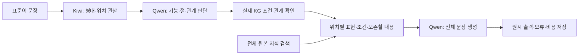

# 9개 문법 분야를 연결한 통합 구현 — 2026-11-06

## 전체 그림

이전에는 문장 끝의 일부 어미에 조건 조회가 집중돼 있었다. 이번에는 **명사, 조사, 연결어미, 서술어, 본용언·보조용언 구성**을 각각 입력 위치로 만들고, 해당 위치의 문법 기능을 Qwen이 판단하도록 연결했다. 조건을 충족하는 KG 지식과 실제 입력 형태를 전달하면 Qwen이 문장 전체를 생성한다. 코드는 Qwen의 문장을 대신 작성하거나 고치지 않는다.

이는 새로운 통합 **후보 구현**이다. 26개 정제 묶음 전체가 끝났거나, 자연스러운 번역이 보장된 운영 버전이라는 뜻은 아니다. 원본 KG와 과거 실행은 보존했다. 현재 시험은 그래프 파일을 읽는 방식이며 Neo4j DB는 교체하지 않았다.



## 무엇을 보존하고 무엇을 추가했나

| 대상 | 실제 수량 | 해석 |
|---|---:|---|
| 원본 KG | 1,625노드 / 6,167관계 | 설계·문헌·출처 자료 전체. 모든 노드가 실행 규칙은 아님 |
| 통합 후보 r2 | 2,320노드 / 7,476관계 | 원본 + 이전 실행 지식 + 새 조건·용법·근거 |
| 조건 조회 용법 | 기존12 + 새44 = 56개 | 56개를 순차적으로 전부 통과하는 방식이 아님 |
| 새44 용법 | 표현후보41 / 의미보존2 / 잘못된 적용 주의1 | 모두 방언 고유 표현이거나 현대 화자 검증을 받은 것은 아님 |
| 원본 문헌 항목 | 721개 검색 가능 | 아직 정제되지 않은 항목의 조회와 적용 허가는 별개 |
| 설계항목·작업묶음 | 911개 / 26묶음 | 새 용법을 연결한 설계항목98개. 항목 전체 완료 수는 아님 |
| 발췌 연결 검사 | 114개, 중복 포함 | 해당 문헌·쪽에 발췌 문자열 존재 확인. 해석 타당성은 별도 검토 |

`r2`는 이번 작업의 두 번째 통합 후보라는 뜻이다. 첫 연결 시험(r1) 이후, 본용언·보조용언의 범위와 실제 어미 형태 조건을 수정한 버전이다. 같은 날 실행한 시험도 버전이 다르면 동일 조건의 대조 실험으로 합치지 않는다.

원본7종의 추출 자료와 기존 지식 목록을 재사용하고 새 용법의 인용 위치를 대조했다. **이번 작업에서 7종 전체의 모든 문장을 다시 의미 정독·정제했다고 주장하지 않는다.** 26묶음은 모두 작업대장에 있으며, 세부 용법과 출처 해석의 미완료 상태를 그대로 남겼다.

## 선택 이유와 한계

- 규칙마다 Python 함수를 만드는 대신, KG의 구성→용법→조건→허용값 관계를 일반 조회기가 읽는다. 새 용법의 조건은 데이터로 추가한다.
- Kiwi의 관찰 형태와 Qwen의 뜻 판단을 분리한다. 예를 들어 `었`이 관찰됐다는 사실과 그 문장의 시간 해석은 서로 다른 값이다.
- 모델의 관계값은 실제 단위 ID와 종류에 맞는지 검사한다. 없는 참여자나 잘못된 대상 연결은 사용하지 않고 기록한다.
- 모델이 모른다고 답한 값은 보류로 남는다. 보류 원인이 분석 부족인지 KG 범위 부족인지 따로 확인한다.
- 원본721항목 검색은 문자열 기반의 참고 검색이다. 정제된56용법의 조건 조회와 같은 방법도, 그래프 효과의 증거도 아니다. 한 글자 어미·조사로 무관 자료가 붙는 문제가 실제 개발 기록에서 확인됐다.
- 사동은 일부 어휘 용법, 피동은 의미 보존 수준이다. 9개 분야를 대상으로 했다는 이유로 각 분야의 문법을 완성했다고 말하지 않는다.

## 실제 산출물

| 파일 | 역할 |
|---|---|
| `src/kg_pipeline/integrated.py` | 통합 그래프, 입력 위치, 분석 형식, 조건 조회, 생성 전달 |
| `tools/run_integrated_grammar.py` | 분석→조회→Qwen 생성 실행, 기록·예산·중단 관리 |
| `build_graph.py` | 원본과 정제 후보를 통합하고 발췌·참조 무결성 확인 |
| `coverage_r2.json` | 26묶음별 새 연결·보류·미완료 현황 |
| `statistics_r2.json` | 실제 그래프 규모와 유형 집계 |
| `private/legacy_item_ledger_r2.json` | 기존911항목의 연결 상태 |
| `private/results_audit.json` | 원시 출력 일치·전달량·사용 규칙·실행 해시 재집계 |
| `private/{claude,codex}/` | 검토 지시문, 전송 기록, 독립 검토 결과 |
| `private/report.html` | 쉬운 설명, 범위표, 입력별 원문·참고·실제 출력·전달 지식 |

비공개 파일에는 문헌 파생 내용과 실행 기록이 있다. Git 커밋 대상과 로컬 보존 대상을 구분한다.

## 실행·확인

```powershell
python -B -X utf8 tools/run_integrated_grammar.py --execute --graph knowledge/authored/semantic_grammar_20261106_integrated_r2/private/graph.json --inputs data/derived_private/standard_inputs_50_20261029_v2/inputs.jsonl --phase regression --deadline <시간대가_포함된_미래시각> --max-calls 100
python -B -X utf8 experiments/analyses/integrated_grammar_20261106/audit_results.py
python -B -X utf8 experiments/analyses/integrated_grammar_20261106/render_report.py
```

새 실행은 기존 관리기에 등록된다. 실제 실행은 새 Run ID에 입력·KG·코드 사본·요청·응답·토큰을 남긴다. 200회 누적 상한은 이번 통합 작업에 적용되며, 이 한도를 넘기려면 별도의 연구 범위를 정해야 한다. 같은 요청의 자동 재시도는 없다.

브라우저: <http://127.0.0.1:8767/reports/integrated-grammar-20261106/report.html>

## 논문에서 주장할 수 있는 범위

이번 것은 문법 범위 확장과 전체 연결의 개발 검증이다. 기존50은 이미 개선에 사용한 회귀 자료이고, 새30도 개발 자료다. 문자열 변경 수, 적격 규칙 수, 자동 경고 감소를 자연스러움·정확도로 쓰지 않는다. 그래프 구조가 일반 검색보다 유리한지 판단하려면 같은 원천 지식·생성 모델·예산을 고정한 비교와 독립 평가가 남아 있다.
