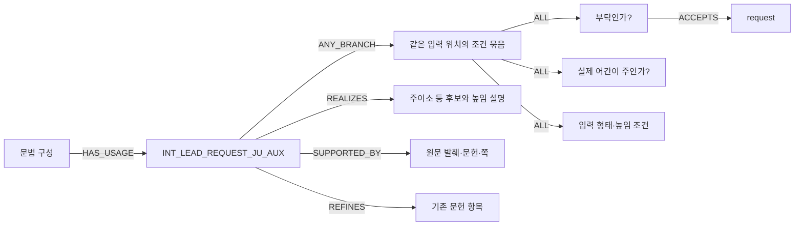

# 실제 그래프와 입력 분석의 연결

## 무엇이 노드이고 무엇이 관계인가

노드는 정보를 담은 상자이고, 관계는 상자 사이의 연결이다. 이번에는 기존 문헌·설계 노드를 그대로 보존하고 아래 실행용 지식을 추가했다. 용법 하나가 Python 함수 하나에 대응하는 구조가 아니다.

| 노드 유형 | 내용 | 실제 연결 |
|---|---|---|
| Module | 기존12 문법 분야의 이름·ID | 용법 → IN_MODULE → 모듈 |
| GrammarConstruction | 관련 용법을 묶는 구성. 새 항목은 작업묶음과 입력 단위 종류로 묶음 | 구성 → HAS_USAGE → 용법 |
| SemanticRule | 지시문, 보존할 의미, 입력 종류, 필요한 입력 관계, 출처 해석 상태, 한계 | 용법 → ANY_BRANCH → 적용 조건 묶음 |
| ApplicabilityBranch | 같은 입력 위치에서 함께 맞아야 할 조건들의 묶음 | 묶음 → ALL → 조건 |
| Condition | 확인할 특징, 허용값, 연산자 `in` | 조건 → ACCEPTS → 허용값 |
| FeatureValue | 실제로 허용되는 특징값 하나 | 예: speech_act=prohibition |
| Realization | 선택할 형태, 결합 설명, 보존할 내용 | 용법 → REALIZES → 실현형 |
| Evidence | 문헌ID, PDF쪽, 발췌, 쪽 텍스트 해시, 자료 계통 | 용법 → SUPPORTED_BY → 근거 |
| 기존 SourceAtom·AnalysisConcept 등 | 원래 문헌·설계 정보 | 새 용법 → REFINES → 기존 항목 |

새 `GrammarConstruction`의 이름이 작업묶음 ID인 경우가 있다. 이것만으로 모든 통사 구조를 표현한 것은 아니다. 구체적인 본/보조 연결은 아래 입력 분석 관계로 확인한다. 자연스러운 조합 가능성 전체를 증명하는 그래프는 아직 아니다.

## 실제 조회 예

위 그림은 읽기 위한 일부 관계만 보여 준다. 정확한 모든 조건은 비공개 `refined_knowledge.json`과 `graph.json`에 있다. 보고서의 ‘새 지식44개’에서 실제 조건·형태·근거를 볼 수 있다.

## 문장마다 새로 만들어지는 분석값

입력마다 `unit_id`를 만든다. 명사, 조사, 연결어미, 서술어, 보조구성이 서로 다른 단위다. 각 단위에 원문의 위치와 형태소가 붙는다. 이는 영구 문법 규칙 노드와 다르며 실행 기록에 저장된다.

| 값 | 작성 주체 | 사용 방법 |
|---|---|---|
| 표면 위치·형태소·어간·어미·관찰된 과거 형태 | Kiwi와 관찰 코드 | 어떤 부분을 분석했는지 고정 |
| 문장 기능·뜻·높임·절 구분 | Qwen | 해당 용법의 조건값과 대조 |
| 명사와 조사, 앞뒤 절, 본용언과 보조용언 관계 | Qwen 제안 후 코드 구조 검사 | 실제 제공된 단위인지, 연결 가능한 종류인지 확인 |
| 조건 판정 | 일반 조회 코드 | 맞음 / 불일치 / 모름을 모두 기록 |
| 최종 문장 | Qwen | 원시 응답을 그대로 저장 |

`required_relations`는 용법 노드에 저장한 필요한 **입력 관계 이름**이다. 영구 KG에 입력 문장마다 새 관계를 적재하는 방식은 아니다. 관계의 대상 ID와 구조를 검사해도 Qwen의 의미 해석이 옳다는 보장은 없다.

## 기록 위치

실행의 `private/records/<문장ID>/`에 다음을 남긴다.

1. `morphology.json`, `units.json`: 위치와 형태 관찰.
2. `analysis/request.json`, `analysis/response.json`, `analysis/parsed.json`: 실제 분석 요청·응답.
3. `bound_analysis.json`: 관찰과 모델 판단을 연결한 값, 거부한 관계와 이유.
4. `retrieval.json`: 실제 규칙ID, 조건의 참/거짓/모름, KG 관계ID, 전체 관련 자료 검색 결과.
5. `generation_packet.json`: 모델에 실제 전달한 내용과 제외 이유.
6. `generation/request.json`, `generation/response.json`: 실제 생성 요청·응답.
7. `result.json`: 최종 원시 출력, 실패 단계, 자동 관찰 경고. 정답 점수가 아니다.

조회 경로가 있다는 것, 생성 요청에 들어갔다는 것, 모델이 사용했다고 말한 것, 실제 출력에 올바르게 적용됐다는 것은 네 가지 서로 다른 사실이다.
