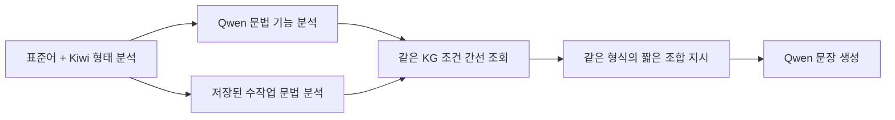

# 질문 KG 분석·조회·생성 연결 실험

2026-11-03. **연결 코드는 실행했지만 자동 분석 경로의 생성은 성공하지 못했다.**

## 무엇을 비교했나

같은 질문 16개 ID(서로 다른 원문 15개)에 두 경로를 적용했다.

KG는 `semantic_questions_20261102_r3`의 동결 JSON 그래프다. 실제 조건 간선을 조회했으며 실시간 Neo4j 적재·조회 실험은 아니다. 넓은 모듈의 카드 전체를 전달하지 않았다. 모델에는 사용자 수용 문장이나 대안을 주지 않았다.

## 결과

| 항목 | 수작업 분석 경로 | Qwen 분석 경로 |
|---|---:|---:|
| 입력 사례 | 16 | 16 |
| 실제 생성 호출 | 13 | 0 |
| 조회 조건 때문에 보류 | 3 | 15 |
| 분석 응답 잘림 | 해당 없음 | 1 |
| 기존 사용자 수용 표현과 정확히 일치 | 생성 13개 중 10개 | 비교 불가 |

완료된 Qwen 분석 15개가 모두 `speech_act=request`를 반환했다. 대부분은 정보 질문을 기술하면서 요청·재촉의 분류값을 넣었다. 현재 KG의 정보 질문 조건과 맞지 않아 생성 전에 멈췄다. Q15의 재촉 해석은 적절하므로 15건 전부를 같은 의미 오류로 세지 않는다. 또한 5개 분석은 Kiwi가 보여준 과거 선어말 형태를 `none`으로 기록했다.

수작업 분석으로 생성한 결과에서도 Q04는 과거형을 누락했고, Q06은 선택된 어미를 누락했으며, Q08은 선택된 명사·어미 결합 지시와 달랐다. 분석만 고쳐도 모든 문제가 해결된다는 결론은 성립하지 않는다.

저장된 분석의 발화 기능과 선어말 값만 바꾸고 **조회만** 재현한 일반 질문 12건은 준비 가능 0→8→12건이었다. 이는 병목 위치의 근거이며 개선된 생성 성능은 아니다.

## 재현과 파일

- Run ID: `20261103T005600868935Z_question_paired_development`
- 상세 결과: [쉽게 읽는 보고서](private/report.html), [진단 원본](private/audit.json)
- 호출·응답·분석·조회·전달·코드 동결본: [실행 폴더](../../runs/20261103T005600868935Z_question_paired_development/)
- `contracts.py`: 분석·생성 프롬프트와 응답 형식
- `adapter.py`: Kiwi 위치·형태 연결, 조건 조회, 짧은 생성 지시, 출력 경고
- `run.py`: 두 경로 실행, 기록, 관리 시스템 등록
- `test_adapter.py`: 형태 대응과 전달·조회 연결 검사 9개
- `analyze.py`: 저장된 결과의 집계·조회 재현·HTML 생성. 모델 호출 없음
- `verify_artifacts.py`: 산출물 해시, 집계 분모, 보고서·요청 연결 검사. 모델 호출 없음

본실험 호출 29회(분석16+생성13), 연결 시험 분석 1회, 총 30회. 연결 시험에서는 조회 보류로 생성 요청을 보내지 않았다. 총 19,480토큰, 본실험 18,852토큰. 기록 경과 약 81.8초는 연결 시험·Kiwi·본실험이며 코드 작성 시간은 제외한다. 자동 재시도는 없었다.

기존 공통 집계 `valid_output_records=31`은 출력 없는 보류 기록도 포함한다. **실제 생성 문장은 13개**다. 동결 실행 원본은 그대로 두고 진단 보고서에서 이를 명시했다. 기존 대시보드의 해당 집계는 번역 수·성공률로 사용하면 안 된다.

## 해석 범위와 다음 작업

16개는 개발 사례다. Q13은 문맥에 따른 두 해석, Q15는 현재 범위 밖의 재촉, Q16은 Q05와 같은 문장의 누락값 검사다. 수작업 해석을 유일한 정답 분석으로 주장하지 않는다. 10개 표현 일치는 독립 평가 정확도가 아니다. Q15 부정값은 새 실행 사본에서만 바로잡고 기존 원본은 보존했다.

다음 제안은 ① Kiwi가 관찰한 형태 정보를 분석 과정에서 잃지 않도록 분담 수정, ② 정보 질문과 행동 요청을 명확히 구분하는 분석 전용 비교, ③ 동일 지식에서 조합 지시를 비교하는 생성 전용 시험이다. 이번 결과만으로 카드 내용 또는 전달 형식 하나가 유일한 원인이라고 확정하지 않는다. 후속 실험은 아직 실행하지 않았다.

보고서는 데이터·링크 구조를 검사한다. 실제 브라우저 렌더 검수는 수행하지 않았다.
