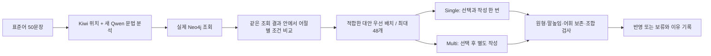

# 말높임·연결어미 보완과 실제 Qwen 재실험

사용자 승인: “1,2번 작업 진행하고, qwen 실험까지 같이 진행해서 보고해”.

## 전체 흐름



문헌 카드와 KG 자체를 새로 작성한 실험이 아니다. 기존 카드 721개(v3)와 실제 조회 결과를 사용한다. 원문에 맞는 카드를 우선 전달하고, 적용할 때도 같은 조건을 확인한다. 특정 단계를 검사했다고 자연스러운 방언이 보장되는 것은 아니다.

## 바꾼 부분과 근거

| 문제 | 구현 | 범위와 한계 |
|---|---|---|
| 공손한 원문에 반말 종결 카드 | 실제 종결형과 기존 카드 화계 대조, 같은 조회 결과 안에서 대안 후보 탐색 | 일부 화계의 넓은 대응만 운영 정책으로 정의. 불분명한 화계는 미확인 |
| `-는데`에 `-지만`용 카드 | 명시적 원형→변환형 및 `source_endings`를 실제 어미와 비교 | 같은 의미 범주라고 원형을 같게 취급하지 않음 |
| 선별과 모델 안내 불일치 | 공통 후보 자격 함수 공유 | 추천 후보도 다른 조건과 조합 검사를 거침 |
| 명백한 모음 미축약·조건형 매개모음 소실 | 제한된 공통 조합 처리와 변경 기록 | 전체 방언 활용기 아님 |
| 파생접사 누락 | XSV/XSA도 보존 검사 | Kiwi 재분석으로 방언의 정확성을 인증하지 않음 |

48개 상한은 유지했다. 어절별 후보를 돌아가며 먼저 배치한 다음 기존 순위의 카드로 채운다. 맞지 않는 카드가 참고용으로 포함될 수 있지만, 적용 조건까지 면제되는 것은 아니다. 48이 최적이라는 결론은 내리지 않는다.

## 실행과 비교

- 새 batch: `20261030T085346443103Z`
- 새 Single: `20261030T085346443103Z_cards_single_regression`
- 새 Multi: `20261030T085346443103Z_cards_multi_regression`
- 이전 실제 기준: `20261030T062819598143Z_scoped_cards_{single,multi}_regression`
- 입력: `data/derived_private/standard_inputs_50_20261029_v2/inputs.jsonl`
- 카드: `kg_cards_20261030_v3`
- 실제 모델: `Qwen3.8-27B`, temperature 0, top_p 1, seed 20261028, 2개 병렬 작업, 자동 재시도 없음.
- 이번에는 50개 분석과 KG 조회부터 새로 실행. 이전 실제 기준은 분석을 재사용했다. 따라서 여러 변경의 합친 결과 비교이며 두 수정의 단독 인과 효과나 KG 자체의 효과를 증명하지 않는다.
- 승인 표현은 Qwen 요청에 넣지 않는다. 보고서 비교에만 사용한다. 다만 이 50건은 이미 개선에 노출된 회귀 테스트셋이다.
- 사전 별도 3문장 점검 batch `20261030T084515269068Z`는 최종 추가 수정 전 코드로 실행했다. 본 실험과 분리 보존한다.

실행 원본은 `experiments/runs/<run_id>/`에 입력별 요청·응답·실패·분석·조회·선별·계획·코드 사본·해시를 보존한다. 모델 인증정보는 포함하지 않는다.

주의: 기존 실행 준비 함수가 설정에 남긴 `content_projection` 설명은 이번 후보 재선별을 충분히 설명하지 못한다. 원본 설정을 사후 수정하지 않고 각 실행의 `private/config_clarification.json`에 정정 설명을 함께 보존했다. 카드 ID와 형태의 집합은 유지되지만 전달 목록과 순서는 바뀔 수 있다.

## 파일과 재현

실행 완료 결과:

| 방식 | 이전 변경/유지/무출력 | 이번 변경/유지/무출력 |
|---|---|---|
| Single | 30 / 15 / 5 | 30 / 20 / 0 |
| Multi | 31 / 14 / 5 | 31 / 16 / 3 |

본 실행은 191호출·1,219,004토큰·19.46분이었다. 155개 프로그램 검사를 통과했고 실제 100개 기록·97개 완성 출력의 조합과 해시를 확인했다. 자연스러움 점수는 계산하지 않았다. 무출력 감소가 성공적인 방언 변환 증가를 뜻하지 않으며 변경 수는 이전과 같다.

원형·말높임 검사로 잘못된 적용 일부를 차단했지만, 모델의 화계 오해와 자모 결합 실패, 부자연스러운 조합이 남았다. 결과 검토 중 금지 명령에 대한 추천/적용 기능 사전 불일치도 확인했다. 이번 실행 코드에서 해결된 것으로 표시하지 않는다. Reviewer는 실제 5문장×두 방식만 독립 대조했으며 전체 자연스러움 검증은 아니다.

| 파일 | 역할 |
|---|---|
| `report.py` | 실제 이전/이번 기록을 읽어 통계와 50문장 비교 HTML 작성 |
| `verify.py` | 카드 출처·입력 짝·조합 출력·해시·웹 공개 범위 검증 |
| `progress.py` | 저장된 완료 기록 수를 작업 화면에 반영 |
| `private/protocol.json` | 사전에 정한 실행 범위 |
| `private/tests_preexperiment.json` | 본 실험 직전 155개 검사 결과 |
| `private/reviewer.json` | 코드 검토 2개 지적과 수정 확인, 검토 한계 |
| `private/summary.json` | 실제 실행 통계. 자연스러움 점수는 없음 |
| `private/cases.json` | 50개 입력의 두 방식 이전/이번 상세 대조 |
| `private/interpretation.json` | 총괄 해석·남은 문제·다음 제안 |
| `private/verification.json` | 산출물 검증 결과 |

보고서와 검증을 재생성하려면 저장소 루트에서 프로젝트 의존성이 있는 Python으로 실행한다.

```powershell
python experiments/analyses/register_connective_20261030/report.py
python experiments/analyses/register_connective_20261030/verify.py --http
```

실제 모델 재실행은 별도 Run ID가 만들어진다. 보고서 재생성은 모델을 호출하지 않는다. `private/`는 Git 제외 자료이므로 clone만으로 실험 원본이 복원되지 않는다.

보고서: <http://127.0.0.1:8767/reports/register-connective-20261030/report.html>
