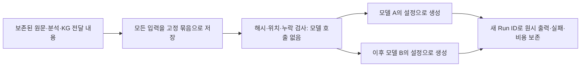

# 문법 범위와 모델 교체 준비 — 2026-11-06

> 후속 사용자 지시로 확장 목표가 9개 분야 통합 작업으로 넓어졌습니다. 아래 요청문 한 묶음 계획은 당시 준비 기록입니다. 최신 범위는 [전체 현황·통합 확장](../coverage_scope_20261106/README.md)을 따릅니다. 모델 비교 실행기 구현 기록은 유지합니다.

## 무엇을 준비했나

**문법 범위 결정은 [SCOPE.md](SCOPE.md)에 있다.** 기존 범위를 유지하면서 다음 확장 대상으로 긍정 보조용언 ‘-아/어 주세요’ 요청을 선정했다. 이 새 규칙의 KG 반영과 생성 실험은 아직 하지 않았다.

같은 문장을 분석하고 같은 지식을 골랐는데 생성 모델만 바뀌면 결과가 달라지는지 확인하기 위한 실행기다. 과거 실험의 요청을 그대로 보관하고, 모델을 하나씩 올려 같은 내용을 전달한다. 새 문법 지식의 효과나 검색 방식의 우월성을 시험한 결과는 아니다.



현재 가져오기 기능은 기존 쉬운30 파일럿의 N/T/J 요청 형식만 지원한다. 새 데이터나 새 KG 결과를 임의로 이 형식에 끼워 넣지 않는다. 준비한 J 묶음에는 과거 전달 결함과 미지원 입력도 그대로 있다. 이는 생성 모델 비교용 **개발 진단 자료**이며 최종 평가셋도, 확장된 새 KG도 아니다.

## 재사용·변경한 부분

|파일|역할|
|---|---|
|`src/kg_pipeline/io.py`|기존 요청 생성을 메서드로 분리. 과거 Qwen 요청 값은 유지|
|`src/kg_pipeline/model_comparison.py`|자료 동결, 무호출 준비 검사, 모델별 요청, 순차 생성·기록|
|`tools/run_model_comparison.py`|터미널 진입점|
|`experiments/templates/model_profile.example.json`|인증키 없이 모델명·환경변수 이름·요청 옵션·한도 지정|
|`tests/test_model_comparison.py`|누락·변조·잘못된 위치·모델 보류·비용 결측·만료·모의 실행 검사|

분석을 다시 호출하지 않는다. 기존 분석 모델에 조건부인 **생성기 비교**이며 전체 시스템 모델 순위가 아니다. 같은 숫자의 seed도 다른 모델 사이에서 같은 난수를 뜻하지 않는다. 최종 문장을 코드로 수정하지 않는다.

## 실행 방법

프로젝트 루트에서 Python으로 실행한다. 아래 준비 명령은 접속키를 읽거나 서버에 접속하지 않는다.

```powershell
python tools/run_model_comparison.py preflight --bundle experiments/analyses/scope_readiness_20261106/private/frozen_easy30_J --profile experiments/templates/model_profile.example.json
```

새 모델을 사용할 때 프로필을 별도 파일로 복사하고 서버에서 제공하는 정확한 model ID를 적는다. `base_url_env`, `api_key_env`가 지정한 환경변수에 접속 주소와 인증정보를 준비한다. 키 자체는 프로필에 적지 않는다. 예제의 `chat_template_kwargs: null`은 Qwen 전용 옵션을 보내지 않는다는 뜻이다. Qwen 비교 기준선에는 기존과 같이 `{"enable_thinking":false}`를 명시해야 한다.

모델들을 순서대로 실행하더라도 **공통 비교 명세**를 먼저 저장한다. 아래 명령은 서버에 접속하지 않는다. 입력 묶음·생성 설정·모델별 옵션을 묶으며 온도·출력 한도·반복 수 등이 다르면 거부한다. 모델별 템플릿 옵션 차이는 명세에 그대로 표시한다. 서로 다른 토크나이저에서 같은 토큰 한도가 같은 글자 수를 뜻하지 않는다는 한계도 결과 해석에 남긴다.

```powershell
python tools/run_model_comparison.py protocol --bundle <고정묶음폴더> --profiles <모델A.json> <모델B.json> --out <새비교명세.json>
```

실제 호출은 다음 형태로 실행한다. `<...>`는 연구자가 확정한 값이며 그대로 복사해 실행하는 명령이 아니다.

```powershell
python tools/run_model_comparison.py run --execute --bundle <고정묶음폴더> --profile <모델프로필.json> --protocol <새비교명세.json> --deadline <시간대가포함된미래종료시각> --max-calls <전체입력수곱하기반복수이상>
```

`run`은 네트워크를 사용한다. 실행 전에 실제 모델의 JSON 스키마 출력·요청 옵션·출력 길이 호환성을 소량 확인해야 한다. 예제 모델명으로는 실행할 수 없다. 과거 마감 시각을 고치기 위해 과거 실행기를 편집하지 않는다. 모델이 없으면 다른 모델로 바꾸지 않고 실패한다. 실패해도 자동 재시도·출력 보정은 하지 않는다.

마감은 **새 서버 요청을 시작하지 않는 시각**이다. 이미 시작한 요청의 응답은 설정된 제한 시간까지 기다릴 수 있고, 늦게 끝났는지 기록한다. 서버 모델 목록 확인 1회는 생성 호출 예산과 별도로 센다. 중도 중단은 관리 화면에서도 완료로 표시하지 않는다. 모든 입력을 시도했더라도 빈 출력·실패가 있으면 품질 성공으로 세지 않으며 CLI는 비정상 종료코드를 돌려준다.

Run 폴더에는 고정 근거 전체도 복사한다. `private/frozen_bundle`만으로 원래 source run 없이 준비 검사를 다시 할 수 있다. 입력 고유 개수와 반복을 포함한 결과 개수는 구별한다. `valid_output_records`는 모델명이 일치하고 규격에 맞는 비어 있지 않은 응답 수이며, 모델이 검토를 요청한 응답도 포함한다. 정확도나 자연스러움 점수가 아니다.

## 무엇을 비교할 수 있고 없는가

- 모든 모델에 동일한 원문·분석·지식·프롬프트를 제공했는지 묶음 해시로 확인할 수 있다.
- 지식이 선택되지 않은 입력도 남긴다. 통신 실패·빈 출력·모델 검토 요청은 구별한다.
- 토큰 통계가 없는 호출은 0이 아니라 미측정으로 센다.
- 비용은 이번 생성 호출만 집계한다. 저장된 분석을 만드는 데 들었던 비용까지 무료라고 주장하지 않는다. 전체 파이프라인 비용은 분석 비용을 따로 결합해야 한다.
- 새 모델 서버의 실제 호환성과 방언 자연스러움은 아직 확인하지 않았다.
- N/T/J는 지식 없음/같은 지식의 평탄화/JSON이다. 일반 검색·조건표·그래프 조회 비교가 아니다.
- 새 독립 평가 자료와 검색 비교 실행기는 이번에 구현하지 않았다.

## 검토 기록

모델 비교 검사 19개, 기존 연구 관리 검사 38개, 기존 요청·직렬화 검사 5개가 통과했다(총 62개). 실제 등록기를 사용하여 반복·중단·실패를 검사했으며 모델 통신만 모의 처리했다. 실제 30문장 J 묶음도 전수 준비 검사를 수행했다. 새 모델의 실제 호출·호환성·방언 품질은 아직 검사하지 않았다.

`private/lead_summary.md`는 첫 검토 취합, `private/codex/implementation_review.md`는 후속 코드 검토, `private/claude/request_scope.md`는 요청 문법의 후속 근거 검토다. 사용자 데이터와 문헌 발췌가 있어 Git에 넣지 않는다. 실제 반영·미반영 이유는 `private/implementation_resolution.md`에 기록한다.

이 단계의 종료는 “좋은 번역을 얻음”이 아니라 **문법 범위 결정의 근거와 모델 비교의 고정 입력·실행·기록 경로를 갖춤**이다. 서버 호환성 확인과 본 모델 비교는 이후 실제 실행으로 따로 기록한다.
