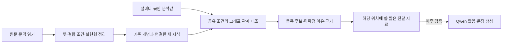

# 문헌의 뜻에서 출발하는 KG 재구축

이번 단계는 **전체 KG 재구축의 첫 검증 구간**이다. 기존 KG·카드·50문장·과거 실험은 보존한다. Qwen 생성 실험은 아직 실행하지 않는다.

## 무엇을 바꾸는가

기존 방식은 큰 문법 분류에 속한 카드를 모은 뒤 모델과 코드가 골랐다. 새 시험에서는 **한 절의 질문 뜻·서술어 종류·실제 선어말 형태를 묶어 조건을 검사하고, 맞는 어미와 근거를 찾아간다.**

예: `그 사람이 학생이었어?`를 ‘예/아니오 질문, 계사, -었- 있음’으로 분석하면, 현재 계사의 `-가`가 아니라 과거 형태 뒤의 `-나` 용법을 찾는다. `학생이었나?`라는 완성 문장을 KG에 외워 넣지 않는다. 현재 시험은 분석값을 총괄이 작성한 조회 시험이며, Qwen이 분석하거나 생성한 결과가 아니다.



## 이번에 실제 만든 것

- 전체721개 항목의 ID·종류·기존 검토 상태 작업대장. **의미 검증721개 완료가 아니다.**
- 과거 추출 본문7종474쪽의 해시 대조. 이후 원본 PDF7종의 접근을 다시 확인했고 파일 해시가 모두 일치했다. 사용한8쪽의 추출 본문과 PDF 화면도 대조했다.
- 의문문 구성1개, 조건별 용법6개로 된 별도 그래프. 공통 척추·12모듈의 기존 ID를 보존하고 새 용법은 새 ID로 연결한다.
- 형태와 의미 구분: `prefinal_type=eoss`는 -었- 계열 형태가 있다는 뜻이며, `tense=past`와 별도다.
- 조건집합은 AND, 여러 조건집합은 OR. 부족한 분석은 unknown으로 남긴다.
- 신규 쉬운 문장24개: 적용 예16개, 모호함·높임·다른문장유형 등 경계8개. 개발용이며 성능 평가 정답셋이 아니다.
- 조건 검사와 Qwen 전달 자료 작성. 실제 Qwen 호출·Neo4j 적재·자연스러움 평가는 수행하지 않았다.
- 교차 검토 후 조건과 개념의 잘못된 연결, 계사 이형태 누락, 범위 밖 판정, 분석·조회 결과의 불일치를 수정했다. 별도25개 테스트가 통과했다. 최종 수정본 전체의 재독립검토는 아직 아니다.
- 출판본 위치는 `knowledge/authored/semantic_foundation_20261102_r2/`. 현재81노드·198관계이며 실험 폴더 자료는 같은 버전의 검증 스냅숏이다.

`semantic_graph.py`는 문법규칙별 Python함수를 만들지 않는다. 규칙 내용은 `private/foundation.json`, 그래프는 `private/graph.json`에 저장한다. 그래프의 `ACCEPTS → ALL → ANY_BRANCH → REALIZES` 연결을 사용한다. 모듈의 모든 카드를 가져오거나 상위48개로 자르는 동작은 없다. 이번 작은 그래프에서는 모든 공유 조건·용법 분기를 순회하므로 대규모 성능 이점은 아직 측정하지 않았다.

현재·과거, 직접 정보 질문, 주체높임 없음은 **이번 지원 범위**다. 이 밖의 표현을 틀린 문법으로 판정한다는 뜻이 아니다. 계사+노 용례는 근거 연결로 보존하며, 현재 후보가 모든 허용 표현을 망라하지 않는다. 완성형의 축약·이형태 조합은 뒤 단계다.

## 두 검토자가 하는 일

| 담당 | 확인할 것 | 제출 내용 |
|---|---|---|
| Claude Opus5.5 | 원문 문맥·용법·반례·외부 사전/논문 | 문제 위치 → 짧은 실제 근거 → 정제 수정안 |
| Codex GPT-6-Astra High | 조건 표현·절 범위·조회·검증 설계 | 문제 위치 → 코드/그래프 근거 → 구조 수정안 |
| 총괄 | 원문·두 의견·실제 코드 대조 | 채택/부분채택/보류 이유, 구현·테스트, 남은 범위 |

독립 검토1회 → 상대 의견과 실제 구현의 교차 검토1회 → 총괄 수정·재검증. 모델끼리 동의해도 문헌 사실이나 자연스러움으로 인증하지 않는다. 새 쟁점만 후속 검토하며 끝없는 토론을 돌리지 않는다. 모든 지시는 한국어이고 원문·응답·모델·시각은 `private/dispatch/`에 보존한다.

## 전체 확장 순서

| 단계 | 범위 | 완료 기준 |
|---|---|---|
| 1 | 현재 의문문 구성·공통 특징 | 근거·조건·관계·후보·보존 정보가 끊기지 않음 |
| 2 | 설계 규칙81개를 용법군으로 정제 | 조건별 출처와 범위, 필요한 분석값, 반례 확인 |
| 3 | 실현형 목록433개를 용법군과 연결 | 단순 형태 목록과 적용 가능한 용법 구분 |
| 4 | 관찰183개·분류24개 정리 | 관찰을 적용 허가로 바꾸지 않고 의미 차이 보존 |
| 5 | 종결·높임·시상 → 연결·인용 → 조사·논항 → 보조용언·어휘·형태음운 | 모듈 사이 공유 특징과 조합 시험, 모든721개의 처리 이력 |
| 6 | 분석기 연결 → Qwen 생성 | 수작업 분석값 시험과 비교해 오류 시작점 분리 |
| 7 | 독립 평가 | 개발에 보지 않은 문장, 의미·높임·자연스러움 사람 평가 |

721개는 지식 항목 수이지 반드시721개 실행 규칙을 만들어야 한다는 뜻이 아니다. 단위의 통합·분할·참고자료 유지·미확인 상태를 기록한다. `본문 대조`, `PDF 확인`, `조건 조회 시험`, `생성 시험`, `사람 평가`는 각각 별도로 센다.

## 논문에서 무엇을 검증할 것인가

KG를 쓰면 무조건 품질이 좋아진다고 가정하지 않는다. 같은 지식·조건·분석·생성기를 사용한 **평면 규칙 검색과 그래프 검색**을 비교해야 그래프 구조 자체의 기여를 볼 수 있다. Qwen단독과 비교하면 외부 지식 제공의 효과를 볼 수 있지만 그래프만의 효과는 분리되지 않는다. 기존 넓은 조회와 비교하면 조회 설계 전체의 효과다.

동일한 후보·지시를 전달하면 결과 품질도 비슷할 수 있다. 이 경우 KG의 기여는 조건 재사용, 근거 추적, 지식 갱신 시 일관성, 확장 비용에서 찾아 측정한다. 쉬운 문장으로 통과하더라도 복잡한문장·다른지역으로의 일반화는 별도 검증한다. 잘 나오는 유형만 사후 선택하지 않는다.

## 재현

프로젝트 루트에서:

```powershell
python experiments/analyses/semantic_kg_rebuild_20261102/inventory.py
python experiments/analyses/semantic_kg_rebuild_20261102/build_foundation.py
python -m unittest discover -s experiments/analyses/semantic_kg_rebuild_20261102 -p "test_*.py" -v
```

`inventory.py`는 전체 구조 집계용이다. 기존 작업대장·원본 접근 확인 결과가 있으면 보존한다. 착수 진행기록은 이미 완료된 작업에 덮어쓰지 않는다. 원문 캐시 경로는 해당 파일에 기록되어 있다. PDF/전체 추출 본문/검토원문/상세지식은 private 영역에 보존하며 Git 공유 범위와 구별한다.

`verify_sources.py`는 현재 PDF의 동일성과 지정 페이지 추출·렌더링을 확인한다. `finalize.py`는 테스트·새 버전 산출물·검토 반영표·보고서를 생성한다. 보고서는 직접 로컬 파일로 열 수 있다. 브라우저 자동 열기는 file 프로토콜 정책으로 차단되어 화면 자동 검수는 하지 못했다.
