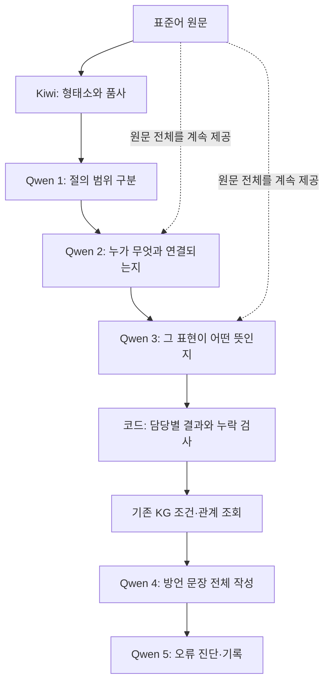

# 의미·관계 분석을 나누는 설계안 · 2026-11-09

**상태: 검토 후 제안. 구현·KG 변경·Qwen 실험은 하지 않았다.**

## 1. 결론부터

시제 담당, 높임 담당, 보조용언 담당을 각각 따로 만드는 방식은 첫 선택으로 권하지 않는다. 한국어에서는 한 표현에 이 정보가 함께 들어간다. 예를 들어 ‘읽고 계셨어요’는 진행·과거·주체 높임·상대 높임을 함께 읽어야 한다. 워커 수를 늘리면 같은 표현을 각자 다르게 판단할 위험과 비용도 늘어난다.

우선 비교할 분업 후보는 **절 범위 담당 → 관계·역할 담당 → 서술 표현의 의미 담당**이다. Kiwi를 유지하고, Qwen 분석은 현재2역할에서3역할로 늘린다. 그 뒤 KG 조회·Qwen 작성·진단 검토는 유지한다. 같은 Qwen 모델을 역할마다 따로 호출하는 고정 작업 흐름이며 서로 독립적인 지식원을 합의시키는 방식이 아니다.

다만 분업을 개선책으로 확정하지 않는다. 두 검토자는 공통으로 **현재 질문과 응답의 뜻을 먼저 명확히 하는 단일 담당 대조군이 필요하다**고 판단했다. 분업 후보와 이 대조군을 비교해야 한다. 질문 정리만으로 문제가 해결되면 더 저렴한 단일 담당을 유지한다.

## 2. 전체 그림

| 담당 | 실제로 하는 일 | 하지 않는 일 |
|---|---|---|
| Kiwi | 어간·어미·조사와 품사 관찰 | 문맥 의미를 확정하거나 최종 문장 작성 |
| 절 범위 | 주절·관형절·인용절 등 범위와 포함 관계를 표시 | 단어별로 독립 문장을 만들기 |
| 관계·역할 | 조사와 명사, 서술어와 참여자, 본용언과 보조용언, 앞뒤 절의 연결을 판단. 명사·조사·연결어미의 문법 기능도 담당 | 시제·높임을 다른 담당 대신 확정 |
| 서술 의미 | 같은 서술 표현의 평서/질문/요청/금지, 시간 의미, 부정, 보조 의미, 주체/상대 높임을 함께 판단 | 관계 ID를 덮어쓰거나 방언 번역 |
| 병합 코드 | 실제 ID·응답 누락·중복·담당 범위·형식 검사, 기존 조회 형식으로 합침 | 모르는 값을 정답으로 채우기, 모델 의견을 다수결로 사실 확정 |
| 작성·진단 | 기존처럼 Qwen이 전체 문장 작성, 별도 호출로 문제 기록 | 코드가 최종 문장을 몰래 대체하거나 자동 반복 재작성 |

절 범위는 첫 비교에서 공통으로 고정한다. 관계 담당이 만든 최소 연결표를 의미 담당이 읽되 **추정값**임을 표시한다. 의미 담당은 원문·Kiwi 관찰을 직접 대조하고, 잘못된 관계가 의심되면 이의를 기록한다. 원문 전체와 부모 절 문맥을 둘 모두 볼 수 있게 하여 ‘방금’, ‘내일’, 인용 화자 같은 단서를 잃지 않는다.

## 3. 왜 이 경계를 선택했나

초안은 ‘구성·관계 / 시간·높임’이었다. Claude는 같은 어미의 의미를 둘로 자르는 위험을 지적하며 ‘서술 표현 / 관계·역할’을 권했다. Codex는 초안 분할을 쓰더라도 관계 결과를 먼저 읽는 순차 흐름이 필요하다고 지적했다. 두 검토자가 같은 경계를 합의한 것은 아니다.

리드는 **관계·역할 먼저, 서술 의미 다음**을 제안한다. 화행·보조·시제·높임을 같은 담당에게 남겨 어미 해석을 분절하지 않고, 관계 대상 ID를 찾고 작성하는 부담을 다른 담당으로 옮긴다. 단어 수에 따라 워커를 늘리지 않는다. 시제와 높임이 서로 같은 문법이라는 뜻도 아니다.

이 안도 단점이 있다. 서술 의미 담당의 질문은 여전히 많고, 잘못된 관계가 뒤로 전파될 수 있다. 그래서 추정 연결표를 정답으로 취급하지 않고 원문을 함께 전달한다. 앞 담당 오류의 전파가 실제로 늘면 이 안을 채택하지 않는다. 병렬은 추후 지연 비교 후보이며, 문법 의존을 해결하지 않은 채 속도 때문에 먼저 도입하지 않는다.

## 4. 실제로 어떻게 읽을까 — 아래는 기대 동작 예시이며 새 실행 결과가 아니다

| 입력 | 관계·역할 담당 | 서술 의미 담당 | 확인하려는 것 |
|---|---|---|---|
| 수업 시간에는 떠들지 마세요. | 떠들다와 금지 보조 ‘말다’의 결합, 금지 대상 동작 연결 | 금지와 요청을 구별하고 보조를 진행으로 오인하지 않음. ‘세요’의 높임을 주체/청자 구분하여 판단 | 현재의 progressive 오분류가 줄어드는가 |
| 선생님께서 책을 읽고 계셨어요. | 선생님·책의 역할, 읽다·계시다의 결합 | 진행과 과거를 함께 해석하고 주체 높임·상대 높임을 구분 | 분업 뒤에도 여러 문법 요소가 함께 유지되는가 |
| 방금 정리한 서류를 책상에 놓았어요. | 정리한→서류의 수식 관계와 주절 구분 | 관형절과 주절의 시간·높임 범위를 구별. ‘방금’도 참고 | ‘었’이 없으면 과거가 없다는 단정을 피하는가. 정확히 분석해도 생성이 높임을 버리는 문제는 별도 |

## 5. 지금 오류 중 어디에 도움이 될까

| 확인된 문제 | 분업으로 기대하는 효과 | 분업만으로 해결할 수 없는 부분 |
|---|---|---|
| 본/보조 연결 누락 | 관계 담당이 연결 ID 작성에 집중 | 같은 모델이 관계를 모르거나 Kiwi 단위가 빠진 경우 |
| 금지를 진행으로 분류 | 서술 의미 담당의 대상·선택지 정의를 명확히 하고 관계 자료 제공 | 정의가 모호하면 여러 워커도 같은 오답을 낼 수 있음 |
| null 때문에 규칙 보류 | 모름·무관·미응답을 구별해 원인 추적 | 그 조건이 KG에서 정말 필요한지의 문제. 전역 null 통과로 우회하지 않음 |
| 존댓말 정보가 도착했는데 놓았어로 생성 | 분석이 맞는지 더 정확히 확인 | 생성자가 정보를 무시하는 실패를 분석 워커 추가로 고쳤다고 주장할 수 없음 |

## 6. 담당별 실제 전달 형식의 설계

현재 기록의 의미 필드는11개, 관계 역할은13개다. 이는 전체 KG 노드 수가 아니라 분석 응답의 항목 종류다. 초안의 ‘14종 관계’ 표기는13종으로 정정한다.

| 항목 | 제안 소유자 |
|---|---|
| 원문 범위·단위 ID·Kiwi 관찰 | 공통 입력. 워커가 임의 생성/변경하지 않음 |
| clause_key(어느 절인가) | 공유 구조값을 복사. 의미 워커에게 중복 재작성시키지 않음. 절 이의는 별도 기록 |
| grammatical_role, related_unit_ids, relations, construction_links, clause_role | 관계·역할 담당 |
| nominal/particle/connector의 semantic_function | 관계·역할 담당. 종류별 뜻을 각각 정의 |
| predicate/construction의 speech_act, question_kind, polarity, tense, auxiliary_kind, voice, predicate_class, addressee_level, subject_honorific | 서술 의미 담당. 해당 단위에서 필요한 필드만 질문 |
| 그 밖의 기존 단위/필드 조합 | 구현 전 현재 KG·생성 보존 요구에서 목록을 뽑아 하나의 담당에 배정. 소유자 없는 필드는 조용히 삭제하지 않고 설계 누락으로 중단 |
| predicate/construction의 semantic_function | 현재 질문 정의가 불명확한 부분. 실제 사용하는 KG 조건부터 확인해 뜻/해당 범위를 정한다. 한꺼번에 삭제하거나 양태 값으로 임의 사용하지 않음 |
| structural_corrections | 누구든 원문 근거와 함께 제안은 가능. 공통 기록에 작성자·대상을 남기며 관찰값 자동 수정은 금지 |
| 분석 오류·미확정 사유 | 작성자·대상 필드/관계·범위를 포함한 별도 진단. 차단에 쓰는 값과 설명 기록을 구별 |

겸양·객체높임과 세밀한 상·양태는 현재 독립 조회 필드가 모두 준비된 것이 아니다. 이번 분업으로 지원 완료라고 표시하지 않는다. 저/제·께·드리다 등의 보존 근거를 읽되, 새 메모를 생성 입력에 추가한다면 단일 대조군에도 똑같이 넣거나 별도 실험으로 분리한다. 비교 중 KG 의미 영역을 몰래 늘리지 않는다.

### 누락과 충돌은 어떻게 처리하나

- **응답 누락:** 맡은 칸 자체가 없으면 기록 형식 실패다. 추정값으로 채워 통과시키지 않는다.
- **모름:** 판단할 근거가 부족하다. null과 사유를 남기고 해당 KG 조건은 기존처럼 미확정 처리한다.
- **해당 없음:** 그 단위에는 묻는 항목이 적용되지 않는다. 모름과 구별해 기록하되 기존 조회용 null을 자동 참으로 바꾸지 않는다.
- **구조 모순:** 잘못된 ID/범위 등 코드로 확인되는 오류와 모델이 의심한 문법 오류를 구분한다. 모델의 ‘모순’ 표시도 사실 인증은 아니다.
- **다른 담당의 값과 충돌:** 덮어쓰기·다수결·상위 모델의 전면 재분석을 하지 않는다. 원문과 함께 이의로 보존한다. 첫 비교는 자동 재질문0회·자동 재작성0회로 하고 실패도 분모에 넣는다.

현재 코드는 자유문장 경고가 하나만 있어도 해당 단위에 의존하는 후보를 전달에서 뺄 수 있다. 새 분업에서 경고를 단순 합집합으로 붙이지 않는다. 공통 어댑터에서 미확정 진단과 기존 차단 대상인 구조 이의를 명시적으로 구별하고 **질문 정리 단일군과 분업군 모두 같은 처리**를 적용한다. 경고 때문에 빠진 후보 수와 실제 원인을 별도 집계한다. 차단 조건 변경이 섞인 기존 방식과의 차이는 ‘분업 단독 효과’로 부르지 않는다.

## 7. 짧은 역할 지시 초안 — 운영 프롬프트가 아니다

**절 담당:** “원문에서 절의 범위와 포함 관계를 표시하세요. 같은 본동작·보조동작을 임의로 독립절로 나누지 마세요. 모호한 경계는 근거와 함께 남기세요. 번역하지 마세요.”

**관계 담당:** “제공된 실제 단위 ID로 누가 어떤 동작에 참여하고, 어떤 형태들이 결합하는지 연결하세요. 명사·조사·연결어미의 역할을 종류별로 판단하세요. 없는 대상은 만들지 마세요. 시제·높임을 대신 확정하거나 문장을 바꾸지 마세요.”

**서술 의미 담당:** “원문·형태 관찰과 앞 담당의 추정 연결표를 함께 보세요. 각 서술 표현의 기능·시간·부정·보조 의미·높임을 함께 판단하세요. 앞 담당의 값을 정답으로 가정하지 마세요. 목록 밖 의미와 판단 불가를 구별하고, 불명확한 값을 가장 가까운 선택지로 억지로 채우지 마세요. 관계를 덮어쓰거나 방언 문장을 만들지 마세요.”

## 8. 비교·비용·종료 기준 제안

### 비교 조건

| 조건 | 의미·관계 담당 | 전체 기본 Qwen 호출 | 해석 |
|---|---:|---:|---|
| 현재 방식 |1|4|과거 방식과의 기준. 모호한 질문·진단 처리가 남음 |
| 질문·응답 정리 |1|4|분업군과 같은 정의·필드 소유 묶음·미확정 사유·공통 어댑터를 사용 |
| 역할 분담 |2, 순차|5|위 정리 방식에서 담당 호출을 분리. 주 비교 대상 |

원문·Kiwi·절 구획·단위·KG·모델·생성 지시·응답 예산 규칙을 고정한다. 조회의 불필요 조건 제거는 별도 연구로 분리한다. 전체 토큰은 호출 수와 비례하지 않으므로 실제로 잰다. 같은 생성 지시라도 분석 결과에 따라 전달 지식은 달라질 수 있다.

‘5명이4명보다 우수하다’는 일반 결론은 내리지 않는다. 주 비교는 질문 정리 단일군 대 분업군이다. 추가 호출 자체의 효과를 분리하려면 나중에 단일 담당이 자기 응답을 한 번 재검토하는 동일 호출 수 대조도 필요하다. 총 호출이 같아도 토큰·지연까지 같다는 뜻은 아니다. 서버 병렬 처리 속도나 특정 토큰 증가율은 이번에 측정하지 않았다.

### 구현 승인 후의 순서 — 이번에는 실행하지 않음

1. **질문 정의·소유표와 분석 판정표 확정.** 기존12개는 노출된 회귀 자료로 사용한다. 새 개발 입력은 금지/요청, 부정 평서, 시제, 주체/상대높임, 겸양·수혜, 보조용언, 관형절, 인용·절연결의8묶음×3개=24개를 제안한다. 이는 소규모 개발 진단이지 독립 논문 최종평가가 아니다. 사람 검토가 끝나기 전 정확도라고 부르지 않는다. 방언 정답은 분석 입력에 넣지 않는다.
2. **질문 정리 단일군부터 분석·조회 비교.** 같은36문장에서 현재와 질문정리 단일군을 먼저 비교하면 새 공통 절36회+의미72회=108회다. 이 단계에서 해결되면 분업 호출을 생략한다. 재시도0. 실제 실행 전에 입력과 판정표·비용 상한을 고정한다. 기존12 구조를 재사용하면 별도 기록하고 호출을 중복 계상하지 않는다.
3. **분업이 필요한 경우만 추가.** 같은 공통 구조를 재사용해 관계/서술 의미72호출을 추가한다. 분석 단계 합계 최대180회다. 같은 실행 묶음 안에서 모델·설정과 단일군 결과를 고정하고, 시간차·환경 변화가 생기면 단일군 재실행을 별도 계획한다. 분업이 남은 필드/관계 오류를 줄이고 새 오류가 없는지 확인한다. 비용을 늘렸는데 같은 오류가 남으면 더 많은 워커를 추가하지 않는다.
4. **유망한 두 방식만 같은 작성 조건으로 생성 비교.** 최대36×2방식×작성/진단2회=144회 추가. 분석 개선과 최종 생성의 의미·높임 보존을 따로 보고한다. 분석이 맞아도 작성 실패가 반복되면 생성 방식/모델의 문제로 이관한다.
5. **회복이 확인된 뒤50건 전체 회귀.** 새 손실, 남은 오류, 조건별 호출·토큰·지연을 보존한다. 독립 최종평가로 주장하지 않는다.

단회 소규모 개선은 개발 관찰로만 보고한다. 안정성 주장이나 논문 효과 검증에는 출력 변동, 입력별 쌍 비교, 사람 자연스러움 평가와 별도의 미노출 평가가 필요하다. 고정된 실패 최소 차이·통계 유의성을 임의로 만들어 ‘통과’라고 하지 않는다. 분석 판정표와 종료 기준을 동결한 후에만 실제 실험을 시작한다.

## 9. 검토자 의견과 리드 판단

두 검토자는 독립적으로 현재 코드와 기록을 읽었다. 문법 해석과 토큰 과부하 원인은 검토자의 해석이며 사실 인증이 아니다. 자세한 채택/비채택은 [검토 반영 기록](REVIEW_RESOLUTION.md)에 남겼다. [Claude 검토](private/claude_design_review.md)와 [Codex 검토](private/codex_design_review.md)를 보존했다.

## 10. 참고 근거

- Anthropic, [Building effective agents](https://www.anthropic.com/research/building-effective-agents): 작업 분해는 과제를 단순하게 만들 수 있지만 비용·지연의 절충이 있다. 이 프로젝트의 최적 담당 수를 증명하지 않는다.
- Liu et al. (2024), [Lost in the Middle](https://aclanthology.org/2024.tacl-1.9/): 장문에서 관련 정보 위치에 따른 성능 차이를 보였다. 지금의 Qwen 오분류나 높임 손실이 장문 망각 때문이라는 증거로 사용할 수 없다.
